# Delineamento completamente aleatorizado {#dca}


O Capítulo 1 estabeleceu repetição, aleatorização e controle local como os três pilares do
controle do erro experimental; o Capítulo 2 deu a esses pilares uma linguagem formal — o modelo
linear. Este capítulo une as duas coisas no delineamento mais simples possível: o
**delineamento completamente aleatorizado (DCA)**, em que um único fator é sorteado livremente
entre as unidades experimentais, sem qualquer restrição de blocagem. É o ponto de partida de
todo o resto do curso — e, por ser o desenho mais simples, também é o lugar certo para introduzir
com rigor a ideia de **teste de aleatorização**, o modelo estatístico, a análise de variância (ANOVA), o planejamento do
tamanho amostral, o problema da subamostragem, o modelo de efeitos aleatórios e a verificação dos
pressupostos que tornam a inferência clássica válida.


```{=html}
<div class="caixa-aviso">
<strong>O que este capítulo controla, e o que não controla</strong><br>
O delineamento completamente aleatorizado (DCA) é o experimento controlado mínimo: um único sorteio
distribui os tratamentos entre as unidades experimentais. Ele controla tudo o que as unidades
trazem de antes do experimento, medido ou não, e é desse sorteio que o capítulo deduz o próprio
modelo e a distribuição de referência do teste $F$. Ele não controla a heterogeneidade entre as
unidades, que vai inteira para o erro (o Capítulo 4 trata disso com blocos), nem o que acontece
depois do sorteio, como a ordem de execução. As comparações múltiplas acrescentam outro tipo de
controle, o das taxas de erro, que não substitui o primeiro.
</div>
```

## Princípios de aleatorização: a ideia de um teste de aleatorização {#principios-aleatorizacao}

Antes de introduzir qualquer suposição distribucional, vale a pena perguntar: *de onde vem*, em
termos lógicos, a validade de um teste estatístico em um experimento aleatorizado? A resposta de
Fisher é elegante e não depende de normalidade alguma [@fisher1935design].

Considere um DCA com $t$ tratamentos e $N$ unidades experimentais ao todo. Sob a hipótese nula de
que o tratamento não tem efeito algum, o valor que cada unidade experimental produziria é o
*mesmo*, não importa qual tratamento ela receba — os rótulos de tratamento são, sob $H_0$,
completamente permutáveis entre as unidades. O mecanismo físico de aleatorização escolheu **uma**
entre as $\binom{N}{n_1, n_2, \ldots, n_t}$ formas possíveis de distribuir os tratamentos pelas
unidades; sob $H_0$, todas essas formas são igualmente prováveis e teriam produzido exatamente os
mesmos $N$ valores de resposta, apenas reagrupados de outra maneira.

Um **teste de aleatorização** (ou teste de permutação) explora essa ideia diretamente:

1. Calcula-se uma estatística de teste $T$ nos dados observados (por exemplo, a estatística $F$
   da ANOVA, definida na Seção \@ref(anova-dca)).
2. Reembaralham-se os rótulos de tratamento entre as $N$ unidades, muitas vezes (idealmente, todas
   as permutações possíveis; na prática, um grande número delas sorteado aleatoriamente), e
   recalcula-se $T$ a cada reembaralhamento.
3. O valor-$p$ de aleatorização é a proporção de reembaralhamentos que produziu um $T$ tão grande
   quanto (ou maior que) o observado.

<div class="figure" style="text-align: center">
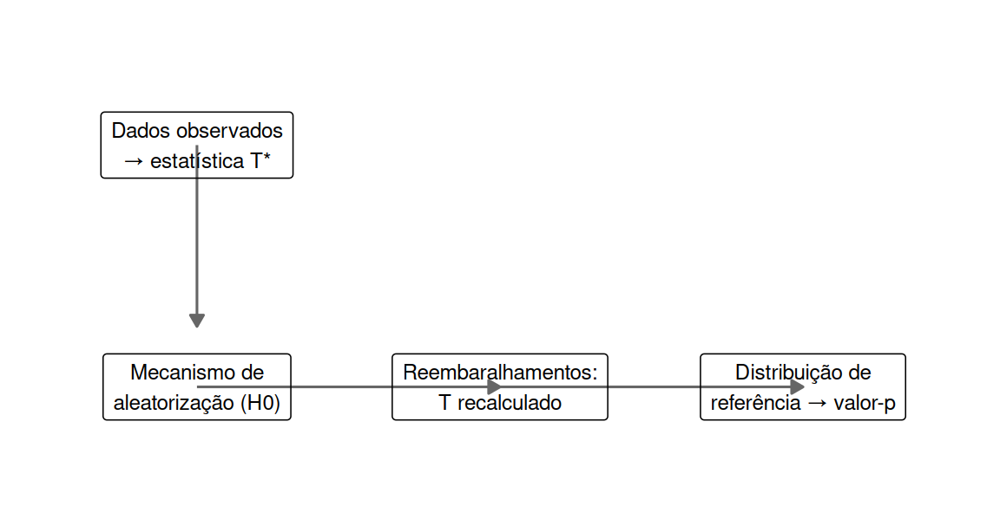
<p class="caption">(\#fig:fig-esquema-teste-aleatorizacao)O esquema geral por trás de todo teste de aleatorização, em quatro passos: dados observados produzem uma estatística observada T*; o mecanismo de aleatorização do próprio delineamento gera reembaralhamentos sob H0 e T é recalculado em cada um; a distribuição desses valores é a distribuição de referência; localizar T* nela define o valor-p.</p>
</div>

O diagrama resume o princípio geral por trás não só do teste de aleatorização, mas de qualquer
teste de hipótese baseado em simulação: (i) computar a estatística nos dados reais; (ii) simular
repetidamente sob um modelo explícito de $H_0$; (iii) localizar a estatística observada na
distribuição simulada. O reembaralhamento de rótulos descrito acima **é** esse esquema, com o
"modelo de $H_0$" sendo, literalmente, o mecanismo físico de aleatorização do próprio
delineamento — não uma suposição extra importada de fora dos dados.

Esse procedimento não assume normalidade, nem variâncias iguais, nem qualquer outra forma
distribucional — sua validade vem inteiramente do mecanismo de aleatorização em si
[@edgington2007randomization]. O que a teoria normal-linear faz, a partir da Seção
\@ref(modelo-dca), é oferecer uma **aproximação** ao teste de aleatorização exato — uma
aproximação excelente quando os erros são razoavelmente próximos de normais, e que tem a enorme
vantagem prática de fornecer fórmulas fechadas em vez de exigir reembaralhamento computacional.

```{=html}
<div class="caixa-r"><strong>Uso do R</strong> — comparando o teste de aleatorização com o teste F</div>
```


``` r
set.seed(48)
condicao <- c("Nenhuma", "Sonora", "Visual")
n_por_grupo <- 12

dados_tr <- tibble(
  sujeito      = 1:(3 * n_por_grupo),
  condicao     = factor(rep(condicao, each = n_por_grupo), levels = condicao),
  tempo_reacao = c(rnorm(n_por_grupo, 480, 45),
                    rnorm(n_por_grupo, 512, 45),
                    rnorm(n_por_grupo, 555, 45))
)

F_obs <- summary(aov(tempo_reacao ~ condicao, data = dados_tr))[[1]][["F value"]][1]

R_perm <- 4000
F_perm <- replicate(R_perm, {
  rotulo_embaralhado <- sample(dados_tr$condicao)
  summary(aov(dados_tr$tempo_reacao ~ rotulo_embaralhado))[[1]][["F value"]][1]
})

tibble(
  Método   = c("Teste F (teórico)", "Teste de aleatorização"),
  `Valor-p` = c(pf(F_obs, 2, 33, lower.tail = FALSE), mean(F_perm >= F_obs))
) %>%
  kable(digits = 4, caption = "Valor-p teórico vs. valor-p por aleatorização, mesmos dados") %>%
  kable_styling(full_width = FALSE)
```

<table class="table" style="width: auto !important; margin-left: auto; margin-right: auto;">
<caption>(\#tab:randomizacao-vs-f)Valor-p teórico vs. valor-p por aleatorização, mesmos dados</caption>
 <thead>
  <tr>
   <th style="text-align:left;"> Método </th>
   <th style="text-align:right;"> Valor-p </th>
  </tr>
 </thead>
<tbody>
  <tr>
   <td style="text-align:left;"> Teste F (teórico) </td>
   <td style="text-align:right;"> 0.0066 </td>
  </tr>
  <tr>
   <td style="text-align:left;"> Teste de aleatorização </td>
   <td style="text-align:right;"> 0.0073 </td>
  </tr>
</tbody>
</table>

<div class="figure" style="text-align: center">
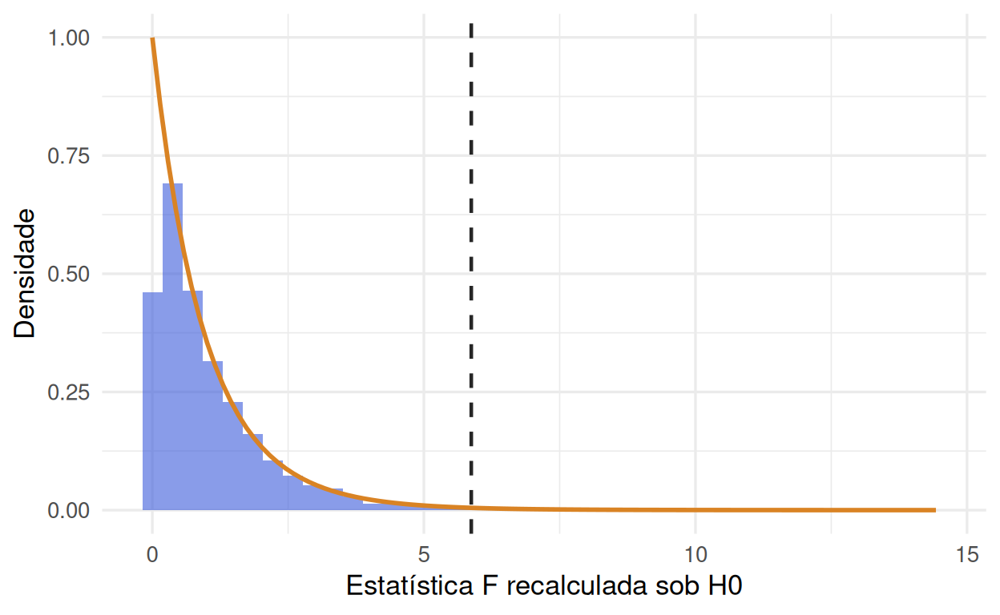
<p class="caption">(\#fig:plot-f-perm)Distribuição de referência: os 4.000 valores de F recalculados sob reembaralhamentos aleatórios dos rótulos de condição (histograma), com o F observado nos dados reais (linha tracejada) e a densidade F(2,33) teórica sobreposta (curva). A área à direita da linha tracejada, sob o histograma, é o valor-p de aleatorização; sob a curva teórica, é o valor-p do teste F.</p>
</div>

O histograma (distribuição empírica de aleatorização) e a curva $F(2,33)$ teórica praticamente se
sobrepõem, e a linha tracejada ($F$ observado) cai na cauda direita de ambas — confirmação visual
de que a aproximação normal-linear captura bem a distribuição de referência exata neste exemplo,
sem que nenhuma das duas dependa de suposição alguma sobre a forma de $Y$: a curva $F$ é válida
sob normalidade dos erros; o histograma é válido apenas pelo mecanismo de aleatorização em si,
qualquer que seja a distribuição verdadeira dos dados.

Os dois valores-$p$ ficam muito próximos — é exatamente o comportamento esperado quando os
pressupostos do modelo normal-linear (que introduzimos a seguir) são razoáveis. A Seção
\@ref(dca-pressupostos) trata de como verificar, na prática, se essa aproximação é confiável.

### De onde vêm os graus de liberdade $(2,33)$: a ponte entre aleatorização, variância decomposta e $F$ {#randomizacao-df-f}

Vale amarrar, com todo o rigor já disponível neste ponto do livro, *por que* a curva $F(2,33)$ é
uma boa aproximação da distribuição de aleatorização — não apenas *que* ela é, como a Figura
\@ref(fig:plot-f-perm) já mostrou empiricamente. A resposta liga três coisas que, até aqui,
apareceram em capítulos diferentes: a decomposição da variação em fontes (Capítulo 1, Seção
\@ref(fontes-variacao)), a forma aditiva do modelo que essa decomposição força sob aleatorização
(Seção \@ref(aditividade-aleatorizacao) do Capítulo 1) e a contagem de graus de liberdade via posto
de matrizes de projeção e diagramas de Hasse (Capítulo 2, Seções \@ref(matriz-projecao) e
\@ref(hasse)).

**O que permanece fixo em cada reembaralhamento, e o que muda.** Reembaralhar os rótulos de
tratamento entre as $N=36$ unidades, como no chunk anterior, não move nenhum valor de resposta —
os 36 tempos de reação observados são exatamente os mesmos a cada repetição, só a *partição* deles
em três grupos de 12 muda. Consequentemente, $SQ_{\text{Total}} = \mathbf{Y}'\mathbf{M}\mathbf{Y}$
(Capítulo 2, Seção \@ref(soma-quadrados-total)) é **idêntica** em todas as 4.000 reamostragens — só
$\mathbf{X}$ muda a cada reembaralhamento (a matriz de delineamento reflete a nova partição), e com
ela a forma como $SQ_{\text{Total}}$ se reparte entre $SQ_{\text{Trat}}=\mathbf{Y}'(\mathbf{P}_X-
\tfrac1N\mathbf{J})\mathbf{Y}$ e $SQ_E=\mathbf{Y}'(\mathbf{I}_N-\mathbf{P}_X)\mathbf{Y}$. Essa é,
literalmente, a mesma decomposição de fontes de variação do Capítulo 1 — fonte 1 (tratamento) *versus*
fontes 2+3 combinadas (o que sobra) — só que agora vista sob 4.000 partições diferentes dos mesmos
36 valores, em vez de uma única partição observada.

**Por que os graus de liberdade não mudam.** Embora $\mathbf{X}$ mude a cada reembaralhamento, seu
*posto* não muda: qualquer reembaralhamento continua produzindo $t=3$ grupos não vazios (o sorteio
apenas troca *quais* 12 unidades vão para cada grupo, nunca o número de grupos nem o tamanho de
cada um, que ficam fixados pelo desenho). Logo $\mathrm{posto}(\mathbf{X})=3$ em toda reamostragem,
e a contagem por subtração do diagrama de Hasse (Capítulo 2, Seção \@ref(hasse)) — com gl indicando graus de liberdade, $\text{gl}
(\text{Trat})=t-1=2$, $\text{gl}(\text{Erro})=N-t=33$ — vale identicamente para as 4.000 partições,
não só para os dados observados. É exatamente por isso que a *forma* da curva de referência (uma
$F$ com $(2,33)$ graus de liberdade) é estável sob reembaralhamento, mesmo sem nenhuma suposição de
normalidade: os graus de liberdade são uma propriedade do **desenho** ($t$ e $N$ fixos), não da
distribuição dos erros — o que muda de uma reamostragem para outra é só *onde*, dentro dessa forma
fixa, cada estatística $F$ recalculada cai.

```{=html}
<div class="caixa-r"><strong>Uso do R</strong> — confirmando que os graus de liberdade vêm do posto de X, não da distribuição dos dados</div>
```


``` r
X_dca_tr <- model.matrix(~ condicao, data = dados_tr)

gl_trat_matriz <- qr(X_dca_tr)$rank - 1          # posto(X) - 1 (Cap. 2, Secao matriz-projecao)
gl_erro_matriz <- nrow(dados_tr) - qr(X_dca_tr)$rank  # N - posto(X)

c(gl_trat = gl_trat_matriz, gl_erro = gl_erro_matriz)
```

```
## gl_trat gl_erro 
##       2      33
```

Os valores batem exatamente com o $(2,33)$ já usado em `df(..., df1 = 2, df2 = 33)` na Figura
\@ref(fig:plot-f-perm) — não por coincidência ou por termos "sabido de antemão" quais graus de
liberdade usar, mas porque $2=3-1$ e $33=36-3$ vêm diretamente do posto de $\mathbf{X}$, exatamente
como a regra de subtração do diagrama de Hasse prediz, e esse posto é uma função só de $t$ e $N$
(quantos grupos o desenho tem e quantas unidades ao todo), não de $\mathbf{Y}$.

**Por que a aproximação $F$ funciona tão bem aqui.** A teoria normal-linear (Capítulo 2, Seção
\@ref(formas-quadraticas)) prevê que, *se* os erros fossem exatamente normais e i.i.d. — a leitura
de $\varepsilon_{ij}$ que a Seção \@ref(aditividade-aleatorizacao) do Capítulo 1 justificou como
consequência da aleatorização, não como suposição gratuita —, então $SQ_{\text{Trat}}/\sigma^2$ e
$SQ_E/\sigma^2$ seriam qui-quadrado independentes com $2$ e $33$ graus de liberdade sob $H_0$, e sua
razão (normalizada pelos respectivos graus de liberdade) seguiria $F_{2,33}$ **exatamente**, não
apenas aproximadamente. A distribuição de aleatorização, por outro lado, não usa normalidade
alguma: ela é exata *por construção*, qualquer que seja a distribuição de $Y$, porque enumera (ou
amostra) diretamente as $\binom{36}{12,12,12}$ formas de particionar os mesmos 36 valores. As duas
curvas da Figura \@ref(fig:plot-f-perm) quase se sobrepõem porque, quando $n_i=12$ por grupo já não
é pequeno e a distribuição de $Y$ não é patologicamente assimétrica, o Teorema Central do Limite
aplicado a cada média de grupo $\bar Y_{i\cdot}$ torna a distribuição de $SQ_{\text{Trat}}$ sob
reembaralhamento cada vez mais próxima da qui-quadrado teórica que a normalidade exigiria
[@edgington2007randomization; @boxhunterhunter2005] — a aproximação melhora com $n$, e pioraria em
desenhos com $n_i$ muito pequeno ou $Y$ muito assimétrico (o cenário de heterocedasticidade da
Seção \@ref(dca-pressupostos), adiante). Em suma: **aleatorização** garante que o modelo aditivo
$Y_{ij}=\mu+\tau_i+\varepsilon_{ij}$ é uma leitura válida dos dados (Seção
\@ref(aditividade-aleatorizacao)); a **decomposição de variância** em fontes fixa os graus de
liberdade $(t-1,\,N-t)$ como propriedade do desenho, geometricamente visível no diagrama de Hasse
(Capítulo 2); e é só quando essas duas peças já estão no lugar que a normalidade entra — não para
criar a validade da inferência, que já vem da aleatorização, mas para trocar reembaralhamento
computacional por uma fórmula fechada, a $F_{t-1,N-t}$.

### O modelo linear deduzido da aleatorização {#modelo-deduzido}

Até aqui usamos o modelo $Y_{ij}=\mu+\tau_i+\varepsilon_{ij}$ como ponto de partida, justificando-o
informalmente. Vale agora fazer melhor: **deduzi-lo** do ato físico de sortear, sem postulá-lo. É
esta derivação — devida a @cornfield1944samples e sistematizada por @kempthorne1952design — que
separa um curso de planejamento de experimentos de um curso de regressão. No fim dela teremos algo
inesperado: o erro que emerge do sorteio é **correlacionado**, e ainda assim mínimos quadrados
ordinários continuam ótimos.

#### A população conceitual de respostas

Considere $N$ unidades experimentais e $t$ tratamentos, e defina

$$
Y_{ij} \;=\; \text{resposta que a unidade } j \text{ apresentaria sob o tratamento } i,
\qquad i=1,\dots,t,\quad j=1,\dots,N .
$$

O quadro $t\times N$ dos $Y_{ij}$ é a **população conceitual de respostas**. Ela não é observável:
de cada unidade $j$ veremos **uma** linha apenas, a do tratamento que o sorteio lhe deu. São
exatamente os **resultados potenciais** de Neyman-Rubin da Seção \@ref(potencial-causal), agora
organizados como uma tabela — e é essa tabela que torna a derivação possível.

<div class="figure" style="text-align: center">
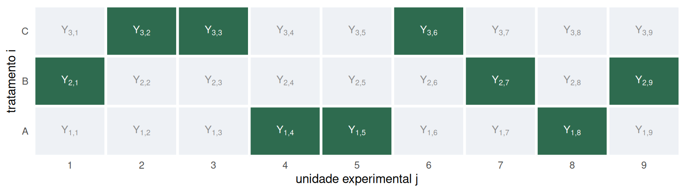
<p class="caption">(\#fig:pop-conceitual-dca)A população conceitual de respostas de um DCA com t = 3 tratamentos (A, B, C) e N = 9 unidades: cada célula é a resposta que a unidade j teria sob o tratamento i. Em verde, as células que um sorteio particular deixa observar — exatamente uma por coluna, porque cada unidade recebe um único tratamento.</p>
</div>

A Figura \@ref(fig:pop-conceitual-dca) torna o quadro concreto: das $t \times N = 27$ respostas
potenciais, o experimento revela apenas $N = 9$, uma por coluna, e **qual** delas aparece em cada
coluna foi decidido pelo sorteio. Todo o resto da derivação consiste em descrever o que esse sorteio
faz com as médias do quadro.

Escreva as médias marginais $\bar Y_{i\cdot}$ (sobre unidades, para o tratamento $i$),
$\bar Y_{\cdot j}$ (sobre tratamentos, para a unidade $j$) e $\bar Y_{\cdot\cdot}$ (geral). A
identidade algébrica exata de qualquer tabela de dupla entrada é

$$
Y_{ij}=\bar Y_{\cdot\cdot}
+\underbrace{(\bar Y_{i\cdot}-\bar Y_{\cdot\cdot})}_{\text{efeito do tratamento}}
+\underbrace{(\bar Y_{\cdot j}-\bar Y_{\cdot\cdot})}_{\text{efeito da unidade}}
+\underbrace{(Y_{ij}-\bar Y_{i\cdot}-\bar Y_{\cdot j}+\bar Y_{\cdot\cdot})}_{\text{interação tratamento}\times\text{unidade}} .
$$

O último termo é uma **interação entre tratamento e unidade**: o tratamento $i$ favorecendo
especialmente a unidade $j$. A **aditividade no sentido estrito** consiste em supor esse termo
nulo — e convém ser franco sobre o que se está supondo: que o efeito de trocar o tratamento $i$
pelo $k$ é o mesmo em toda unidade. É uma suposição, não uma conveniência de notação, e é
precisamente a que o Capítulo 4 voltará a interrogar ao discutir aditividade em blocos.

#### A variável de seleção de Cornfield

Falta a peça que liga a população conceitual ao dado observado: uma representação matemática do
**sorteio**. Seja $y_{ir}$ a resposta da $r$-ésima réplica do tratamento $i$ e defina

$$
\delta_{ir}^{\,j}=
\begin{cases}
1, & \text{se a } r\text{-ésima réplica do tratamento } i \text{ foi aplicada à unidade } j,\\
0, & \text{caso contrário.}
\end{cases}
$$

Os índices têm papéis distintos, e confundi-los é o erro comum aqui: $ir$ designa uma **posição no
plano experimental** (a 2ª réplica do tratamento A), enquanto $j$ designa uma **unidade física**
(o voluntário nº 5). A aleatoriedade de $\delta$ não vem de natureza alguma: vem do papelzinho
sorteado pelo pesquisador. Sob aleatorização completa,

$$
P(\delta_{ir}^{\,j}=1)=\frac1N,
\qquad
P\big(\delta_{ir}^{\,j}=1 \,\big|\, \delta_{i'r'}^{\,j'}=1\big)=\frac{1}{N-1}
\;\; (ir\neq i'r',\; j\neq j'),
\qquad
\sum_{j=1}^{N}\delta_{ir}^{\,j}=1 .
$$

A última identidade diz apenas que toda posição do plano é preenchida por exatamente uma unidade.
Com ela, a **relação de seleção** que conecta o observável ao conceitual é uma soma que "filtra" a
população:

$$
y_{ir}=\sum_{j=1}^{N}\delta_{ir}^{\,j}\,Y_{ij}.
$$

#### A dedução

Substituindo a identidade algébrica já simplificada pela aditividade estrita,
$Y_{ij}\approx\bar Y_{\cdot\cdot}+(\bar Y_{i\cdot}-\bar Y_{\cdot\cdot})+(\bar Y_{\cdot j}-\bar Y_{\cdot\cdot})$,
na relação de seleção, e usando $\sum_j\delta_{ir}^{\,j}=1$ para eliminar os termos que não dependem
de $j$:

$$
y_{ir}
=\underbrace{\bar Y_{\cdot\cdot}}_{\mu}
+\underbrace{(\bar Y_{i\cdot}-\bar Y_{\cdot\cdot})}_{\tau_i}
+\underbrace{\sum_{j=1}^{N}\delta_{ir}^{\,j}\,(\bar Y_{\cdot j}-\bar Y_{\cdot\cdot})}_{\omega_{ir}}
\qquad\Longrightarrow\qquad
\boxed{\;y_{ir}=\mu+\tau_i+\omega_{ir}\;}
$$

O modelo linear **não foi suposto: foi obtido**. E note o que $\omega_{ir}$ é — não um "ruído"
abstrato, mas o efeito da unidade específica que o sorteio colocou naquela posição. Daí o nome
**erro de aleatorização**, e daí a diferença decisiva em relação ao $\varepsilon_{ij}$ de
Gauss-Markov: as propriedades de $\varepsilon$ são *assumidas*; as de $\omega$ são *deduzidas* da
distribuição do sorteio, que o próprio pesquisador escolheu.

#### As propriedades de $\omega$ — e uma surpresa

Escreva $u_j=\bar Y_{\cdot j}-\bar Y_{\cdot\cdot}$ para o efeito da unidade $j$, de modo que
$\sum_j u_j=0$, e defina $\sigma_u^2=\frac{1}{N-1}\sum_j u_j^2$. Tomando esperanças sobre a
distribuição de aleatorização (indicada por $\mathbb E_R$):

$$
\mathbb E_R(\omega_{ir})=\sum_{j}\frac1N\,u_j=0,
\qquad
\mathrm{Var}_R(\omega_{ir})=\sum_j \frac1N u_j^2=\Big(1-\frac1N\Big)\sigma_u^2 ,
$$

e, para duas posições distintas $ir\neq i'r'$,

$$
\mathrm{Cov}_R(\omega_{ir},\omega_{i'r'})
=\frac{1}{N(N-1)}\Big[\Big(\sum_j u_j\Big)^2-\sum_j u_j^2\Big]
=-\frac{\sigma_u^2}{N} \;<\;0 .
$$

A covariância é **negativa**, e a razão é puramente combinatória: as unidades são sorteadas **sem
reposição**, então a unidade que foi parar numa posição não pode estar em outra. Em forma
matricial, empilhando as $N$ observações,

$$
\mathrm{Var}_R(\boldsymbol\omega)=\mathbf V=\sigma_u^2\Big(\mathbf I_N-\tfrac1N\mathbf J_N\Big),
$$

que **não é diagonal**. Ou seja: a aleatorização, que é o que garante a validade da inferência,
produz por construção erros correlacionados — exatamente a hipótese que o teorema de Gauss-Markov
(Seção \@ref(gauss-markov) do Capítulo 2) exige que *não* seja violada.

```{=html}
<div class="caixa-r"><strong>Uso do R</strong> — verificando as três identidades por enumeração exaustiva</div>
```

As identidades acima não são aproximações assintóticas: valem exatamente. Com $N$ pequeno dá para
conferir isso enumerando **todas** as aleatorizações possíveis, em vez de simular.


``` r
N <- 7
set.seed(7)
u <- rnorm(N, 0, 3); u <- u - mean(u)          # efeitos de unidade (somam zero)
sigma2_u <- sum(u^2) / (N - 1)

# todas as N! atribuicoes possiveis de unidades a posicoes
permutacoes <- function(v) {
  if (length(v) == 1) return(matrix(v))
  do.call(rbind, lapply(seq_along(v),
                        function(i) cbind(v[i], permutacoes(v[-i]))))
}
omega <- matrix(u[permutacoes(seq_len(N))], ncol = N)   # uma linha por aleatorizacao

tibble(
  Quantidade = c("E(ω)", "Var(ω)", "Cov(ω, ω′)"),
  Enumerado  = c(mean(omega[, 1]),
                 mean(omega[, 1]^2),
                 mean(omega[, 1] * omega[, 2])),
  Fórmula    = c(0,
                 (1 - 1 / N) * sigma2_u,
                 -sigma2_u / N)
) %>%
  kable(digits = 10, caption = "Propriedades do erro de aleatorização, sobre todas as N! atribuições") %>%
  kable_styling(full_width = FALSE)
```

<table class="table" style="width: auto !important; margin-left: auto; margin-right: auto;">
<caption>(\#tab:omega-enumeracao)Propriedades do erro de aleatorização, sobre todas as N! atribuições</caption>
 <thead>
  <tr>
   <th style="text-align:left;"> Quantidade </th>
   <th style="text-align:right;"> Enumerado </th>
   <th style="text-align:right;"> Fórmula </th>
  </tr>
 </thead>
<tbody>
  <tr>
   <td style="text-align:left;"> E(ω) </td>
   <td style="text-align:right;"> 0.000000 </td>
   <td style="text-align:right;"> 0.000000 </td>
  </tr>
  <tr>
   <td style="text-align:left;"> Var(ω) </td>
   <td style="text-align:right;"> 12.232455 </td>
   <td style="text-align:right;"> 12.232455 </td>
  </tr>
  <tr>
   <td style="text-align:left;"> Cov(ω, ω′) </td>
   <td style="text-align:right;"> -2.038742 </td>
   <td style="text-align:right;"> -2.038742 </td>
  </tr>
</tbody>
</table>

#### Zyskind: por que ainda assim usamos mínimos quadrados ordinários {#zyskind-dca}

Se $\mathrm{Var}(\boldsymbol\omega)=\mathbf V\neq\sigma^2\mathbf I$, o teorema de Gauss-Markov não
se aplica, e o estimador de variância mínima passa a ser o de **mínimos quadrados generalizados**
de @aitken1936least, $\hat{\boldsymbol\beta}_{GLS}=(\mathbf X'\mathbf V^{-1}\mathbf X)^{-}
\mathbf X'\mathbf V^{-1}\mathbf Y$. Seria desconfortável: todo o curso usa mínimos quadrados ordinários (MQO).

O resultado que resolve a questão é de @zyskind1967canonical. Sob o modelo de Aitken, o estimador
de **mínimos quadrados ordinários** permanece BLUE (melhor estimador linear não viesado) se e somente se existe uma matriz $\mathbf Q$
tal que

$$
\mathbf V\mathbf X=\mathbf X\mathbf Q,
$$

isto é, se e somente se o espaço-coluna de $\mathbf V\mathbf X$ está contido no de $\mathbf X$ —
$\mathcal C(\mathbf V\mathbf X)\subseteq\mathcal C(\mathbf X)$.

Verifiquemos a condição no nosso caso. Como o DCA tem intercepto, $\mathbf 1\in\mathcal C(\mathbf X)$,
e portanto $\mathbf J\mathbf X=\mathbf 1(\mathbf 1'\mathbf X)$ tem todas as colunas proporcionais a
$\mathbf 1$, logo em $\mathcal C(\mathbf X)$. Daí

$$
\mathbf V\mathbf X=\sigma_u^2\Big(\mathbf X-\tfrac1N\mathbf J\mathbf X\Big)\in\mathcal C(\mathbf X),
$$

e a condição de Zyskind **é satisfeita**.


``` r
trat <- factor(rep(1:3, each = 3))       # t=3 tratamentos, 3 replicas, N=9
X <- model.matrix(~ trat)
V <- diag(9) - matrix(1 / 9, 9, 9)       # sigma_u^2 fatorado (nao altera a condicao)

Q <- qr.solve(X, V %*% X)                # resolve V X = X Q em Q
max(abs(V %*% X - X %*% Q))              # zero numerico => condicao satisfeita
```

```
## [1] 3.885781e-16
```

A conclusão é a que faltava para fechar o argumento, e merece ser dita sem rodeios: **embora os
erros de aleatorização sejam correlacionados, podemos proceder como se não fossem**. Não porque a
correlação seja pequena ou desprezível, mas porque a estrutura particular que o sorteio induz —
simetria composta com covariância negativa constante — é exatamente uma para a qual MQO continua
sendo o melhor estimador linear não viesado. A licença é formal, não uma concessão prática.

Vale reter o desenho completo do argumento, porque ele reaparece no Capítulo 4 para blocos
[@hinkelmann2008design]: a aleatorização **gera** o modelo linear (não o supõe), **gera** um erro
correlacionado (não i.i.d.), e **gera**, pela condição de Zyskind, a permissão de analisá-lo com a
ferramenta mais simples. As três coisas vêm do mesmo sorteio.

## O delineamento completamente aleatorizado a uma via de classificação {#dca-uma-via}

```{=html}
<div class="caixa-aplicacao">
<strong>Aplicação — Psicologia: tempo de reação sob distração</strong><br>
Um pesquisador em psicologia cognitiva quer saber se o tipo de distração afeta o tempo de reação
em uma tarefa de decisão simples (pressionar um botão assim que um estímulo aparece na tela). Ele
recruta 36 voluntários e sorteia 12 para cada uma de três condições: <strong>nenhuma
distração</strong>, <strong>distração sonora</strong> (um ruído constante de fundo) e
<strong>distração visual</strong> (elementos piscando na periferia da tela). Cada voluntário
realiza a tarefa uma única vez sob sua condição sorteada, e o tempo de reação (em milissegundos)
é registrado.
</div>
```

Quem decidiu a condição de cada voluntário foi o **sorteio**. Na versão não controlada, cada
voluntário escolheria em que condição ser testado (e os mais lentos poderiam evitar as
distrações), ou o laboratório testaria a condição visual só no fim do dia. A tabela de ANOVA
sairia igual na forma, mas responderia a "estes grupos de pessoas diferem?", e não a "a distração
tem efeito?"; a Seção \@ref(cnc-cap3) mede o tamanho dessa diferença.

Este é um DCA a uma via de classificação: um único fator (tipo de distração), três níveis, sem
blocagem — a atribuição de voluntários às condições é inteiramente aleatória. A **unidade
experimental e a unidade amostral coincidem** aqui (um voluntário, uma medição): não há
subamostragem — assunto ao qual voltaremos na Seção \@ref(dca-submuestreo).

<div class="figure" style="text-align: center">
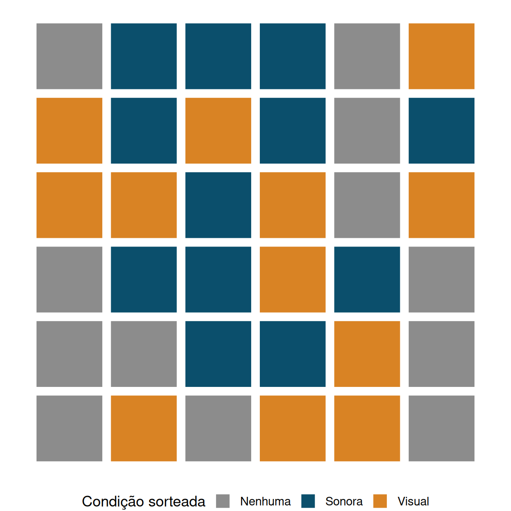
<p class="caption">(\#fig:fig-layout-dca)Layout de um DCA: 36 unidades experimentais dispostas em uma grade puramente ilustrativa (a posição na grade não tem nenhum significado -- não há linha, coluna nem vizinhança relevante), coloridas pelo tratamento sorteado. Note a ausência de qualquer padrão espacial ou de agrupamento: essa é justamente a marca do DCA -- nenhuma restrição além do sorteio -- que o contrasta com os delineamentos em blocos do Capítulo 4.</p>
</div>

Antes de qualquer ajuste de modelo, vale sempre inspecionar a estrutura completa do dado e deixar
explícito, coluna a coluna, o papel de cada variável — o hábito que evita, mais adiante, o erro de
pseudorreplicação descrito no Capítulo 1 (Seção \@ref(unidades)):


``` r
glimpse(dados_tr)   # dados_tr foi simulado na Seção 3.1, ao comparar teste F e aleatorização
```

```
## Rows: 36
## Columns: 3
## $ sujeito      <int> 1, 2, 3, 4, 5, 6, 7, 8, 9, 10, 11, 12, 13, 14, 15, 16, 17…
## $ condicao     <fct> Nenhuma, Nenhuma, Nenhuma, Nenhuma, Nenhuma, Nenhuma, Nen…
## $ tempo_reacao <dbl> 488.9892, 354.8937, 448.6911, 573.3930, 515.5600, 502.043…
```

<table class="table" style="width: auto !important; margin-left: auto; margin-right: auto;">
<caption>(\#tab:tabela-papel-variaveis-04)Estrutura do dado: papel de cada variável</caption>
 <thead>
  <tr>
   <th style="text-align:left;"> Variável </th>
   <th style="text-align:left;"> Papel </th>
  </tr>
 </thead>
<tbody>
  <tr>
   <td style="text-align:left;"> `sujeito` </td>
   <td style="text-align:left;"> Identificador da unidade experimental (e, aqui, também da unidade amostral) </td>
  </tr>
  <tr>
   <td style="text-align:left;"> `condicao` </td>
   <td style="text-align:left;"> Fator de tratamento (3 níveis) — sorteado por `sujeito` </td>
  </tr>
  <tr>
   <td style="text-align:left;"> `tempo_reacao` </td>
   <td style="text-align:left;"> Resposta — uma única medição por `sujeito` </td>
  </tr>
</tbody>
</table>

### O modelo estatístico {#modelo-dca}

O modelo de efeitos fixos para um DCA com $t$ tratamentos, cada um com $n_i$ repetições
($i = 1, \ldots, t$; $j = 1, \ldots, n_i$; $N = \sum_i n_i$), é

$$
Y_{ij} = \mu + \tau_i + \varepsilon_{ij}, \qquad \varepsilon_{ij} \overset{iid}{\sim} N(0, \sigma^2),
$$

em que _iid_ abrevia "independentes e identicamente distribuídos", $\mu$ é a média geral, $\tau_i$ é o efeito (fixo, desconhecido) do $i$-ésimo tratamento,
sujeito à restrição $\sum_i n_i \tau_i = 0$ (ou $\sum_i \tau_i = 0$ no caso balanceado) para
tornar o modelo identificável, e $\varepsilon_{ij}$ é o erro experimental — a soma de tudo aquilo
que não é explicado pelo tratamento nem pela média geral (Capítulo 1, Seção
\@ref(fontes-variacao)). A média do $i$-ésimo tratamento é $\mu_i = \mu + \tau_i$, de modo que o
modelo pode ser lido, de forma equivalente, como $Y_{ij} = \mu_i + \varepsilon_{ij}$: cada
observação é a média populacional do seu grupo mais um desvio aleatório.

As variáveis aleatórias envolvidas são: $Y_{ij}$ (a resposta observada, aleatória antes da coleta
de dados), $\varepsilon_{ij}$ (o erro experimental, aleatório e não observável diretamente) — já
$\mu$ e $\tau_i$ são parâmetros fixos e desconhecidos, e $t$, $n_i$ são constantes de
delineamento, fixadas pelo pesquisador antes do experimento.

Os estimadores de mínimos quadrados — que, sob o modelo acima, coincidem com os estimadores de
máxima verossimilhança — são as médias amostrais:

$$
\hat\mu_i = \bar Y_{i \cdot} = \frac{1}{n_i}\sum_{j=1}^{n_i} Y_{ij}, \qquad
\hat\sigma^2 = \text{MS}_E = \frac{1}{N - t}\sum_{i=1}^t \sum_{j=1}^{n_i} (Y_{ij} - \bar Y_{i\cdot})^2,
$$

em que $\text{MS}_E$ (quadrado médio do erro) é definido formalmente na próxima seção.

### Notação matricial: o DCA como caso particular do modelo linear geral {#matricial-dca}

O Capítulo 2 (Seções \@ref(matriz-projecao) e \@ref(soma-quadrados-total)) já anunciava que a
decomposição $\mathbf{Y} = \mathbf{X}\boldsymbol{\beta} + \boldsymbol{\varepsilon}$, especializada
para um único fator categórico, se tornaria a soma de quadrados entre e dentro de tratamentos da
ANOVA. Cumprimos essa promessa aqui, usando a **parametrização de médias de célula**: $t$ colunas
indicadoras (sem intercepto), uma por tratamento, de modo que $\boldsymbol{\beta} =
(\mu_1,\ldots,\mu_t)'$ diretamente — sem a restrição de soma zero que a parametrização
$\mu+\tau_i$ da Seção \@ref(modelo-dca) exige para identificabilidade.

$$
\mathbf{X}_{[ij],\,i'} = \mathbb{1}\{i'=i\}, \qquad
\mathbf{Y} = \mathbf{X}\boldsymbol{\beta} + \boldsymbol{\varepsilon}, \qquad
\boldsymbol{\varepsilon}\sim N(\mathbf{0},\sigma^2\mathbf{I}_N).
$$

Para os seis primeiros voluntários do experimento de distração (dois por condição), $\mathbf{X}$ é


``` r
toy <- dados_tr %>% group_by(condicao) %>% slice_head(n = 2) %>% ungroup()
X_toy <- model.matrix(~ condicao - 1, data = toy)
X_toy
```

```
##   condicaoNenhuma condicaoSonora condicaoVisual
## 1               1              0              0
## 2               1              0              0
## 3               0              1              0
## 4               0              1              0
## 5               0              0              1
## 6               0              0              1
## attr(,"assign")
## [1] 1 1 1
## attr(,"contrasts")
## attr(,"contrasts")$condicao
## [1] "contr.treatment"
```

Como as colunas de $\mathbf{X}$ são indicadoras de grupos disjuntos, $\mathbf{X}'\mathbf{X} =
\mathrm{diag}(n_1,\ldots,n_t)$ — diagonal, sem termos cruzados — e $\mathbf{X}$ tem **posto
completo** ($t$, um por coluna): diferente do caso geral do Capítulo 2, aqui **todo** $\mu_i$ (e
toda diferença $\mu_i-\mu_k$) é trivialmente estimável, sem exigir contrastes especiais.


``` r
Xfull <- model.matrix(~ condicao - 1, data = dados_tr)
t(Xfull) %*% Xfull
```

```
##                 condicaoNenhuma condicaoSonora condicaoVisual
## condicaoNenhuma              12              0              0
## condicaoSonora                0             12              0
## condicaoVisual                0              0             12
```

Consequentemente, $\hat{\boldsymbol{\beta}} = (\mathbf{X}'\mathbf{X})^{-1}\mathbf{X}'\mathbf{Y} =
(\bar Y_{1\cdot}, \ldots, \bar Y_{t\cdot})'$: o vetor de médias amostrais reaparece, agora como
instância direta da fórmula geral de mínimos quadrados, não como um resultado ad hoc.

Como $\mathbf{X}$ tem posto completo, o Teorema de Gauss-Markov (Seção \@ref(gauss-markov)) se
aplica sem qualificações: $\hat{\boldsymbol{\beta}}$ é o **BLUE** de $\boldsymbol{\beta}$ — em
particular, $\hat\mu_i=\bar Y_{i\cdot}$ é o BLUE de $\mu_i$ — e

$$
\mathrm{Cov}(\hat{\boldsymbol{\beta}}) = \sigma^2(\mathbf{X}'\mathbf{X})^{-1}
= \sigma^2\,\mathrm{diag}(1/n_1,\ldots,1/n_t),
$$

exatamente o erro-padrão $\sqrt{\sigma^2/n_i}$ usado nos intervalos de confiança (ICs) da próxima seção — agora com
justificativa matricial completa em vez de apenas invocada. A dedução detalhada, para este $\mathbf{X}$
específico, é o Exercício 4 da Lista 04.

A matriz de projeção $\mathbf{P}_X=\mathbf{X}(\mathbf{X}'\mathbf{X})^{-1}\mathbf{X}'$ herda a
estrutura de blocos de $\mathbf{X}'\mathbf{X}$: é **bloco-diagonal**, com o bloco do grupo $i$
igual a $\tfrac{1}{n_i}\mathbf{J}_{n_i}$ (a matriz $n_i\times n_i$ de 1's dividida por $n_i$) —
projetar $\mathbf{Y}$ com $\mathbf{P}_X$ substitui cada observação pela média do seu próprio
grupo, e nada mais:


``` r
P_toy <- X_toy %*% solve(t(X_toy) %*% X_toy) %*% t(X_toy)
round(P_toy, 3)
```

```
##     1   2   3   4   5   6
## 1 0.5 0.5 0.0 0.0 0.0 0.0
## 2 0.5 0.5 0.0 0.0 0.0 0.0
## 3 0.0 0.0 0.5 0.5 0.0 0.0
## 4 0.0 0.0 0.5 0.5 0.0 0.0
## 5 0.0 0.0 0.0 0.0 0.5 0.5
## 6 0.0 0.0 0.0 0.0 0.5 0.5
```

Com $\mathbf{P}_X$ em mãos, a decomposição $\mathbf{M}=(\mathbf{P}_X-\tfrac1N\mathbf{J})+
(\mathbf{I}_N-\mathbf{P}_X)$ do Capítulo 2 (Seção \@ref(soma-quadrados-total)) — válida porque o
espaço-coluna de $\mathbf{X}$ contém $\mathbf{1}$ (a soma das $t$ colunas indicadoras é o vetor de
uns) — dá, sem nenhuma soma indexada por $i,j$,

$$
\underbrace{\mathbf{Y}'\mathbf{M}\mathbf{Y}}_{SQ_{\text{Total}}} =
\underbrace{\mathbf{Y}'\!\left(\mathbf{P}_X-\tfrac1N\mathbf{J}\right)\!\mathbf{Y}}_{SQ_{\text{Trat}}}
+ \underbrace{\mathbf{Y}'(\mathbf{I}_N-\mathbf{P}_X)\mathbf{Y}}_{SQ_E}.
$$

Substituindo a forma em blocos de $\mathbf{P}_X$, essas duas formas quadráticas se reduzem
exatamente às somas indexadas $\sum_i n_i(\bar Y_{i\cdot}-\bar Y_{\cdot\cdot})^2$ e $\sum_{i,j}
(Y_{ij}-\bar Y_{i\cdot})^2$ da Seção \@ref(anova-dca) — a tabela de ANOVA não é maquinaria nova,
é o Teorema de formas quadráticas idempotentes do Capítulo 2 (Seção \@ref(formas-quadraticas))
aplicado às matrizes $\mathbf{P}_X-\tfrac1N\mathbf{J}$ (idempotente, posto $t-1$) e
$\mathbf{I}_N-\mathbf{P}_X$ (idempotente, posto $N-t$). As duas **formas quadráticas** correspondentes são independentes — as
matrizes, sendo determinísticas, não têm do que ser independentes; o que o resultado de Craig
garante é que $\mathbf A_1\mathbf A_2=\mathbf 0$ implica independência das formas
$\mathbf Y'\mathbf A_1\mathbf Y$ e $\mathbf Y'\mathbf A_2\mathbf Y$ sob normalidade, e aqui
$(\mathbf P_X-\tfrac1N\mathbf J)(\mathbf I_N-\mathbf P_X)=\mathbf 0$. Daí decorre diretamente a
distribuição $F_{t-1,N-t}$ sob $H_0$ e a não centralidade $\lambda$ sob $H_1$ da Seção
\@ref(anova-dca): nenhuma suposição adicional além das já feitas no
Capítulo 2.

### Resultados potenciais e o estimando causal {#potencial-causal}

O que significa, formalmente, "o tipo de distração afeta o tempo de reação"? Até aqui,
$\mu_i-\mu_k$ é apenas um contraste entre parâmetros do modelo — para interpretá-lo como um
**efeito causal**, precisamos do arcabouço de resultados potenciais de Neyman e Rubin
[@neyman1923application; @rubin1974estimating; @imbensrubin2015].

Para cada uma das $N$ unidades experimentais $u=1,\ldots,N$ da população em estudo, postulamos
$t$ **resultados potenciais** $Y_u(1),\ldots,Y_u(t)$ — um por tratamento —, valores fixos
(não aleatórios) que existiriam se $u$ recebesse cada um dos tratamentos. Dois pressupostos,
reunidos sob o nome **SUTVA** (*stable unit treatment value assumption*)
[@imbensrubin2015], tornam $Y_u(i)$ bem definido:

1. **Sem interferência:** o resultado potencial de $u$ depende apenas do tratamento atribuído a
   $u$, não do que é atribuído às demais unidades (um voluntário sob "nenhuma distração" não é
   afetado pela condição sorteada para outro voluntário).
2. **Sem versões ocultas de tratamento:** "distração sonora" significa a mesma intervenção,
   consistente, para toda unidade que a recebe.

Sob SUTVA, o resultado **observado** é $Y_u = Y_u(T_u)$, em que $T_u\in\{1,\ldots,t\}$ é o
tratamento efetivamente sorteado para $u$ — apenas um dos $t$ resultados potenciais de cada
unidade é jamais observável; os demais permanecem contrafactuais. O **estimando causal** de
interesse, para dois tratamentos $i,k$, é o efeito médio de tratamento na população finita do
experimento,

$$
\tau_{i,k} = \frac{1}{N}\sum_{u=1}^N \big[Y_u(i) - Y_u(k)\big].
$$

**Proposição (Neyman, 1923/1990).** Em um DCA — $N$ unidades, $n_i$ sorteadas para o tratamento
$i$ por amostragem aleatória simples sem reposição, para cada $i$ —, a diferença de médias
observadas $\bar Y_i^{\text{obs}} - \bar Y_k^{\text{obs}}$ é **não viesada** para $\tau_{i,k}$, em
que a esperança é tomada sobre o mecanismo de aleatorização, mantendo os $Y_u(i)$ fixos.

*Demonstração.* Seja $R_{u,i}=\mathbb{1}\{T_u=i\}$. O mecanismo de aleatorização completa garante,
por simetria, que toda unidade $u$ tem a mesma chance marginal de cair no grupo $i$:
$P(R_{u,i}=1)=n_i/N$, para todo $u$ — essa é a única propriedade probabilística de que
precisamos, e ela não depende de $Y_u(i)$ de forma alguma. Como $Y_u^{\text{obs}}=Y_u(i)$ quando
$R_{u,i}=1$,

$$
\bar Y_i^{\text{obs}} = \frac{1}{n_i}\sum_{u=1}^N R_{u,i}\,Y_u(i)
\;\Longrightarrow\;
E\big[\bar Y_i^{\text{obs}}\big] = \frac{1}{n_i}\sum_{u=1}^N E[R_{u,i}]\,Y_u(i)
= \frac{1}{n_i}\sum_{u=1}^N \frac{n_i}{N}\,Y_u(i) = \frac{1}{N}\sum_{u=1}^N Y_u(i),
$$

pela linearidade da esperança — os $Y_u(i)$ são constantes, só $R_{u,i}$ é aleatório. O mesmo
argumento vale para o tratamento $k$, e subtraindo,

$$
E\big[\bar Y_i^{\text{obs}} - \bar Y_k^{\text{obs}}\big]
= \frac{1}{N}\sum_u Y_u(i) - \frac{1}{N}\sum_u Y_u(k) = \tau_{i,k}. \qquad\blacksquare
$$

Note o que a demonstração **não** usa: nenhuma suposição sobre a distribuição dos $Y_u(i)$,
nenhuma normalidade, nenhum modelo $Y_{ij}=\mu+\tau_i+\varepsilon_{ij}$. A validade do estimador
$\bar Y_i^{\cdot}-\bar Y_k^{\cdot}$ para o efeito causal médio vem inteiramente do **mecanismo
físico de aleatorização** — o mesmo mecanismo que justificou o teste de aleatorização da Seção
\@ref(principios-aleatorizacao). Os dois resultados são complementares: o argumento de Fisher
testa a hipótese nula "aguda" $Y_u(i)=Y_u(k)$ para *toda* unidade $u$ (nenhum efeito, em nenhum
caso), enquanto o argumento de Neyman estima e testa a hipótese "fraca" $\tau_{i,k}=0$ (nenhum
efeito, *em média*). O que o modelo normal-linear $Y_{ij}=\mu+\tau_i+\varepsilon_{ij}$ acrescenta
a essa base puramente aleatorizada não é a validade do ponto estimado — já garantida por Neyman —
mas sim distribuições exatas em amostra finita ($t$, $F$) para intervalos de confiança e testes,
como visto na Seção \@ref(ic-dca) a seguir.

### Estimação e intervalos de confiança {#ic-dca}

Sob o modelo normal, $\bar Y_{i\cdot} \sim N\!\left(\mu_i, \sigma^2/n_i\right)$ e
$(N-t)\,\text{MS}_E/\sigma^2 \sim \chi^2_{N-t}$, independente de todas as $\bar Y_{i\cdot}$. Isso
dá origem a dois intervalos de confiança fundamentais, ambos baseados na distribuição $t$ de
Student com $N-t$ graus de liberdade (os graus de liberdade do erro).

**Intervalo de confiança (IC) para a média de um tratamento.** Um intervalo de $100(1-\alpha)\%$ de confiança para
$\mu_i$ é

$$
\bar Y_{i\cdot} \; \pm \; t_{\alpha/2,\, N-t} \sqrt{\frac{\text{MS}_E}{n_i}}.
$$

**IC para a diferença entre duas médias de tratamento.** Um intervalo de $100(1-\alpha)\%$ de
confiança para $\mu_i - \mu_k$ ($i \neq k$) é

$$
(\bar Y_{i\cdot} - \bar Y_{k\cdot}) \; \pm \; t_{\alpha/2,\, N-t} \sqrt{\text{MS}_E\left(\frac{1}{n_i} + \frac{1}{n_k}\right)}.
$$

Note que os dois intervalos usam o mesmo $\text{MS}_E$ — a *combinação* (pooling) da
variabilidade de todos os $t$ grupos para estimar um único $\sigma^2$ comum é o que torna a ANOVA
mais eficiente do que fazer $t$ estimativas de variância separadas, uma por grupo, desde que a
suposição de variância comum (Seção \@ref(dca-pressupostos)) seja razoável.

### A tabela de análise de variância {#anova-dca}

A ANOVA decompõe a soma de quadrados total em uma parte atribuível ao tratamento e uma parte
residual (erro):

$$
\underbrace{\sum_{i,j}(Y_{ij}-\bar Y_{\cdot\cdot})^2}_{SQ_{\text{Total}}} =
\underbrace{\sum_i n_i(\bar Y_{i\cdot}-\bar Y_{\cdot\cdot})^2}_{SQ_{\text{Trat}}} +
\underbrace{\sum_{i,j}(Y_{ij}-\bar Y_{i\cdot})^2}_{SQ_E}.
$$

<table class="table" style="width: auto !important; margin-left: auto; margin-right: auto;">
<caption>(\#tab:tabela-anova-teorica)Tabela de análise de variância do DCA a uma via</caption>
 <thead>
  <tr>
   <th style="text-align:left;"> Fonte de variação </th>
   <th style="text-align:left;"> G.l. </th>
   <th style="text-align:left;"> Soma de quadrados </th>
   <th style="text-align:left;"> Quadrado médio </th>
   <th style="text-align:left;"> F </th>
  </tr>
 </thead>
<tbody>
  <tr>
   <td style="text-align:left;"> Tratamento </td>
   <td style="text-align:left;"> $t-1$ </td>
   <td style="text-align:left;"> $SQ_{\text{Trat}}$ </td>
   <td style="text-align:left;"> $MS_{\text{Trat}} = SQ_{\text{Trat}}/(t-1)$ </td>
   <td style="text-align:left;"> $MS_{\text{Trat}}/MS_E$ </td>
  </tr>
  <tr>
   <td style="text-align:left;"> Erro </td>
   <td style="text-align:left;"> $N-t$ </td>
   <td style="text-align:left;"> $SQ_E$ </td>
   <td style="text-align:left;"> $MS_E = SQ_E/(N-t)$ </td>
   <td style="text-align:left;">  </td>
  </tr>
  <tr>
   <td style="text-align:left;"> Total </td>
   <td style="text-align:left;"> $N-1$ </td>
   <td style="text-align:left;"> $SQ_{\text{Total}}$ </td>
   <td style="text-align:left;">  </td>
   <td style="text-align:left;">  </td>
  </tr>
</tbody>
</table>

A coluna de graus de liberdade da tabela acima é, em miniatura, o diagrama de Hasse de um único
fator já apresentado no Capítulo 2 (Seção \@ref(hasse)): uma cadeia de três nós Média $\prec$
Tratamento $\prec$ Erro. Vale a pena vê-lo com os números concretos deste próprio experimento
($t=3$ condições, $n=12$ voluntários por condição, $N=36$), em vez de reler apenas o exemplo
genérico do capítulo anterior:

```{=html}
<div class="caixa-r"><strong>Uso do R</strong> — diagrama de Hasse do DCA de distração</div>
```


``` r
nos_tr <- tibble(
  termo   = c("Média", "Condição", "Erro"),
  classes = c(1, 3, 36)            # t=3 condicoes; N=36 voluntarios
)
arestas_tr <- tibble(de = c("Média", "Condição"), para = c("Condição", "Erro"))

knitr::include_graphics(
  hasse_svg(nos_tr, arestas_tr,
            arquivo = "figuras/hasse/dca-distracao.svg",
            titulo  = "DCA de distração: t=3, n=12 (N=36)")
)
```

<div class="figure" style="text-align: center">
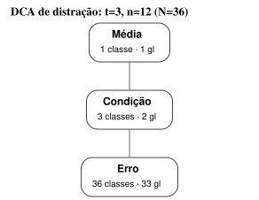
<p class="caption">(\#fig:hasse-dca-distracao)Diagrama de Hasse do DCA de distração e tempo de reação: t=3 condições, n=12 voluntários por condição (N=36). A mesma cadeia de três nós do exemplo genérico do Capítulo 2 (Seção sobre diagramas de Hasse), agora com os graus de liberdade deste experimento.</p>
</div>

Os três nós somam $1+2+33=36=N$, confirmando a leitura da tabela: nenhuma outra fonte de variação
estrutural além da condição experimental, exatamente como no exemplo genérico do Capítulo 2 — a
diferença entre os dois diagramas é só de escala ($t=3$ contra $t=4$), não de forma, porque os dois
são o mesmo delineamento (um único fator, sem blocagem nem aninhamento).

Sob $H_0: \tau_1 = \cdots = \tau_t = 0$ (nenhum efeito de tratamento), $F = MS_{\text{Trat}}/MS_E
\sim F_{t-1,\,N-t}$; rejeita-se $H_0$ para valores grandes de $F$. Quando $H_0$ é falsa, $F$ segue
uma distribuição $F$ **não central**, cujo parâmetro de não centralidade é

$$
\lambda = \frac{\sum_i n_i \tau_i^2}{\sigma^2}
\;\overset{\text{balanceado}}{=}\; N f^2 ,
$$

em que $f$ é o tamanho de efeito de Cohen. Quanto maiores os efeitos de tratamento em relação ao
erro, maior $\lambda$ e maior o poder do teste.

Convém distinguir $\lambda$ de uma segunda quantidade que aparece na literatura clássica e é
fácil de confundir com ele:

$$
\Phi^2 = \frac{\lambda}{t} = \frac{\sum_i n_i \tau_i^2}{t\,\sigma^2}
\;\overset{\text{balanceado}}{=}\; n f^2 .
$$

$\Phi^2$ é a grandeza auxiliar usada nas **curvas características de operação** (curvas OC, de *operating characteristic*) de
@montgomery2017design, tabuladas para leitura gráfica do poder; **não** é o parâmetro de não
centralidade de distribuição alguma. A distinção é prática, não pedante: funções como
`pwr::pwr.anova.test()` e `stats::pf(..., ncp = )` esperam $\lambda = Nf^2$, de modo que usar
$\Phi^2$ no lugar de $\lambda$ subestima o poder por um fator $t$. É $\lambda$ que será a chave
da Seção \@ref(numero-replicas-dca).

```{=html}
<div class="caixa-r"><strong>Uso do R</strong> — ajustando o DCA e obtendo IC's</div>
```


``` r
modelo_tr <- aov(tempo_reacao ~ condicao, data = dados_tr)
summary(modelo_tr)
```

```
##             Df Sum Sq Mean Sq F value  Pr(>F)   
## condicao     2  31366   15683   5.872 0.00658 **
## Residuals   33  88133    2671                   
## ---
## Signif. codes:  0 '***' 0.001 '**' 0.01 '*' 0.05 '.' 0.1 ' ' 1
```

``` r
MS_E  <- summary(modelo_tr)[[1]][["Mean Sq"]][2]
df_E  <- summary(modelo_tr)[[1]][["Df"]][2]
t_crit <- qt(0.975, df_E)

dados_tr %>%
  group_by(condicao) %>%
  summarise(media = mean(tempo_reacao), n = n(), .groups = "drop") %>%
  mutate(
    ep  = sqrt(MS_E / n),
    lwr = media - t_crit * ep,
    upr = media + t_crit * ep
  ) %>%
  kable(digits = 1, caption = "Médias por condição com IC de 95% (pooled MS_E)") %>%
  kable_styling(full_width = FALSE)
```

<table class="table" style="width: auto !important; margin-left: auto; margin-right: auto;">
<caption>(\#tab:ajuste-dca)Médias por condição com IC de 95% (pooled MS_E)</caption>
 <thead>
  <tr>
   <th style="text-align:left;"> condicao </th>
   <th style="text-align:right;"> media </th>
   <th style="text-align:right;"> n </th>
   <th style="text-align:right;"> ep </th>
   <th style="text-align:right;"> lwr </th>
   <th style="text-align:right;"> upr </th>
  </tr>
 </thead>
<tbody>
  <tr>
   <td style="text-align:left;"> Nenhuma </td>
   <td style="text-align:right;"> 494.0 </td>
   <td style="text-align:right;"> 12 </td>
   <td style="text-align:right;"> 14.9 </td>
   <td style="text-align:right;"> 463.7 </td>
   <td style="text-align:right;"> 524.4 </td>
  </tr>
  <tr>
   <td style="text-align:left;"> Sonora </td>
   <td style="text-align:right;"> 514.4 </td>
   <td style="text-align:right;"> 12 </td>
   <td style="text-align:right;"> 14.9 </td>
   <td style="text-align:right;"> 484.1 </td>
   <td style="text-align:right;"> 544.8 </td>
  </tr>
  <tr>
   <td style="text-align:left;"> Visual </td>
   <td style="text-align:right;"> 564.3 </td>
   <td style="text-align:right;"> 12 </td>
   <td style="text-align:right;"> 14.9 </td>
   <td style="text-align:right;"> 534.0 </td>
   <td style="text-align:right;"> 594.7 </td>
  </tr>
</tbody>
</table>

O teste $F$ rejeita $H_0$ ($p = 0.0066$): o tipo de
distração afeta o tempo de reação médio. Os intervalos de confiança individuais mostram que a
condição visual se destaca das demais, um ponto que será formalizado com comparações múltiplas
(próxima seção do capítulo, além do escopo deste texto).

<div class="figure" style="text-align: center">
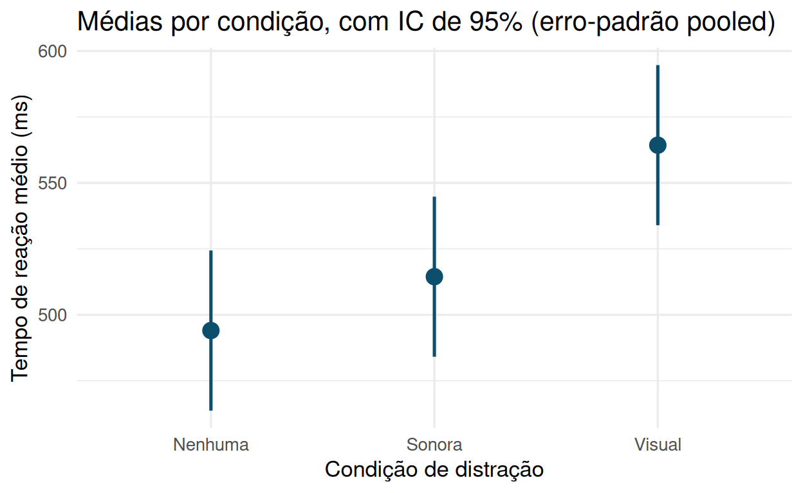
<p class="caption">(\#fig:plot-medias-ic-dca)Médias de tempo de reação por condição, com intervalos de confiança de 95% construídos a partir do quadrado médio do erro (QME) comum às três condições.</p>
</div>

O gráfico traduz visualmente a tabela anterior: os três intervalos usam a mesma largura, porque
todos compartilham o mesmo $QME$ (o erro-padrão pooled da ANOVA, não um erro-padrão calculado
grupo a grupo), o que é, por si só, a suposição de variância homogênea em ação. A condição visual
se destaca claramente das demais — seu intervalo não se sobrepõe ao das outras duas —, enquanto os
intervalos de "Nenhuma" e "Sonora" se tocam, sugerindo que a diferença entre elas é mais tênue.
Essa leitura visual antecipa exatamente o que os procedimentos de comparação múltipla da Seção
\@ref(contrastes) vão formalizar com rigor estatístico.

### Número de réplicas necessário {#numero-replicas-dca}

Quantas unidades experimentais por tratamento são necessárias? A resposta depende de três
escolhas do pesquisador — o nível de significância $\alpha$, o poder desejado $1-\beta$, e o
**tamanho de efeito** mínimo que se quer ter boa chance de detectar — e de uma quantidade que
raramente é conhecida com exatidão antes do experimento: $\sigma^2$, normalmente estimada a
partir de um estudo piloto ou da literatura.

Uma forma conveniente de expressar o tamanho de efeito para $t$ grupos é o **$f$ de Cohen**,

$$
f = \frac{\sigma_\mu}{\sigma}, \qquad \sigma_\mu^2 = \frac{1}{t}\sum_i (\mu_i - \bar\mu)^2,
$$

isto é, o desvio-padrão das médias populacionais dividido pelo desvio-padrão comum dentro dos
grupos — quanto mais as médias se afastam entre si em relação ao ruído, maior $f$. A relação com
o parâmetro de não centralidade da Seção \@ref(anova-dca) é direta: $\lambda = N f^2 = n\,t\,f^2$
no caso balanceado (e a grandeza das curvas OC é $\Phi^2=\lambda/t=n f^2$). Dado $f$, $\alpha$ e o poder desejado, o número de réplicas $n$ por
grupo é obtido numericamente (não há fórmula fechada, pois a distribuição $F$ não central não se
inverte analiticamente).

```{=html}
<div class="caixa-r"><strong>Uso do R</strong> — número de réplicas via `pwr::pwr.anova.test()`</div>
```


``` r
medias_grupo <- c(494, 514, 564)     # estimativa piloto das médias por condição
sigma_piloto <- sqrt(MS_E)           # estimativa piloto do desvio-padrão comum

f_cohen <- sqrt(mean((medias_grupo - mean(medias_grupo))^2)) / sigma_piloto
f_cohen
```

```
## [1] 0.5696575
```

``` r
pwr::pwr.anova.test(k = 3, f = f_cohen, sig.level = 0.05, power = 0.80)
```

```
## 
##      Balanced one-way analysis of variance power calculation 
## 
##               k = 3
##               n = 10.95974
##               f = 0.5696575
##       sig.level = 0.05
##           power = 0.8
## 
## NOTE: n is number in each group
```

Com o tamanho de efeito observado neste estudo ($f \approx 0.57$), seriam
necessárias cerca de 11 unidades por grupo para poder de 80% — as 12 efetivamente usadas já
garantem poder ligeiramente superior a 80%. Na prática, essa conta deve ser feita **antes** da
coleta de dados, com $f$ estimado a partir de um piloto, da literatura, ou de uma diferença
mínima de interesse prático especificada pelo próprio pesquisador (por exemplo, "uma diferença de
40 ms ou mais entre condições é relevante clinicamente").

### Um segundo exemplo, com dado real: fertilizante em feijão {#dca-feijao}

O exemplo de distração e tempo de reação, acima, foi simulado deliberadamente — controlar o
"efeito verdadeiro" permite verificar cada passo da álgebra contra um valor conhecido. Fecha-se a
seção com a mesma maquinaria aplicada a um dado genuinamente real, sem efeito verdadeiro
conhecido de antemão.

```{=html}
<div class="caixa-aplicacao">
<strong>Aplicação — Agricultura: dose de fertilizante na produção de feijão</strong><br>
Um agrônomo compara quatro fertilizantes (F1–F4) quanto à produção de feijão. Vinte parcelas de
terra, previamente homogeneizadas quanto a exposição solar e tipo de solo, são sorteadas em quatro
grupos de cinco (<strong>unidade experimental, UE = parcela</strong>), cada grupo recebendo um dos quatro fertilizantes.
Produção (kg) é medida ao final da colheita.
</div>
```

As 20 parcelas foram sorteadas entre os fertilizantes. Se o agrônomo tivesse aplicado o
fertilizante mais caro nas parcelas de melhor aparência, todas as análises a seguir (ANOVA,
contrastes, Duncan, Tukey) continuariam produzindo números, mas ordenariam parcelas, não
fertilizantes.


``` r
feijao <- read_csv("data/feijao.csv", show_col_types = FALSE) %>%
  mutate(Fertilizante = factor(Fertilizante, labels = paste0("F", 1:4)))
glimpse(feijao)
```

```
## Rows: 20
## Columns: 3
## $ Parcela      <dbl> 1, 2, 3, 4, 5, 6, 7, 8, 9, 10, 11, 12, 13, 14, 15, 16, 17…
## $ Fertilizante <fct> F1, F1, F4, F1, F2, F3, F4, F4, F3, F1, F2, F3, F3, F3, F…
## $ Producao     <dbl> 5.91, 3.76, 8.31, 4.04, 6.81, 1.69, 8.46, 8.51, 5.69, 5.3…
```


``` r
mod_feijao <- aov(Producao ~ Fertilizante, data = feijao)
summary(mod_feijao)
```

```
##              Df Sum Sq Mean Sq F value   Pr(>F)    
## Fertilizante  3  54.74  18.248   9.209 0.000897 ***
## Residuals    16  31.70   1.982                     
## ---
## Signif. codes:  0 '***' 0.001 '**' 0.01 '*' 0.05 '.' 0.1 ' ' 1
```

<div class="figure" style="text-align: center">
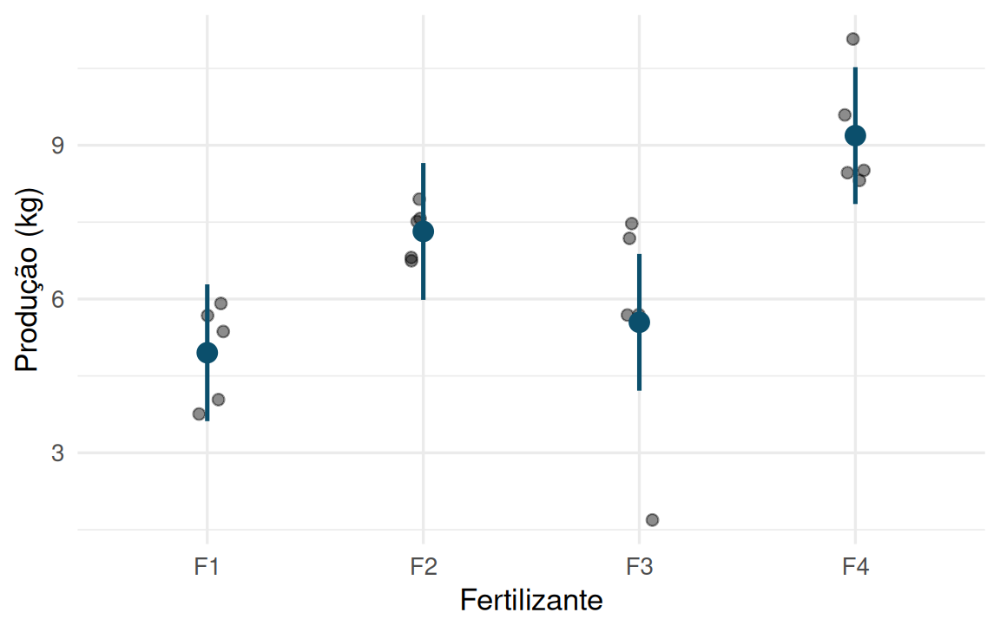
<p class="caption">(\#fig:feijao-plot)Produção de feijão por fertilizante: pontos individuais (parcelas) e média por grupo com intervalo de confiança de 95%, construído a partir do QME comum.</p>
</div>

O teste $F$ rejeita $H_0$ ($p<0{,}001$): há diferença real entre fertilizantes. F4 (média
9.2 kg) supera claramente F1 (média
5 kg), com F2 e F3 numa faixa
intermediária — leitura visual confirmada pelos intervalos de confiança do gráfico, que já
antecipa o que uma comparação múltipla (Seção \@ref(comparacoes-multiplas)) formalizaria.

Honestidade estatística: ao contrário do exemplo simulado, aqui não há garantia de que os
pressupostos do modelo se sustentam — e de fato não se sustentam perfeitamente. O teste de
Shapiro-Wilk nos resíduos dá $p\approx 0.046$
— no limiar de $0{,}05$, uma normalidade duvidosa com só 20 observações. É exatamente o tipo de
situação real que a Seção \@ref(dca-pressupostos), a seguir, ensina a diagnosticar e tratar (em
vez de ignorar).

## Subamostragem em um DCA {#dca-submuestreo}

Retomamos aqui, com rigor, a distinção entre unidade experimental (UE) e unidade amostral
introduzida no Capítulo 1 (Seção \@ref(unidades)): quando uma UE é medida mais de uma vez —
várias tentativas de um mesmo sujeito, vários peixes do mesmo aquário, várias leituras do mesmo
lote — dizemos que há **subamostragem**. As subamostras não são réplicas do tratamento: são
réplicas da *medição* dentro de uma única aplicação do tratamento, e carregam uma fonte de
variação a mais, que precisa ser modelada separadamente.

<div class="figure" style="text-align: center">

<p class="caption">(\#fig:fig-ue-uo-submuestreo-1)Três formas de organizar o mesmo experimento com três tratamentos (rótulos Trat. 1-3), adaptado de Hinkelmann e Kempthorne (1994). Situação Experimental 1 (esquerda): uma única caixa de 4 vasos por tratamento -- a caixa é a unidade experimental (UE), cada vaso é uma subamostra, e só 3 UEs existem em todo o experimento (uma por tratamento). Situação Experimental 2 (centro): cada vaso é sorteado individualmente -- UE e unidade amostral coincidem, 12 UEs verdadeiras, sem subamostragem. Situação Experimental 3 (direita): duas caixas de 2 vasos por tratamento -- subamostragem como na Situação 1, mas agora com 2 UEs por tratamento em vez de 1.</p>
</div><div class="figure" style="text-align: center">

<p class="caption">(\#fig:fig-ue-uo-submuestreo-2)Três formas de organizar o mesmo experimento com três tratamentos (rótulos Trat. 1-3), adaptado de Hinkelmann e Kempthorne (1994). Situação Experimental 1 (esquerda): uma única caixa de 4 vasos por tratamento -- a caixa é a unidade experimental (UE), cada vaso é uma subamostra, e só 3 UEs existem em todo o experimento (uma por tratamento). Situação Experimental 2 (centro): cada vaso é sorteado individualmente -- UE e unidade amostral coincidem, 12 UEs verdadeiras, sem subamostragem. Situação Experimental 3 (direita): duas caixas de 2 vasos por tratamento -- subamostragem como na Situação 1, mas agora com 2 UEs por tratamento em vez de 1.</p>
</div><div class="figure" style="text-align: center">

<p class="caption">(\#fig:fig-ue-uo-submuestreo-3)Três formas de organizar o mesmo experimento com três tratamentos (rótulos Trat. 1-3), adaptado de Hinkelmann e Kempthorne (1994). Situação Experimental 1 (esquerda): uma única caixa de 4 vasos por tratamento -- a caixa é a unidade experimental (UE), cada vaso é uma subamostra, e só 3 UEs existem em todo o experimento (uma por tratamento). Situação Experimental 2 (centro): cada vaso é sorteado individualmente -- UE e unidade amostral coincidem, 12 UEs verdadeiras, sem subamostragem. Situação Experimental 3 (direita): duas caixas de 2 vasos por tratamento -- subamostragem como na Situação 1, mas agora com 2 UEs por tratamento em vez de 1.</p>
</div>

Os três diagramas mostram o mesmo número de plantas (12 no total, três tratamentos) organizadas de
formas distintas. Na Situação 1, o sorteio de tratamento ocorre **caixa a caixa**: uma vez que uma
caixa recebe, digamos, o Tratamento 1, todos os quatro vasos dentro dela recebem necessariamente o
mesmo tratamento — a caixa é a UE, e as quatro plantas dentro dela são subamostras da mesma UE.
Como só existe **uma** caixa por tratamento, há apenas **3 UEs em todo o experimento** — uma por
tratamento, não três por tratamento —, e isso é fatal: com uma única UE por tratamento, não sobra
nenhum grau de liberdade para estimar o erro experimental *entre* UEs, e o efeito do tratamento
fica completamente confundido com qualquer peculiaridade daquela caixa específica (Capítulo 1,
Seção \@ref(fontes-variacao)). Na Situação 2, cada vaso é sorteado **individualmente**: a moeda do
desenho aleatorizado é lançada 12 vezes, uma por vaso, e UE e unidade amostral coincidem — não há
subamostragem, e as 12 observações são, de fato, 12 réplicas independentes do sorteio de tratamento,
com $12-3=9$ graus de liberdade de erro. A Situação 3 corrige o problema fatal da Situação 1 sem
abrir mão da subamostragem: **duas** caixas por tratamento (não uma) dão 2 UEs por tratamento — poucas,
mas suficientes para estimar o erro experimental entre caixas, com $2\times3-3=3$ graus de
liberdade — a mesma estrutura, em miniatura, do exemplo real da tilápia a seguir (4 probióticos,
5 aquários cada). A diferença entre as três situações não aparece em nenhuma estatística
descritiva calculada ingenuamente sobre os 12 valores brutos — só se torna visível quando se
pergunta, explicitamente, "quantas vezes o mecanismo de aleatorização foi
acionado?" — e é exatamente essa pergunta que a distinção UE/unidade amostral formaliza.

```{=html}
<div class="caixa-aplicacao">
<strong>Aplicação — Agricultura: probiótico e ganho de peso em tilápia</strong><br>
Um estudo de aquicultura testa quatro formulações de probiótico (dados <code>mojarra.csv</code>)
quanto ao ganho de peso de tilápias entre o início do experimento e o dia 45. O delineamento usa
20 aquários, sorteados 5 para cada probiótico — o <strong>aquário é a unidade experimental</strong>,
pois é nele que o probiótico é aplicado (misturado à ração de todo o aquário) e não é possível
sortear o probiótico peixe a peixe dentro de um mesmo aquário. Cada aquário contém, em geral, 5
peixes medidos individualmente — o <strong>peixe é a unidade amostral</strong> (subamostra).
</div>
```

O controle aqui vale no nível em que o sorteio aconteceu: o **aquário**. Os peixes de um mesmo
aquário compartilham água, temperatura e alimentação, e não foram sorteados um a um. Tratá-los como
unidades experimentais seria fingir um controle que não houve, e, com o probiótico sem efeito,
o teste $F$ rejeitaria $H_0$ em cerca de metade dos experimentos.

### Como são os dados: uma linha por subamostra {#dados-submuestreo}

Antes de qualquer modelo, convém olhar a planilha. Ela tem **uma linha por peixe**, não por
aquário, e três colunas de identificação, uma para cada nível da estrutura:

```{=html}
<div class="caixa-r"><strong>Uso do R</strong> — lendo os dados da tilápia</div>
```


``` r
mojarra <- read_csv("data/mojarra.csv", show_col_types = FALSE) %>%
  rename(probiotico = probiotico, aquario = Acuario,
         peso_inicial = `Peso Inicial`, peso_45 = `Peso 45`) %>%
  drop_na(peso_45) %>%                                  # 3 peixes morreram antes do dia 45
  mutate(
    probiotico = factor(probiotico),
    aquario    = factor(aquario),
    ganho      = peso_45 - peso_inicial
  ) %>%
  group_by(aquario) %>% mutate(peixe = row_number()) %>% ungroup()

mojarra %>% filter(aquario %in% c(1, 6)) %>% slice(c(1:3, 6:8)) %>%
  dplyr::select(probiotico, aquario, peixe, ganho)
```

```
## # A tibble: 6 × 4
##   probiotico aquario peixe ganho
##   <fct>      <fct>   <int> <dbl>
## 1 1          1           1  12.2
## 2 1          1           2   8.5
## 3 1          1           3   9.4
## 4 2          6           1   8.2
## 5 2          6           2  11.8
## 6 2          6           3   8.5
```

As colunas `probiotico`, `aquario` e `peixe` correspondem aos índices $i$, $j$ e $k$ do modelo da
próxima seção, e é nesse formato longo que os dados entram em `aov()`, `lm()` ou `lmer()`.
Resumindo cada aquário pela média dos seus peixes, os mesmos dados cabem numa tabela probiótico
$\times$ réplica:

<table class="table" style="width: auto !important; margin-left: auto; margin-right: auto;">
<caption>(\#tab:tabela-larga-mojarra)Ganho médio (g) de cada aquário, arrumado por probiótico</caption>
 <thead>
  <tr>
   <th style="text-align:left;"> probiotico </th>
   <th style="text-align:right;"> réplica 1 </th>
   <th style="text-align:right;"> réplica 2 </th>
   <th style="text-align:right;"> réplica 3 </th>
   <th style="text-align:right;"> réplica 4 </th>
   <th style="text-align:right;"> réplica 5 </th>
  </tr>
 </thead>
<tbody>
  <tr>
   <td style="text-align:left;"> 1 </td>
   <td style="text-align:right;"> 10.5 </td>
   <td style="text-align:right;"> 13.0 </td>
   <td style="text-align:right;"> 16.8 </td>
   <td style="text-align:right;"> 13.4 </td>
   <td style="text-align:right;"> 9.3 </td>
  </tr>
  <tr>
   <td style="text-align:left;"> 2 </td>
   <td style="text-align:right;"> 10.5 </td>
   <td style="text-align:right;"> 15.5 </td>
   <td style="text-align:right;"> 16.2 </td>
   <td style="text-align:right;"> 14.3 </td>
   <td style="text-align:right;"> 12.9 </td>
  </tr>
  <tr>
   <td style="text-align:left;"> 3 </td>
   <td style="text-align:right;"> 17.9 </td>
   <td style="text-align:right;"> 21.9 </td>
   <td style="text-align:right;"> 20.7 </td>
   <td style="text-align:right;"> 24.0 </td>
   <td style="text-align:right;"> 17.3 </td>
  </tr>
  <tr>
   <td style="text-align:left;"> 4 </td>
   <td style="text-align:right;"> 23.5 </td>
   <td style="text-align:right;"> 24.8 </td>
   <td style="text-align:right;"> 21.9 </td>
   <td style="text-align:right;"> 16.8 </td>
   <td style="text-align:right;"> 28.3 </td>
  </tr>
</tbody>
</table>

Essa tabela engana com facilidade, e vale dizer o que ela **não** é. Não é uma tabela de
contingência: numa tabela de contingência cada célula conta quantas unidades caíram numa
combinação de categorias (probiótico $\times$ sobreviveu/morreu, por exemplo), e a análise é por
$\chi^2$ ou modelos log-lineares; aqui cada célula contém uma **medida**, o ganho médio de um
aquário em gramas. Também não é um DBCA (delineamento em blocos completos aleatorizados, Capítulo 4) nem um fatorial probiótico $\times$ aquário: a "réplica 3"
do probiótico 1 e a "réplica 3" do probiótico 2 são aquários diferentes, sem nada em comum, de
modo que não existe efeito de coluna, e embaralhar os valores dentro de uma linha não muda nada.
O aquário não cruza com o probiótico, porque cada aquário recebe um probiótico só: ele está
**aninhado** no probiótico. O que a tabela é, exatamente, é o DCA de um fator da Seção
\@ref(dca-uma-via), com 4 tratamentos, 5 réplicas e o ganho médio do aquário como resposta. A
planilha longa guarda a camada adicional, os peixes, que a tabela resume, e o modelo a seguir
usa as duas camadas.

### O modelo com dois níveis de erro {#modelo-submuestreo}

Com $t$ tratamentos, $r$ unidades experimentais (UEs) por tratamento e $q$ unidades amostrais
(subamostras) por UE, o modelo passa a ter **dois** termos de erro:

$$
Y_{ijk} = \mu + \tau_i + \delta_{ij} + \varepsilon_{ijk},
$$

$$
i = 1,\ldots,t; \quad j = 1,\ldots,r; \quad k = 1,\ldots,q,
$$

em que $\delta_{ij} \overset{iid}{\sim} N(0,\sigma_\delta^2)$ é o **erro experimental** (o desvio
específico da UE $j$ dentro do tratamento $i$ — por exemplo, algo peculiar daquele aquário, além
do efeito do probiótico) e $\varepsilon_{ijk} \overset{iid}{\sim} N(0,\sigma_\varepsilon^2)$ é o
**erro de amostragem** (o desvio específico da subamostra $k$ dentro da UE — a variação entre
peixes de um mesmo aquário), independente de $\delta_{ij}$. A variância total de uma observação
individual é $\text{Var}(Y_{ijk}) = \sigma_\delta^2 + \sigma_\varepsilon^2$, mas o que importa
para comparar tratamentos é apenas $\sigma_\delta^2$: aumentar $q$ (mais peixes por aquário) nunca
reduz a incerteza sobre o efeito do tratamento além de um certo ponto, porque não gera novas UEs.

A ligação com o DCA de um fator aparece ao tirar a média dos $q$ peixes de um aquário:

$$
\bar Y_{ij\cdot} = \mu + \tau_i + e_{ij}, \qquad e_{ij} = \delta_{ij} + \bar\varepsilon_{ij\cdot},
\qquad \mathrm{Var}(e_{ij}) = \sigma_\delta^2 + \frac{\sigma_\varepsilon^2}{q}.
$$

As médias dos aquários seguem, portanto, exatamente o modelo do DCA de um fator, com $r$ réplicas
por tratamento e variância do erro $\sigma_\delta^2+\sigma_\varepsilon^2/q$. Três consequências
saem daí sem conta adicional. As réplicas do tratamento são as UEs, e o erro tem $t(r-1)$ graus de
liberdade, não $tr(q-1)$. Mais subamostras só diminuem a parcela $\sigma_\varepsilon^2/q$, e a
parcela $\sigma_\delta^2$ fica. E, com $q$ constante, as esperanças dos quadrados médios da tabela
de ANOVA adiante se deduzem da Seção \@ref(dca-uma-via): o quadrado médio do erro experimental é
$q$ vezes a variância amostral das médias de aquário dentro de cada tratamento, logo
$E[QM_{\text{exp}}] = q(\sigma_\delta^2+\sigma_\varepsilon^2/q) = \sigma_\varepsilon^2+q\sigma_\delta^2$;
o de tratamento ganha a parcela $qr\sum_i\tau_i^2/(t-1)$; e o de amostragem, que mede a variação
entre peixes do mesmo aquário, tem esperança $\sigma_\varepsilon^2$. Sob $H_0:\tau_i=0$, só os dois
primeiros têm a mesma esperança, e é por isso que o teste $F$ usa o erro experimental no
denominador.

Em notação matricial, a subamostragem quebra a suposição $\mathrm{Cov}(\boldsymbol{\varepsilon}) =
\sigma^2\mathbf{I}_N$ do Capítulo 2 (Seção \@ref(gauss-markov)): empilhando as $N=trq$
observações, $\mathrm{Cov}(\mathbf{Y}) = \mathbf{V} = \sigma_\delta^2\,\mathbf{Z}\mathbf{Z}' +
\sigma_\varepsilon^2\mathbf{I}_N$, em que $\mathbf{Z}$ é a matriz $N\times tr$ de indicadores de
UE ($Z_{[ijk],\,i'j'} = \mathbb{1}\{i=i',j=j'\}$). $\mathbf{V}$ tem estrutura de blocos de
**simetria composta**: dentro de uma mesma UE, $\mathrm{Cov}(Y_{ijk},Y_{ijk'}) = \sigma_\delta^2$
($k\neq k'$); entre UEs diferentes, covariância nula. Um $\mathbf{X}$ com $\mathrm{Cov}(\mathbf{Y})
=\sigma^2\mathbf{I}$ deixa de bastar — é exatamente essa estrutura de $\mathbf{V}$ que faz do DCA
com subamostragem um caso particular de **modelo linear misto**, ajustável de forma exata (inclusive
sob desbalanceamento) por `nlme::lme()` ou `lme4::lmer()`, embora a ANOVA clássica com `Error()`
recupere o teste correto no caso balanceado.

O que acontece se o número de subamostras por UE **não** for o mesmo em toda UE — um aquário
perdeu um peixe, por exemplo? A condição de Zyskind (Seção \@ref(zyskind-dca)) deixa de se
verificar, e a ANOVA clássica com `Error()` deixa de ter uma base algébrica sólida — o R, nesse
caso, geralmente avisa:

```{=html}
<div class="caixa-r"><strong>Uso do R</strong> — o sintoma de perder o balanceamento: <code>aov()</code> quebra, <code>lmer()</code> não</div>
```


``` r
set.seed(77)
q_desigual <- c(4, 4, 4, 4, 4, 2)   # uma UE com 2 subamostras em vez de 4
delta_ue   <- rnorm(6, 0, 1.7)
dados_desbal <- map_dfr(1:6, function(j) {
  tibble(ue = factor(j), trat = factor(rep(1:3, each = 2)[j]),
         y  = 10 + 2 * rep(1:3, each = 2)[j] + delta_ue[j] + rnorm(q_desigual[j], 0, 0.9))
})
aov(y ~ trat + Error(trat:ue), data = dados_desbal)   # emite o aviso abaixo
```

```
## Warning in aov(y ~ trat + Error(trat:ue), data = dados_desbal): Error() model
## is singular
```

```
## 
## Call:
## aov(formula = y ~ trat + Error(trat:ue), data = dados_desbal)
## 
## Grand Mean: 14.76871
## 
## Stratum 1: trat:ue
## 
## Terms:
##                     trat Residuals
## Sum of Squares  87.37902   8.45898
## Deg. of Freedom        2         3
## 
## Residual standard error: 1.679184
## Estimated effects may be unbalanced
## 
## Stratum 2: Within
## 
## Terms:
##                 Residuals
## Sum of Squares   15.53889
## Deg. of Freedom        16
## 
## Residual standard error: 0.9854851
```

O aviso **"Error() model is singular"** não é cosmético: é o `aov()` avisando que a separação em
estratos experimental/amostral, que a condição de Zyskind garante no caso balanceado, não fecha
aqui. `lme4::lmer(y ~ trat + (1 | ue), data = dados_desbal)` estima os dois componentes de
variância por máxima verossimilhança restrita sem exigir essa condição — o preço é que os graus de
liberdade do teste $F$ deixam de ter fórmula fechada, exigindo uma aproximação (Satterthwaite ou
Kenward-Roger) fora do escopo deste livro.

### O diagrama de Hasse da subamostragem: aninhamento em duas camadas

A estrutura de dois erros descrita acima tem um retrato imediato no diagrama de Hasse introduzido
no Capítulo 2 (Seção \@ref(hasse)). O DCA simples é uma cadeia de três nós — Média $\prec$
Tratamento $\prec$ Erro (Figura \@ref(fig:hasse-dca) do Capítulo 2). A subamostragem insere um quarto
elo *abaixo* do erro experimental: a unidade experimental (aquário) é, ela própria, refinada pela
unidade amostral (peixe) dentro dela — exatamente o padrão de **aninhamento** que a Seção
\@ref(hasse) definiu como "uma cadeia direta de arestas, sem ramificação".

```{=html}
<div class="caixa-r"><strong>Uso do R</strong> — diagrama de Hasse do DCA com subamostragem</div>
```


``` r
nos_sub <- tibble(
  termo   = c("Média", "Tratamento", "UE (aquário)", "Unidade amostral (peixe)"),
  classes = c(1, 4, 4 * 5, 4 * 5 * 5)  # t=4; 20 aquarios; N=100 peixes
)
arestas_sub <- tibble(
  de   = c("Média", "Tratamento", "UE (aquário)"),
  para = c("Tratamento", "UE (aquário)", "Unidade amostral (peixe)")
)

knitr::include_graphics(
  hasse_svg(nos_sub, arestas_sub,
            arquivo = "figuras/hasse/dca-submuestreo.svg",
            titulo  = "DCA com subamostragem: t=4, r=5, q=5 (N=100)")
)
```

<div class="figure" style="text-align: center">
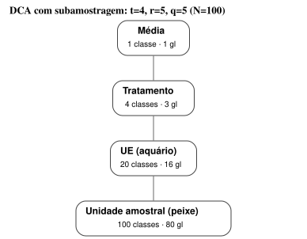
<p class="caption">(\#fig:hasse-submuestreo)Diagrama de Hasse do DCA com subamostragem, exemplo mojarra: t=4 probióticos, r=5 aquários (UEs) por probiótico, q=5 peixes (unidades amostrais) por aquário, N=100. Uma cadeia de quatro nós -- Média, Tratamento, UE e unidade amostral -- em vez dos três nós do DCA simples do Capítulo 2 (seção sobre diagramas de Hasse): a subamostragem insere um quarto elo, aninhando a amostragem de peixes dentro de cada aquário dentro de cada probiótico.</p>
</div>

Os graus de liberdade dos quatro nós somam exatamente $N=trq=4\times5\times5=100$: $1$ (Média) $+\,
3$ (Tratamento, $t-1$) $+\,16$ (UE dentro de tratamento, $t(r-1)$) $+\,80$ (unidade amostral dentro
de UE, $tr(q-1)$) $=100$ — os mesmos dois últimos números que aparecem, com outros nomes ("erro
experimental" e "erro de amostragem"), na tabela de ANOVA da seção seguinte. O diagrama não
acrescenta informação nova à tabela; torna **visível** algo que a tabela só codifica em símbolos:
os dois erros do modelo não são dois termos soltos e paralelos, são dois elos sucessivos de uma
mesma cadeia de refinamento, e o segundo só existe *dentro* do primeiro.

Essa dupla estrutura de aninhamento é precisamente o que a Seção \@ref(amostragem-e-desenho) do
Capítulo 1 antecipava ao introduzir o elo entre teoria de amostragem e planejamento de
experimentos: a atribuição do probiótico acontece uma única vez, no aquário (a unidade
experimental, sorteada por aleatorização de tratamento); mas decidir **quantos e quais** peixes
medir dentro de cada aquário é um problema de amostragem — literalmente, qual subconjunto de
peixes daquele aquário entra na base de dados — aninhado *dentro* do desenho experimental já
definido. O diagrama de Hasse deixa essa dupla camada impossível de confundir: os dois nós
superiores (Média, Tratamento) pertencem à lógica de atribuição aleatória de Neyman-Rubin
formalizada no Capítulo 1; o nó de UE e o nó de unidade amostral, abaixo dele, pertencem à lógica
de amostragem de Kish — e é exatamente por isso que aumentar $q$ (mais amostragem dentro da UE)
nunca substitui aumentar $r$ (mais aleatorização de tratamento), como a Seção
\@ref(amostra-submuestreo), adiante, quantifica.

### ANOVA com subamostragem {#anova-submuestreo}

A soma de quadrados total se decompõe agora em três partes, não duas:

<table class="table" style="width: auto !important; margin-left: auto; margin-right: auto;">
<caption>(\#tab:tabela-anova-sub-teorica)ANOVA do DCA com subamostragem balanceada (q subamostras por UE)</caption>
 <thead>
  <tr>
   <th style="text-align:left;"> Fonte de variação </th>
   <th style="text-align:left;"> G.l. </th>
   <th style="text-align:left;"> E[QM] </th>
  </tr>
 </thead>
<tbody>
  <tr>
   <td style="text-align:left;"> Tratamento </td>
   <td style="text-align:left;"> $t-1$ </td>
   <td style="text-align:left;"> $\sigma_\varepsilon^2 + q\sigma_\delta^2 + \frac{qr\sum\tau_i^2}{t-1}$ </td>
  </tr>
  <tr>
   <td style="text-align:left;"> Erro experimental (entre UEs, dentro de trat.) </td>
   <td style="text-align:left;"> $t(r-1)$ </td>
   <td style="text-align:left;"> $\sigma_\varepsilon^2 + q\sigma_\delta^2$ </td>
  </tr>
  <tr>
   <td style="text-align:left;"> Erro de amostragem (dentro de UEs) </td>
   <td style="text-align:left;"> $tr(q-1)$ </td>
   <td style="text-align:left;"> $\sigma_\varepsilon^2$ </td>
  </tr>
  <tr>
   <td style="text-align:left;"> Total </td>
   <td style="text-align:left;"> $trq-1$ </td>
   <td style="text-align:left;">  </td>
  </tr>
</tbody>
</table>

O ponto crucial está na coluna de esperanças de quadrados médios (E[QM]): o teste correto para o
efeito do tratamento é

$$
F = \frac{MS_{\text{Trat}}}{MS_{\text{Erro experimental}}} \sim F_{t-1,\, t(r-1)} \text{ sob } H_0,
$$

**não** $MS_{\text{Trat}}/MS_{\text{Erro de amostragem}}$. Usar o erro de amostragem no
denominador — como aconteceria ao rodar a ANOVA diretamente nas $trq$ observações individuais,
ignorando a estrutura de aquários — é exatamente o erro de pseudorreplicação descrito no
Capítulo 1: o denominador fica artificialmente pequeno (baseado em $tr(q-1)$ graus de liberdade
"emprestados" de dentro das UEs, não entre elas), o que infla o valor de $F$ e a taxa de falsos
positivos.


<table class="table" style="width: auto !important; margin-left: auto; margin-right: auto;">
<caption>(\#tab:tabela-papel-variaveis-mojarra)Mojarra: papel de cada variável e mapeamento UE/unidade amostral</caption>
 <thead>
  <tr>
   <th style="text-align:left;"> Variável </th>
   <th style="text-align:left;"> Papel </th>
  </tr>
 </thead>
<tbody>
  <tr>
   <td style="text-align:left;"> `probiotico` </td>
   <td style="text-align:left;"> Fator de tratamento (4 níveis) — sorteado por aquário </td>
  </tr>
  <tr>
   <td style="text-align:left;"> `aquario` </td>
   <td style="text-align:left;"> Identificador da unidade experimental (20 níveis, aninhado em `probiotico`) </td>
  </tr>
  <tr>
   <td style="text-align:left;"> `peso_inicial`, `peso_45`, `ganho` </td>
   <td style="text-align:left;"> Peso por peixe (unidade amostral) e resposta derivada (`ganho`) </td>
  </tr>
</tbody>
</table>

<table class="table" style="width: auto !important; margin-left: auto; margin-right: auto;">
<caption>(\#tab:tabela-papel-variaveis-mojarra)Aquários por probiótico (20 UEs no total)</caption>
 <thead>
  <tr>
   <th style="text-align:left;"> probiotico </th>
   <th style="text-align:right;"> n_aquarios </th>
  </tr>
 </thead>
<tbody>
  <tr>
   <td style="text-align:left;"> 1 </td>
   <td style="text-align:right;"> 5 </td>
  </tr>
  <tr>
   <td style="text-align:left;"> 2 </td>
   <td style="text-align:right;"> 5 </td>
  </tr>
  <tr>
   <td style="text-align:left;"> 3 </td>
   <td style="text-align:right;"> 5 </td>
  </tr>
  <tr>
   <td style="text-align:left;"> 4 </td>
   <td style="text-align:right;"> 5 </td>
  </tr>
</tbody>
</table>

<div class="figure" style="text-align: center">
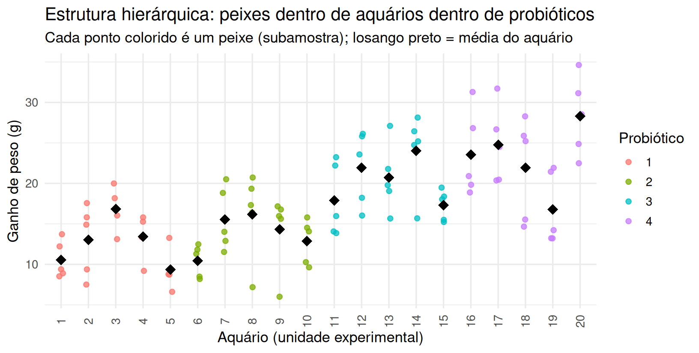
<p class="caption">(\#fig:plot-hierarquia-mojarra)Ganho de peso de cada peixe (pontos coloridos, um por subamostra) em cada aquário, com a média do aquário em losango preto e as cores indicando o probiótico. A dispersão entre losangos de mesma cor é o erro experimental (variação entre aquários); a dispersão dos pontos em torno do losango do próprio aquário é o erro de amostragem (variação entre peixes).</p>
</div>

Cada bloco de cor agrupa os aquários de um mesmo probiótico, e dentro de cada aquário os peixes
(pontos) se espalham em torno da média daquele aquário (losango) — a variação *entre* losangos
dentro de uma mesma cor é o erro experimental $\sigma_\delta^2$; a variação dos pontos *ao redor*
do losango do seu próprio aquário é o erro de amostragem $\sigma_\varepsilon^2$. O gráfico deixa
visível o que a seção seguinte formaliza: as 20 médias de aquário (os losangos) já parecem crescer
de probiótico 1 para 4, um padrão que a ANOVA a seguir testa formalmente usando apenas essas 20
médias como unidade de comparação — não os quase 100 pontos coloridos.

A mortalidade (3 peixes sem peso registrado no dia 45) deixa o desenho levemente desbalanceado,
com 4 ou 5 peixes por aquário em vez de exatamente 5. É o caso em que, como vimos acima, a ANOVA
clássica com `Error()` perde sua base algébrica e o R emite o aviso "Error() model is singular".
Há dois caminhos defensáveis: a ANOVA de um fator sobre as médias dos aquários (a ponte da seção
anterior, aproximada aqui porque $q$ varia pouco) e o modelo misto, que acomoda o desbalanceamento
de forma exata.

```{=html}
<div class="caixa-r"><strong>Uso do R</strong> — a análise da tilápia por médias de aquário e por modelo misto</div>
```


``` r
med_aq <- mojarra %>% group_by(probiotico, aquario) %>%
  summarise(ganho = mean(ganho), .groups = "drop")
summary(aov(ganho ~ probiotico, data = med_aq))          # DCA nas 20 médias de aquário
```

```
##             Df Sum Sq Mean Sq F value   Pr(>F)    
## probiotico   3  380.1  126.71   12.88 0.000155 ***
## Residuals   16  157.4    9.84                     
## ---
## Signif. codes:  0 '***' 0.001 '**' 0.01 '*' 0.05 '.' 0.1 ' ' 1
```

``` r
modelo_sub <- lmerTest::lmer(ganho ~ probiotico + (1 | aquario), data = mojarra)
anova(modelo_sub)                                        # gl do denominador por Satterthwaite
```

```
## Type III Analysis of Variance Table with Satterthwaite's method
##            Sum Sq Mean Sq NumDF  DenDF F value    Pr(>F)    
## probiotico 685.98  228.66     3 15.949  12.945 0.0001528 ***
## ---
## Signif. codes:  0 '***' 0.001 '**' 0.01 '*' 0.05 '.' 0.1 ' ' 1
```


As duas análises concordam, e o `aov()` com `Error()`, que aqui emite o aviso de singularidade,
também chegaria a um valor parecido ($F \approx 12.98$), porque o
desbalanceamento é pequeno. O ponto não é o número, e sim qual análise se pode defender quando $q$
varia: a do modelo misto. Em qualquer delas, o teste do efeito do probiótico usa a variação
**entre aquários dentro de probiótico** como erro (16 g.l.), não a variação entre peixes dentro de
aquário (77 g.l.); se o pesquisador tivesse usado esta última por engano, o denominador do teste
$F$ seria bem menor, inflando artificialmente a significância.

### Tamanho de amostra com subamostragem {#amostra-submuestreo}

Combinando $\delta_{ij}$ e $\varepsilon_{ijk}$, a variância efetiva da média de uma UE baseada em
$q$ subamostras é

$$
\text{Var}(\bar Y_{ij\cdot}) = \sigma_\delta^2 + \frac{\sigma_\varepsilon^2}{q}.
$$

Essa expressão tem uma implicação prática importante: como função de $q$, ela decresce, mas com
retornos decrescentes, aproximando-se assintoticamente de um **piso** igual a $\sigma_\delta^2$ —
nenhuma quantidade de subamostragem elimina a variação entre unidades experimentais. Se o
objetivo é reduzir a incerteza sobre o efeito do tratamento, aumentar $r$ (mais UEs) tem retorno
direto e ilimitado; aumentar $q$ (mais subamostras por UE) tem retorno limitado por esse piso.

```{=html}
<div class="caixa-r"><strong>Uso do R</strong> — retorno decrescente da subamostragem</div>
```


``` r
vc <- as.data.frame(lme4::VarCorr(modelo_sub))          # componentes estimados por REML
sigma2_delta <- vc$vcov[vc$grp == "aquario"]             # erro experimental
sigma2_eps   <- vc$vcov[vc$grp == "Residual"]            # erro de amostragem

tibble(q = c(1, 2, 5, 10, 20, 50)) %>%
  mutate(var_media_UE = sigma2_delta + sigma2_eps / q) %>%
  kable(digits = 2,
        caption = "Variância da média de uma UE conforme o número de subamostras q") %>%
  kable_styling(full_width = FALSE)
```

<table class="table" style="width: auto !important; margin-left: auto; margin-right: auto;">
<caption>(\#tab:retorno-decrescente-sub)Variância da média de uma UE conforme o número de subamostras q</caption>
 <thead>
  <tr>
   <th style="text-align:right;"> q </th>
   <th style="text-align:right;"> var_media_UE </th>
  </tr>
 </thead>
<tbody>
  <tr>
   <td style="text-align:right;"> 1 </td>
   <td style="text-align:right;"> 23.80 </td>
  </tr>
  <tr>
   <td style="text-align:right;"> 2 </td>
   <td style="text-align:right;"> 14.97 </td>
  </tr>
  <tr>
   <td style="text-align:right;"> 5 </td>
   <td style="text-align:right;"> 9.67 </td>
  </tr>
  <tr>
   <td style="text-align:right;"> 10 </td>
   <td style="text-align:right;"> 7.90 </td>
  </tr>
  <tr>
   <td style="text-align:right;"> 20 </td>
   <td style="text-align:right;"> 7.02 </td>
  </tr>
  <tr>
   <td style="text-align:right;"> 50 </td>
   <td style="text-align:right;"> 6.49 </td>
  </tr>
</tbody>
</table>


Com $\hat\sigma_\delta^2 \approx 6.1$ e $\hat\sigma_\varepsilon^2 \approx
17.7$, passar de $q=5$ (o desenho usado) para $q=20$ reduziria a variância da
média de UE em cerca de 27%
(de 9.67 para 7.02) — uma melhora real, mas limitada pelo piso
$\sigma_\delta^2$. Já passar de $r=5$ para $r=20$ aquários por tratamento (o mesmo fator de
aumento, $4\times$) reduziria a variância da **média de tratamento**, que decresce como
$\sigma_\delta^2/r$ sem nenhum piso, em exatos 75% ($1 - 1/4$) — quase o triplo da redução obtida
investindo o mesmo fator de aumento em subamostras. Sempre que o custo por UE adicional for
comparável ao custo por subamostra adicional, investir em mais UEs é a escolha mais eficiente —
uma recomendação de delineamento amostral que decorre diretamente da estrutura do modelo, não de
intuição.

## O modelo de efeitos aleatórios {#dca-efeitos-aleatorios}

Até aqui, os níveis do fator eram os níveis de interesse *per se*: o pesquisador queria comparar
justamente aquelas três condições de distração, ou justamente aqueles quatro probióticos. Há
situações, porém, em que os níveis usados no experimento são apenas **uma amostra aleatória** de
uma população maior e muito mais numerosa de níveis possíveis — e o interesse não está nos
níveis específicos sorteados, mas em **quanto** a fonte de variação que eles representam
contribui para a variabilidade total da resposta, de modo a generalizar para toda a população de
níveis.

```{=html}
<div class="caixa-aplicacao">
<strong>Aplicação — Psicologia: variabilidade entre estímulos sonoros de distração</strong><br>
Voltando ao experimento de distração sonora: existe, na prática, uma população enorme de
possíveis sons de distração (sirenes, conversas, tráfego, música...). Em vez de fixar um único
som, o pesquisador sorteia aleatoriamente <strong>5 clipes sonoros</strong> de um banco com
centenas de gravações e testa cada clipe em 8 novos voluntários (sorteados independentemente
entre clipes). A pergunta não é "o clipe 3 difere do clipe 1?" — não há interesse nesses clipes
específicos — mas sim "o tipo de som usado, de modo geral, contribui de forma relevante para a
variabilidade do tempo de reação?".
</div>
```

### Quando os tratamentos são uma amostra aleatória {#modelo-aleatorio}

O modelo tem a mesma forma algébrica de antes,

$$
Y_{ij} = \mu + \tau_i + \varepsilon_{ij}, \qquad i = 1,\ldots,t; \; j = 1,\ldots,n,
$$

mas agora $\tau_i \overset{iid}{\sim} N(0, \sigma_\tau^2)$ é **aleatório** (não mais sujeito à
restrição de soma zero), independente de $\varepsilon_{ij} \overset{iid}{\sim} N(0,\sigma^2)$.
Consequentemente, $\text{Var}(Y_{ij}) = \sigma_\tau^2 + \sigma^2$, e observações da mesma UE de
nível $i$ (aqui, do mesmo clipe sonoro) são correlacionadas: $\text{Corr}(Y_{ij}, Y_{ij'}) =
\sigma_\tau^2/(\sigma_\tau^2+\sigma^2)$ para $j \neq j'$ — o **coeficiente de correlação
intraclasse (ICC)**. Em notação matricial, isso é a mesma estrutura de blocos de simetria
composta $\mathbf{V}=\sigma_\tau^2\mathbf{Z}\mathbf{Z}'+\sigma^2\mathbf{I}_N$ da Seção
\@ref(modelo-submuestreo), agora com $\mathbf{Z}$ indicando o **nível sorteado** (o clipe), não a
UE — sinal de que subamostragem e efeitos aleatórios são duas instâncias do mesmo fenômeno
estatístico: observações que compartilham um rótulo aleatório deixam de ser independentes. A
hipótese de interesse muda de "as médias são iguais?" para "a variância entre níveis é nula?":

$$
H_0: \sigma_\tau^2 = 0 \quad \text{vs.} \quad H_1: \sigma_\tau^2 > 0.
$$

### ANOVA e componentes de variância {#anova-aleatorio}

A tabela de ANOVA é calculada exatamente como no modelo de efeitos fixos (as somas de quadrados
não mudam — a diferença está só na interpretação e nas esperanças de quadrados médios):

<table class="table" style="width: auto !important; margin-left: auto; margin-right: auto;">
<caption>(\#tab:tabela-anova-aleatoria-teorica)ANOVA do DCA de efeitos aleatórios balanceado</caption>
 <thead>
  <tr>
   <th style="text-align:left;"> Fonte de variação </th>
   <th style="text-align:left;"> G.l. </th>
   <th style="text-align:left;"> E[QM] </th>
  </tr>
 </thead>
<tbody>
  <tr>
   <td style="text-align:left;"> Entre níveis </td>
   <td style="text-align:left;"> $t-1$ </td>
   <td style="text-align:left;"> $\sigma^2 + n\sigma_\tau^2$ </td>
  </tr>
  <tr>
   <td style="text-align:left;"> Erro </td>
   <td style="text-align:left;"> $t(n-1)$ </td>
   <td style="text-align:left;"> $\sigma^2$ </td>
  </tr>
  <tr>
   <td style="text-align:left;"> Total </td>
   <td style="text-align:left;"> $tn-1$ </td>
   <td style="text-align:left;">  </td>
  </tr>
</tbody>
</table>

O teste $F = MS_{\text{Entre}}/MS_E$ é numericamente idêntico ao do modelo fixo, mas a estimativa
de interesse passa a ser o **componente de variância** $\sigma_\tau^2$, obtido pelo método dos
momentos a partir da tabela de ANOVA (método de Henderson tipo I):

$$
\hat\sigma^2 = MS_E, \qquad \hat\sigma_\tau^2 = \frac{MS_{\text{Entre}} - MS_E}{n}.
$$

```{=html}
<div class="caixa-r"><strong>Uso do R</strong> — variância entre clipes sonoros</div>
```


``` r
set.seed(77)
t_niveis <- 5; n_por_nivel <- 8
efeito_clipe <- rnorm(t_niveis, 0, sqrt(300))

dados_clipe <- tibble(
  clipe        = factor(rep(paste("Clipe", 1:t_niveis), each = n_por_nivel)),
  efeito       = rep(efeito_clipe, each = n_por_nivel),   # efeito ALEATÓRIO do clipe sorteado
  tempo_reacao = 520 + efeito + rnorm(t_niveis * n_por_nivel, 0, sqrt(1200))
)
glimpse(dados_clipe)
```

```
## Rows: 40
## Columns: 3
## $ clipe        <fct> Clipe 1, Clipe 1, Clipe 1, Clipe 1, Clipe 1, Clipe 1, Cli…
## $ efeito       <dbl> -9.520009, -9.520009, -9.520009, -9.520009, -9.520009, -9…
## $ tempo_reacao <dbl> 549.8946, 476.8590, 505.9134, 515.5454, 560.4078, 408.587…
```

``` r
# UE = voluntário (8 por clipe, sem subamostragem); "clipe" é o nível sorteado da população de sons

modelo_clipe <- aov(tempo_reacao ~ clipe, data = dados_clipe)
summary(modelo_clipe)
```

```
##             Df Sum Sq Mean Sq F value Pr(>F)  
## clipe        4  13379    3345   2.377 0.0706 .
## Residuals   35  49247    1407                 
## ---
## Signif. codes:  0 '***' 0.001 '**' 0.01 '*' 0.05 '.' 0.1 ' ' 1
```

``` r
tab_cl <- summary(modelo_clipe)[[1]]
MS_entre <- tab_cl[["Mean Sq"]][1]; MS_erro <- tab_cl[["Mean Sq"]][2]
sigma2_tau_hat <- (MS_entre - MS_erro) / n_por_nivel

tibble(
  Componente = c("Entre clipes (sigma_tau^2)", "Erro (sigma^2)", "ICC"),
  Estimativa = c(sigma2_tau_hat, MS_erro, sigma2_tau_hat / (sigma2_tau_hat + MS_erro))
) %>%
  kable(digits = 3, caption = "Componentes de variância estimados") %>%
  kable_styling(full_width = FALSE)
```

<table class="table" style="width: auto !important; margin-left: auto; margin-right: auto;">
<caption>(\#tab:dca-aleatorio-r)Componentes de variância estimados</caption>
 <thead>
  <tr>
   <th style="text-align:left;"> Componente </th>
   <th style="text-align:right;"> Estimativa </th>
  </tr>
 </thead>
<tbody>
  <tr>
   <td style="text-align:left;"> Entre clipes (sigma_tau^2) </td>
   <td style="text-align:right;"> 242.222 </td>
  </tr>
  <tr>
   <td style="text-align:left;"> Erro (sigma^2) </td>
   <td style="text-align:right;"> 1407.053 </td>
  </tr>
  <tr>
   <td style="text-align:left;"> ICC </td>
   <td style="text-align:right;"> 0.147 </td>
  </tr>
</tbody>
</table>

O ICC estimado de cerca de 0,15 sugere que a *identidade do clipe sonoro* explica uma fração
modesta, mas não desprezível, da variabilidade do tempo de reação — informação que o modelo de
efeitos fixos, ao tratar os cinco clipes como se fossem os únicos de interesse, simplesmente não
poderia fornecer.

<div class="figure" style="text-align: center">
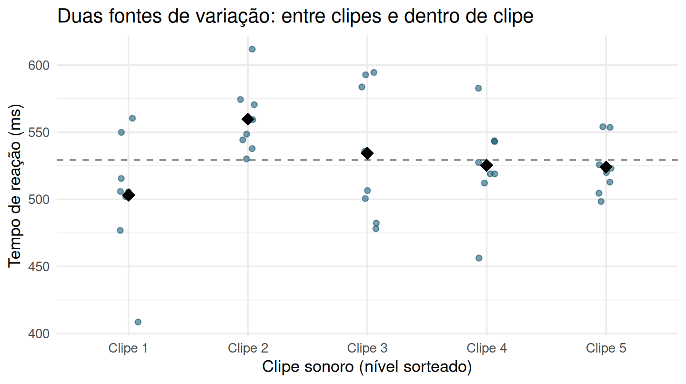
<p class="caption">(\#fig:plot-clipe-icc)Tempo de reação por clipe sonoro (pontos), com a média de cada clipe (losango preto). A dispersão dos losangos em torno da média geral estima sigma_tau^2 (entre clipes); a dispersão dos pontos em torno do próprio losango estima sigma^2 (dentro de clipe).</p>
</div>

A linha tracejada marca a média geral. Os losangos (médias de cada clipe) se espalham em torno
dela — essa dispersão *entre* losangos é o que $\hat\sigma_\tau^2$ mede — enquanto os pontos
individuais (voluntários) se espalham em torno do losango do seu próprio clipe — a dispersão
*dentro* de cada coluna, que $\hat\sigma^2$ mede. Note que nenhum clipe específico se destaca de
forma sistemática: é exatamente esse padrão, em que os cinco níveis observados parecem uma amostra
de uma população maior de clipes possíveis, que justifica tratá-los como efeitos aleatórios em vez
de fixos.

### Tamanho de amostra no modelo de efeitos aleatórios {#amostra-aleatorio}

O planejamento de $n$ (réplicas por nível) no modelo aleatório não usa a distribuição $F$ não
central da Seção \@ref(numero-replicas-dca) — em vez disso, sob $H_1$,

$$
\frac{F}{1 + n\gamma} \sim F_{t-1,\,t(n-1)} \quad \text{(central)}, \qquad
\gamma = \frac{\sigma_\tau^2}{\sigma^2},
$$

de modo que o poder do teste, para um dado $\gamma$ (a razão de variâncias que se deseja detectar)
e um número de níveis $t$ fixado de antemão, é

$$
\text{Poder}(n) = P\!\left(F_{t-1,\,t(n-1)} > \frac{F_{\alpha,\,t-1,\,t(n-1)}}{1+n\gamma}\right).
$$

```{=html}
<div class="caixa-r"><strong>Uso do R</strong> — poder em função de n, dado gamma</div>
```


``` r
gamma_alvo <- 300 / 1200   # sigma_tau^2 / sigma^2 assumido no planejamento
t_niveis   <- 5
alpha      <- 0.05

poder_n <- function(n) {
  Fc <- qf(1 - alpha, t_niveis - 1, t_niveis * (n - 1))
  pf(Fc / (1 + n * gamma_alvo), t_niveis - 1, t_niveis * (n - 1), lower.tail = FALSE)
}

tibble(n = c(8, 10, 15, 20, 25, 30)) %>%
  mutate(poder = map_dbl(n, poder_n)) %>%
  kable(digits = 3, caption = "Poder para detectar gamma = 0,25 com t = 5 níveis") %>%
  kable_styling(full_width = FALSE)
```

<table class="table" style="width: auto !important; margin-left: auto; margin-right: auto;">
<caption>(\#tab:amostra-aleatorio-r)Poder para detectar gamma = 0,25 com t = 5 níveis</caption>
 <thead>
  <tr>
   <th style="text-align:right;"> n </th>
   <th style="text-align:right;"> poder </th>
  </tr>
 </thead>
<tbody>
  <tr>
   <td style="text-align:right;"> 8 </td>
   <td style="text-align:right;"> 0.486 </td>
  </tr>
  <tr>
   <td style="text-align:right;"> 10 </td>
   <td style="text-align:right;"> 0.572 </td>
  </tr>
  <tr>
   <td style="text-align:right;"> 15 </td>
   <td style="text-align:right;"> 0.716 </td>
  </tr>
  <tr>
   <td style="text-align:right;"> 20 </td>
   <td style="text-align:right;"> 0.800 </td>
  </tr>
  <tr>
   <td style="text-align:right;"> 25 </td>
   <td style="text-align:right;"> 0.852 </td>
  </tr>
  <tr>
   <td style="text-align:right;"> 30 </td>
   <td style="text-align:right;"> 0.886 </td>
  </tr>
</tbody>
</table>

Com apenas 8 réplicas por clipe (o desenho do exemplo), o poder para detectar $\gamma=0{,}25$ é de
apenas cerca de 0,49 — seriam necessárias por volta de 20 réplicas por nível para atingir poder de
0,80. O modelo aleatório costuma exigir mais réplicas por nível do que o modelo fixo para o mesmo
poder nominal, porque a variabilidade entre níveis ($\sigma_\tau^2$) se soma à incerteza da
estimativa, em vez de ser um efeito fixo perfeitamente estimável.

## Verificação de pressupostos {#dca-pressupostos}

Toda a inferência das seções anteriores — testes $F$, intervalos de confiança, cálculos de
tamanho amostral — depende de três suposições sobre os erros do modelo: **normalidade**,
**variância constante** entre tratamentos (homocedasticidade) e **independência**. A
independência é garantida (ou não) pelo desenho — pela aleatorização e pela ausência de
dependências não modeladas, como a subamostragem tratada incorretamente — e não se verifica
diretamente nos dados; normalidade e homocedasticidade, por sua vez, são checáveis a partir dos
**resíduos** do modelo ajustado, $e_{ij} = Y_{ij} - \bar Y_{i\cdot}$ — em notação matricial da
Seção \@ref(matricial-dca), o vetor $\mathbf{e} = (\mathbf{I}_N-\mathbf{P}_X)\mathbf{Y}$, a
projeção de $\mathbf{Y}$ sobre o complemento ortogonal do espaço-coluna de $\mathbf{X}$. É
precisamente por $\mathbf{e}$ viver nesse subespaço, ortogonal aos valores ajustados, que ele
funciona como um proxy observável dos erros $\boldsymbol{\varepsilon}$ não observáveis.

```{=html}
<div class="caixa-aplicacao">
<strong>Aplicação — Psicologia: heterocedasticidade em tempos de reação</strong><br>
Tempos de reação são um exemplo clássico de variável que raramente é normal em escala bruta: a
distribuição costuma ser assimétrica à direita (a maioria das respostas é rápida, mas há uma
cauda de respostas bem mais lentas) e a variância tende a crescer com a média — sujeitos/condições
mais lentos não são apenas deslocados, são também mais variáveis. Simulamos abaixo um cenário
assim, com efeito multiplicativo (e não aditivo) do tipo de distração.
</div>
```

### Normalidade: gráfico Q-Q e testes formais {#normalidade-dca}


``` r
set.seed(1234)
condicao <- c("Nenhuma", "Sonora", "Visual")
n <- 15
media_base <- c(420, 470, 560)
cv <- 0.28  # erro multiplicativo: log(tempo) tem desvio-padrão constante nessa escala

dados_het <- tibble(
  sujeito  = 1:(3 * n),
  condicao = factor(rep(condicao, each = n), levels = condicao),
  tempo    = rep(media_base, each = n) * exp(rnorm(3 * n, 0, cv))
)

modelo_het <- aov(tempo ~ condicao, data = dados_het)
```

<div class="figure" style="text-align: center">
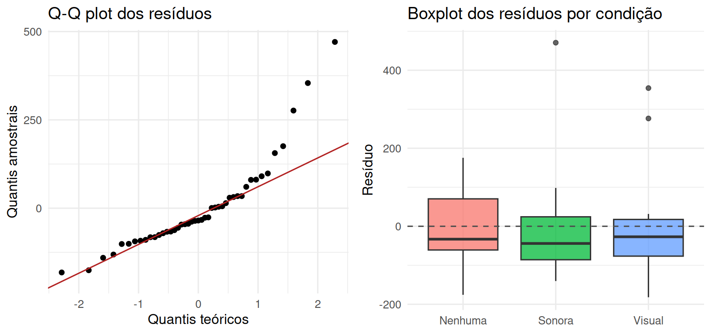
<p class="caption">(\#fig:qqplot-boxplot-dca)Diagnóstico dos resíduos do DCA de tempo de reação sob distração. Esquerda: gráfico quantil-quantil (Q-Q) de todos os resíduos contra a normal, com os pontos se afastando da reta na cauda superior (assimetria à direita). Direita: boxplot dos resíduos por condição; as caixas se alongam para cima e ficam mais altas de Nenhuma para Visual, antecipando variâncias diferentes entre os grupos.</p>
</div>

O gráfico à esquerda é o Q-Q plot de todos os resíduos combinados; o da direita — um diagnóstico
complementar, tão útil quanto o Q-Q e frequentemente esquecido — mostra a **distribuição dos
resíduos separada por tratamento**: além de revelar o mesmo afastamento de simetria (caixas
alongadas para cima em vez de centradas), ele já antecipa o próximo pressuposto a checar, porque a
altura das três caixas cresce visivelmente de "Nenhuma" para "Visual" — sinal de que a variância
não é a mesma nos três grupos, o assunto da próxima seção.

O afastamento sistemático da reta nas caudas do Q-Q — pontos acima da reta à direita, indicando uma
cauda mais pesada que a normal — é o padrão típico de assimetria à direita. O gráfico Q-Q é
sempre o primeiro diagnóstico: mais informativo que um único número, porque mostra *onde* (em
qual parte da distribuição) o desvio da normalidade ocorre. Ele é complementado, não substituído,
por um teste formal — mais útil como confirmação do que o olho já sugeriu do que como árbitro
único, sobretudo em amostras pequenas (baixo poder) ou muito grandes (rejeita quase sempre, por
desvios sem relevância prática):


``` r
shapiro.test(residuals(modelo_het))
```

```
## 
## 	Shapiro-Wilk normality test
## 
## data:  residuals(modelo_het)
## W = 0.84551, p-value = 2.812e-05
```

O teste de **Shapiro-Wilk** [@shapirowilk1965] rejeita a normalidade dos resíduos ($p < 0{,}001$),
consistente com o Q-Q plot.

### Homogeneidade de variância {#homocedasticidade-dca}

Antes do teste formal, o gráfico de **resíduos contra valores ajustados** é o diagnóstico visual
mais direto de heterocedasticidade: se a dispersão vertical dos pontos aumenta sistematicamente
da esquerda para a direita (grupos com médias maiores), a variância não é constante.


``` r
tibble(
  ajustado = fitted(modelo_het),
  residuo  = residuals(modelo_het),
  condicao = dados_het$condicao
) %>%
  ggplot(aes(ajustado, residuo, color = condicao)) +
  geom_hline(yintercept = 0, linetype = "dashed", color = "grey40") +
  geom_point(size = 2, alpha = 0.75) +
  labs(title = "Resíduos vs. valores ajustados", x = "Valor ajustado (média do grupo)",
       y = "Resíduo", color = "Condição") +
  theme_minimal(base_size = 13)
```

<div class="figure" style="text-align: center">
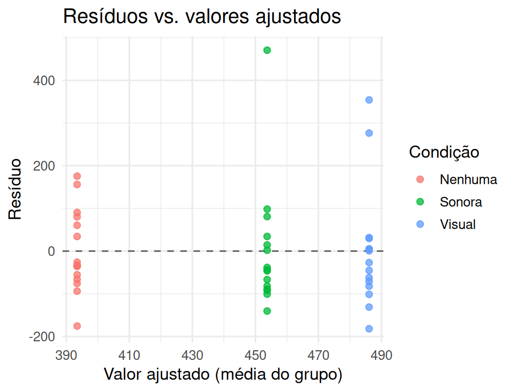
<p class="caption">(\#fig:residuos-ajustados-dca)Resíduos contra valores ajustados (as médias de cada condição) no DCA de tempo de reação. A dispersão dos resíduos aumenta da condição com menor média (Nenhuma) para a de maior média (Visual): o leque típico de um erro multiplicativo, em que a variância cresce com a média.</p>
</div>

O leque se abre visivelmente da esquerda (condição "Nenhuma", ajustado mais baixo) para a direita
(condição "Visual", ajustado mais alto): os resíduos ficam mais dispersos exatamente onde a média
é maior — a marca registrada de um erro multiplicativo, e o mesmo padrão que o teste de Levene, a
seguir, tentará (sem muito sucesso, dado o $n$ pequeno) capturar formalmente.


``` r
car::leveneTest(tempo ~ condicao, data = dados_het)
```

```
## Levene's Test for Homogeneity of Variance (center = median)
##       Df F value Pr(>F)
## group  2  0.1136 0.8929
##       42
```

O teste de **Levene** [@levene1960] (que compara os desvios absolutos em torno da mediana de cada
grupo, sendo por isso mais robusto a não normalidade do que o teste de Bartlett [-@bartlett1937])
não rejeita a homogeneidade
de variância aqui — mas isso não deve surpreender: com apenas 15 observações por grupo, o teste
tem pouco poder para detectar diferenças de variância moderadas, mesmo quando, por construção
(erro multiplicativo) e como o gráfico acima já deixou claro, a variância populacional realmente
cresce com a média. É outro lembrete de que ausência de significância não é evidência de que o
pressuposto vale — sobretudo em amostras pequenas, a inspeção gráfica continua indispensável.

### Independência: resíduos contra a ordem de execução {#independencia-dca}

A independência não se testa com um teste de normalidade ou de Levene, mas há um gráfico que
denuncia a violação mais comum na prática — e que a maioria das análises esquece: os **resíduos
contra a ordem em que as unidades foram medidas**. Se algo ligado ao tempo afeta a resposta (o
equipamento aquece ao longo do dia, o avaliador se cansa, a temperatura do laboratório muda), os
resíduos de unidades medidas em sequência ficam correlacionados, e o gráfico mostra uma tendência.

A simulação abaixo reproduz esse cenário: 40 unidades, 4 tratamentos, a **ordem de execução
sorteada**, e uma deriva linear de 0,28 unidades por medição (o equipamento aquecendo).


``` r
set.seed(21)
n_ord  <- 40
ordem  <- 1:n_ord
deriva <- 0.28 * ordem                                         # aquecimento do equipamento
trat_o <- factor(sample(rep(c("A", "B", "C", "D"), each = 10)))   # ordem de execução SORTEADA
y_o    <- 50 + as.numeric(trat_o) * 2 + deriva + rnorm(n_ord, 0, 2)
```

<div class="figure" style="text-align: center">
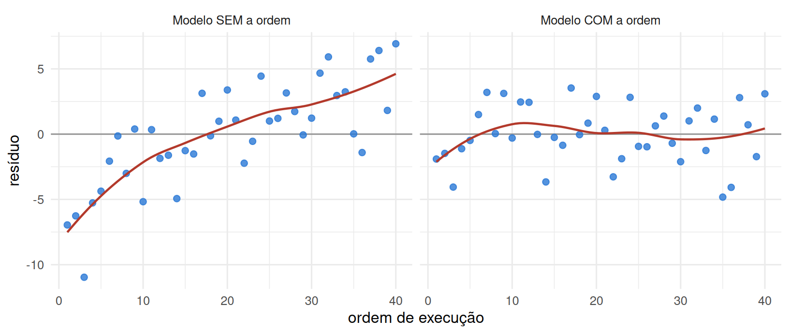
<p class="caption">(\#fig:plot-residuo-ordem)Resíduos contra a ordem de execução, com uma curva loess (vermelho). Esquerda: modelo só com o tratamento — a tendência crescente revela uma deriva ligada ao tempo que o modelo não contém. Direita: modelo com a ordem como covariável — o padrão desaparece.</p>
</div>

<table class="table" style="width: auto !important; margin-left: auto; margin-right: auto;">
<caption>(\#tab:ordem-anova-dca)Quadrado médio do erro e F do tratamento, sem e com a ordem de execução no modelo</caption>
 <thead>
  <tr>
   <th style="text-align:left;"> Modelo </th>
   <th style="text-align:right;"> QM do erro </th>
   <th style="text-align:right;"> F do tratamento </th>
  </tr>
 </thead>
<tbody>
  <tr>
   <td style="text-align:left;"> y ~ tratamento </td>
   <td style="text-align:right;"> 16.6 </td>
   <td style="text-align:right;"> 4.5 </td>
  </tr>
  <tr>
   <td style="text-align:left;"> y ~ ordem + tratamento </td>
   <td style="text-align:right;"> 5.5 </td>
   <td style="text-align:right;"> 13.7 </td>
  </tr>
</tbody>
</table>

À esquerda da Figura \@ref(fig:plot-residuo-ordem), a tendência é inequívoca; à direita, com a
ordem no modelo, ela desaparece. A Tabela \@ref(tab:ordem-anova-dca) mostra o que isso muda, e a
leitura tem três partes. Primeiro, como a ordem de execução foi **sorteada**, a deriva não favorece
nenhum tratamento: o teste sem a ordem é **válido**, apenas ruidoso, porque a deriva foi parar no
erro. Segundo, pondo a ordem no modelo, o erro encolhe e o $F$ cresce — mesmos dados, mais
precisão. Terceiro, se a ordem **não** tivesse sido sorteada (todos os A primeiro, depois os B...),
a deriva se confundiria com o tratamento, e nenhum modelo separaria uma coisa da outra — a
confusão do Capítulo 1. A aleatorização protege a validade; o gráfico de ordem revela o que
**bloquear** no próximo experimento (Capítulo 4).

### Transformações usuais {#transformacoes-dca}

Quando a normalidade e/ou a homocedasticidade falham, a estratégia clássica é **transformar** a
variável resposta para uma escala em que o modelo se comporte melhor, em vez de abandonar a ANOVA
por um método menos eficiente. As transformações mais comuns:

- **Logaritmo** ($\log Y$): indicada quando a variância cresce proporcionalmente ao *quadrado* da
  média (erro multiplicativo, como simulado acima) — muito comum em tempos, concentrações,
  contagens grandes e dados sempre positivos com assimetria à direita.
- **Raiz quadrada** ($\sqrt{Y}$, ou $\sqrt{Y+1/2}$ com contagens pequenas ou zeros): indicada
  quando a variância cresce proporcionalmente à média, o padrão típico de dados de **contagem**
  (número de erros, número de respostas corretas).
- **Box-Cox** [@boxcox1964]: uma família de transformações de potência que generaliza as duas anteriores,

$$
Y^{(\lambda)} = \begin{cases} \dfrac{Y^\lambda - 1}{\lambda}, & \lambda \neq 0 \\[4pt] \log Y, & \lambda = 0 \end{cases}
$$

  em que $\lambda$ é escolhido pelos dados, maximizando a log-verossimilhança perfilada do modelo
  ANOVA ajustado a $Y^{(\lambda)}$ para uma grade de valores de $\lambda$ (frequentemente entre
  $-2$ e $2$). $\lambda=1$ (sem transformar), $\lambda=0$ (log) e $\lambda=1/2$ (raiz quadrada)
  são casos particulares interpretáveis dessa família.

```{=html}
<div class="caixa-r"><strong>Uso do R</strong> — Box-Cox e verificação pós-transformação</div>
```


``` r
bc <- MASS::boxcox(modelo_het, plotit = TRUE, lambda = seq(-2, 2, by = 0.01))
```

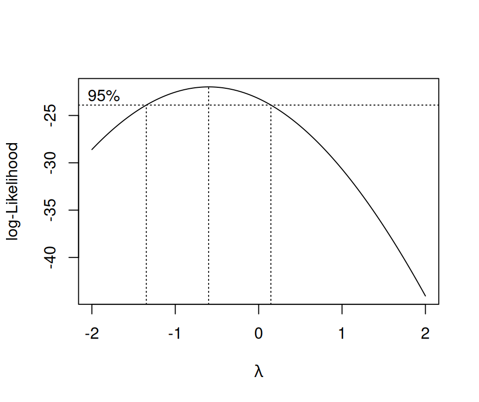

``` r
lambda_otimo <- bc$x[which.max(bc$y)]
lambda_otimo
```

```
## [1] -0.6
```

O valor que maximiza a verossimilhança perfilada é $\hat\lambda \approx -0.6$,
mas o intervalo de verossimilhança de 95% ao redor desse máximo é largo o bastante para incluir
$\lambda=0$ — ou seja, a transformação **logarítmica**, mais simples de interpretar (diferenças
na escala log correspondem a razões, não diferenças, na escala original), é estatisticamente
compatível com os dados e é a escolha usual nesse tipo de situação:


``` r
dados_het <- dados_het %>% mutate(log_tempo = log(tempo))
modelo_log <- aov(log_tempo ~ condicao, data = dados_het)

shapiro.test(residuals(modelo_log))
```

```
## 
## 	Shapiro-Wilk normality test
## 
## data:  residuals(modelo_log)
## W = 0.95569, p-value = 0.08363
```

``` r
car::leveneTest(log_tempo ~ condicao, data = dados_het)
```

```
## Levene's Test for Homogeneity of Variance (center = median)
##       Df F value Pr(>F)
## group  2  0.0259 0.9744
##       42
```

Depois de transformar, o teste de Shapiro-Wilk deixa de rejeitar a normalidade ($p \approx
0.084$) e a homogeneidade de variância
permanece não rejeitada — evidência de que a escala logarítmica é adequada para a ANOVA neste
conjunto de dados. As conclusões substantivas devem então ser reportadas na escala transformada
(por exemplo, "a condição visual aumenta o tempo de reação em um fator estimado de..."), com
cuidado ao traduzir de volta diferenças na escala log para razões multiplicativas na escala
original.

```{=html}
<div class="caixa-r"><strong>Uso do R</strong> — antes e depois da transformação, lado a lado</div>
```

<div class="figure" style="text-align: center">
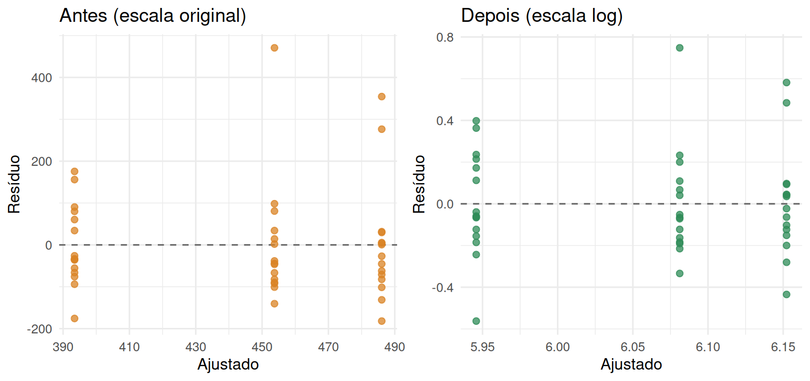
<p class="caption">(\#fig:antes-depois-transf)Resíduos contra valores ajustados antes (esquerda, escala original) e depois (direita, escala log) da transformação. O leque que se abria da esquerda para a direita na escala original desaparece na escala log, em que a dispersão é parecida nas três condições: a transformação estabilizou a variância.</p>
</div>

O leque de dispersão que crescia da esquerda para a direita no painel "Antes" desaparece no painel
"Depois": na escala log, a variabilidade dos resíduos é visualmente comparável entre as três
condições, sinal direto (mais informativo do que qualquer teste isolado) de que a transformação
cumpriu o que se propunha — estabilizar a variância sem distorcer a estrutura de tratamento que
estamos tentando comparar.

Reunindo as três camadas desenvolvidas até aqui para o DCA a uma via: a camada **algébrica**
(Seção \@ref(matricial-dca)) mostra que $SQ_{\text{Trat}}$ e $SQ_E$ são formas quadráticas em
projeções ortogonais, herdadas diretamente do Capítulo 2; a camada **causal**
(Seção \@ref(potencial-causal)) mostra que $\bar Y_i^{\cdot}-\bar Y_k^{\cdot}$ estima um efeito de
tratamento bem definido *independentemente* do modelo normal, só em função da aleatorização; e a
camada **distribucional** (Seções \@ref(anova-dca) a \@ref(transformacoes-dca)) usa a normalidade
para transformar essa base algébrica e causal em testes e ICs exatos em amostra finita — e para
diagnosticar quando essa última camada, especificamente, está em risco.

O restante deste capítulo trata de perguntas mais refinadas dentro do mesmo DCA — comparações
planejadas (contrastes), tendências ao longo de níveis quantitativos (polinômios ortogonais),
comparações múltiplas *a posteriori*, ajuste por covariáveis (análise de covariância, ANCOVA) e a alternativa não
paramétrica de Kruskal-Wallis quando nem mesmo as transformações da seção anterior bastam para
justificar o modelo normal.

## Contrastes e comparações múltiplas {#contrastes}

A ANOVA de um fator responde a uma pergunta agregada: *existe pelo menos uma diferença entre as
$t$ médias de tratamento?* Rejeitar $H_0: \mu_1 = \mu_2 = \cdots = \mu_t$ não diz **quais**
médias diferem, nem **em que direção**, nem **de quanto**. Contrastes e procedimentos de
comparação múltipla respondem exatamente a essas perguntas mais específicas — mas, como veremos,
fazê-lo com rigor exige cuidado extra, porque testar muitas hipóteses sobre o mesmo conjunto de
dados infla a chance de pelo menos um falso positivo. As três seções que seguem (contrastes,
comparações múltiplas e polinômios ortogonais) usam dois conjuntos de dados, mostrados por
inteiro antes de qualquer teste, e seguem sempre a mesma ordem: a teoria, os dados, a conta feita
à mão, a conferência no R, o gráfico e a interpretação.

Vale explicitar a leitura causal por trás desta seção, retomando o arcabouço de resultados
potenciais introduzido no Capítulo 1: cada unidade experimental tem $t$ resultados potenciais
$Y_i(1), \ldots, Y_i(t)$ — um por braço de tratamento —, dos quais só o do braço sorteado é
observado. Cada média $\mu_i = E[Y(i)]$ é a média populacional do resultado potencial sob o
tratamento $i$, e um contraste par a par $\mu_i - \mu_j$ é, literalmente, um **efeito médio de
tratamento** (ATE) entre os braços $i$ e $j$. Um contraste mais geral também é causal:
$\mu_1 - \tfrac13(\mu_2+\mu_3+\mu_4)$ é o ATE do braço 1 contra uma mistura uniforme dos braços
2, 3 e 4. Quando $t>2$, existem $\binom{t}{2}$ ATEs par a par possíveis — mais uma infinidade de
contrastes que agregam grupos de braços —, e é essa multiplicidade de efeitos causais estimados
simultaneamente sobre o mesmo experimento que faz emergir, de forma natural e não como artefato
técnico do procedimento estatístico, o problema de comparações múltiplas da próxima seção: cada
ATE testado isoladamente carrega seu próprio risco de falso positivo, e responder "algum desses
efeitos é diferente de zero?" exige um controle de erro que leve todos eles em conta
simultaneamente.


``` r
suppressPackageStartupMessages({
  library(tidyverse)
  library(kableExtra)
  library(broom)
  library(emmeans)
  library(multcomp)
  library(car)
  library(agricolae)
})
# formatação em português; fm() e fpm() são para números dentro de $...$ (MathJax)
fmt <- function(x, d = 1) formatC(x, format = "f", digits = d, big.mark = ".", decimal.mark = ",")
fp  <- function(p) ifelse(p < 0.0001, "< 0,0001", formatC(p, format = "f", digits = 4, decimal.mark = ","))
fm  <- function(x, d = 1) gsub(",", "{,}", fmt(x, d), fixed = TRUE)
fpm <- function(p) gsub(",", "{,}", fp(p), fixed = TRUE)

set.seed(2026)
config <- c("Nenhum", "Analytics", "Anúncios", "Combo")
n_por_grupo <- 10

# efeito verdadeiro (ms) de cada configuração de scripts de terceiros sobre o
# tempo de carregamento da página, em relação à configuração "Nenhum" (controle)
efeito_config <- c(Nenhum = 0, Analytics = 60, Anúncios = 140, Combo = 210)

dados_scripts <- tibble(
  pagina   = 1:(4 * n_por_grupo),
  config   = factor(rep(config, each = n_por_grupo), levels = config),
  tempo_ms = 900 + efeito_config[as.character(config)] +
    rnorm(4 * n_por_grupo, mean = 0, sd = 70)
)

mod_scripts <- aov(tempo_ms ~ config, data = dados_scripts)
```

```{=html}
<div class="caixa-aplicacao">
<strong>Aplicação — Ciência de dados: scripts de terceiros e tempo de carregamento</strong><br>
Uma equipe de engenharia web quer comparar quatro configurações de uma página de produto quanto
ao tempo de carregamento: <strong>Nenhum</strong> script de terceiros (controle),
<strong>Analytics</strong> apenas, <strong>Anúncios</strong> apenas, e <strong>Combo</strong>
(chat de suporte + anúncios). Dez carregamentos independentes são medidos em cada configuração
(<code>n = 10</code> por grupo, 40 no total), sob condições de rede controladas e em ordem sorteada
(<strong>UE = carregamento</strong>). Antes da coleta, a equipe registrou três perguntas: (i) scripts
de terceiros atrasam a página? (ii) se for para ter um script, o de analytics é o mais leve?
(iii) acrescentar o chat aos anúncios custa caro?
</div>
```

Os 40 carregamentos foram feitos numa ordem sorteada, na mesma máquina e na mesma rede. Comparar,
em vez disso, sites reais que usam ou não anúncios e chat misturaria scripts com tipo de site
(sites com anúncios tendem a ser maiores), e nenhuma correção para comparações múltiplas
removeria essa mistura.

### Os dados e a ANOVA global {#dados-scripts}

A Tabela \@ref(tab:c3c-dados-scripts) mostra os 40 tempos medidos. Cada coluna é um tratamento e
cada linha, uma réplica; a numeração da réplica não tem significado (não há pareamento entre o
carregamento 3 de "Nenhum" e o carregamento 3 de "Combo"), é só uma forma compacta de dispor os
dados de um DCA.

<table class="table" style="width: auto !important; margin-left: auto; margin-right: auto;">
<caption>(\#tab:c3c-dados-scripts)Os 40 tempos de carregamento (ms), por configuração de scripts</caption>
 <thead>
  <tr>
   <th style="text-align:right;"> Réplica </th>
   <th style="text-align:right;"> Nenhum </th>
   <th style="text-align:right;"> Analytics </th>
   <th style="text-align:right;"> Anúncios </th>
   <th style="text-align:right;"> Combo </th>
  </tr>
 </thead>
<tbody>
  <tr>
   <td style="text-align:right;"> 1 </td>
   <td style="text-align:right;"> 936 </td>
   <td style="text-align:right;"> 931 </td>
   <td style="text-align:right;"> 1017 </td>
   <td style="text-align:right;"> 1073 </td>
  </tr>
  <tr>
   <td style="text-align:right;"> 2 </td>
   <td style="text-align:right;"> 824 </td>
   <td style="text-align:right;"> 909 </td>
   <td style="text-align:right;"> 1028 </td>
   <td style="text-align:right;"> 1122 </td>
  </tr>
  <tr>
   <td style="text-align:right;"> 3 </td>
   <td style="text-align:right;"> 910 </td>
   <td style="text-align:right;"> 944 </td>
   <td style="text-align:right;"> 943 </td>
   <td style="text-align:right;"> 1092 </td>
  </tr>
  <tr>
   <td style="text-align:right;"> 4 </td>
   <td style="text-align:right;"> 894 </td>
   <td style="text-align:right;"> 944 </td>
   <td style="text-align:right;"> 1143 </td>
   <td style="text-align:right;"> 1133 </td>
  </tr>
  <tr>
   <td style="text-align:right;"> 5 </td>
   <td style="text-align:right;"> 853 </td>
   <td style="text-align:right;"> 782 </td>
   <td style="text-align:right;"> 1043 </td>
   <td style="text-align:right;"> 1123 </td>
  </tr>
  <tr>
   <td style="text-align:right;"> 6 </td>
   <td style="text-align:right;"> 724 </td>
   <td style="text-align:right;"> 1054 </td>
   <td style="text-align:right;"> 1174 </td>
   <td style="text-align:right;"> 1192 </td>
  </tr>
  <tr>
   <td style="text-align:right;"> 7 </td>
   <td style="text-align:right;"> 849 </td>
   <td style="text-align:right;"> 1003 </td>
   <td style="text-align:right;"> 1161 </td>
   <td style="text-align:right;"> 1152 </td>
  </tr>
  <tr>
   <td style="text-align:right;"> 8 </td>
   <td style="text-align:right;"> 829 </td>
   <td style="text-align:right;"> 975 </td>
   <td style="text-align:right;"> 1044 </td>
   <td style="text-align:right;"> 1048 </td>
  </tr>
  <tr>
   <td style="text-align:right;"> 9 </td>
   <td style="text-align:right;"> 908 </td>
   <td style="text-align:right;"> 904 </td>
   <td style="text-align:right;"> 1085 </td>
   <td style="text-align:right;"> 1150 </td>
  </tr>
  <tr>
   <td style="text-align:right;"> 10 </td>
   <td style="text-align:right;"> 867 </td>
   <td style="text-align:right;"> 1008 </td>
   <td style="text-align:right;"> 1161 </td>
   <td style="text-align:right;"> 1052 </td>
  </tr>
</tbody>
</table>

<table class="table" style="width: auto !important; margin-left: auto; margin-right: auto;">
<caption>(\#tab:c3b-scripts-tab)Resumo do tempo de carregamento (ms) por configuração de scripts</caption>
 <thead>
  <tr>
   <th style="text-align:left;"> Configuração </th>
   <th style="text-align:right;"> n </th>
   <th style="text-align:right;"> Média </th>
   <th style="text-align:right;"> DP </th>
   <th style="text-align:right;"> Mín. </th>
   <th style="text-align:right;"> Máx. </th>
  </tr>
 </thead>
<tbody>
  <tr>
   <td style="text-align:left;"> Nenhum </td>
   <td style="text-align:right;"> 10 </td>
   <td style="text-align:right;"> 859.4 </td>
   <td style="text-align:right;"> 60.3 </td>
   <td style="text-align:right;"> 723.9 </td>
   <td style="text-align:right;"> 936.4 </td>
  </tr>
  <tr>
   <td style="text-align:left;"> Analytics </td>
   <td style="text-align:right;"> 10 </td>
   <td style="text-align:right;"> 945.5 </td>
   <td style="text-align:right;"> 74.6 </td>
   <td style="text-align:right;"> 781.7 </td>
   <td style="text-align:right;"> 1054.3 </td>
  </tr>
  <tr>
   <td style="text-align:left;"> Anúncios </td>
   <td style="text-align:right;"> 10 </td>
   <td style="text-align:right;"> 1079.9 </td>
   <td style="text-align:right;"> 77.4 </td>
   <td style="text-align:right;"> 942.6 </td>
   <td style="text-align:right;"> 1173.6 </td>
  </tr>
  <tr>
   <td style="text-align:left;"> Combo </td>
   <td style="text-align:right;"> 10 </td>
   <td style="text-align:right;"> 1113.6 </td>
   <td style="text-align:right;"> 46.7 </td>
   <td style="text-align:right;"> 1047.6 </td>
   <td style="text-align:right;"> 1191.5 </td>
  </tr>
</tbody>
</table>

<div class="figure" style="text-align: center">
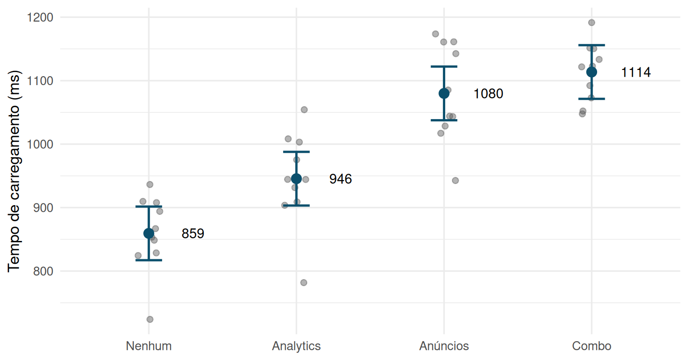
<p class="caption">(\#fig:c3c-plot-dados-scripts)Tempos de carregamento individuais (pontos cinza) e média de cada configuração com intervalo de confiança de 95% calculado com o QME combinado da ANOVA (36 gl), em azul.</p>
</div>

O gráfico já sugere a ordenação Nenhum < Analytics < {Anúncios ≈ Combo}, e os desvios-padrão
parecidos (de 47 a 77 ms) são compatíveis com a
homocedasticidade que o $QME$ combinado pressupõe. A ANOVA global quantifica o que se vê:


``` r
tab_aov_s <- tidy(mod_scripts)
tab_aov_s
```

```
## # A tibble: 2 × 6
##   term         df   sumsq  meansq statistic   p.value
##   <chr>     <dbl>   <dbl>   <dbl>     <dbl>     <dbl>
## 1 config        3 420290. 140097.      32.2  2.67e-10
## 2 Residuals    36 156479.   4347.      NA   NA
```

``` r
sq_trat_s <- tab_aov_s$sumsq[1]; sq_tot_s <- sum(tab_aov_s$sumsq)
```

Com $F = 32{,}23$ em (3, 36) gl, não há dúvida razoável de que as
configurações diferem; $R^2 = SQ_{\text{Trat}}/SQ_{\text{Total}} = 0{,}73$, ou seja,
a configuração explica cerca de 73% da variação dos tempos. O
desvio-padrão de um carregamento dentro de uma configuração é $\sqrt{QME} = 65{,}9$ ms, e o
erro-padrão de uma diferença entre duas médias é $\sqrt{2QME/10} = 29{,}5$ ms — a
"unidade de ruído" contra a qual todas as comparações desta seção serão medidas. Até aqui sabemos
**que** há diferença; as subseções seguintes respondem **onde**, **quanto** e **com que garantia**.

### Definição, esperança e variância de um contraste

Sejam $\mu_1, \ldots, \mu_t$ as médias populacionais dos $t$ tratamentos. Um **contraste** é
qualquer combinação linear

$$L = \sum_{i=1}^{t} c_i \mu_i, \qquad \text{sujeita a} \qquad \sum_{i=1}^{t} c_i = 0.$$

A restrição $\sum c_i = 0$ é o que distingue um contraste de uma combinação linear qualquer: ela
garante que $L$ mede uma **diferença** entre grupos (ou grupos de grupos), não um nível geral.
Formalmente, somar a mesma constante $k$ a todas as médias não altera $L$, porque
$\sum c_i(\mu_i + k) = L + k\sum c_i = L$ — um contraste é invariante ao nível geral da resposta,
exatamente como deve ser uma comparação. Com os dados, $L$ é estimado por
$\hat L = \sum_{i=1}^t c_i \bar y_{i\cdot}$, trocando cada $\mu_i$ pela média amostral do respectivo
grupo. Como as médias amostrais dos $t$ grupos são independentes (unidades experimentais
diferentes) e $E(\bar y_{i\cdot}) = \mu_i$,

$$E(\hat L) = \sum_{i=1}^t c_i\, E(\bar y_{i\cdot}) = \sum_{i=1}^t c_i \mu_i = L,$$

ou seja, $\hat L$ é um estimador não viesado de $L$. Assumindo variância homogênea $\sigma^2$
entre tratamentos (o mesmo pressuposto de homocedasticidade da ANOVA) e $n_i$ réplicas no
tratamento $i$,

$$\mathrm{Var}(\hat L) = \sum_{i=1}^t c_i^2\, \mathrm{Var}(\bar y_{i\cdot}) = \sigma^2 \sum_{i=1}^t \frac{c_i^2}{n_i},$$

que se reduz a $\mathrm{Var}(\hat L) = \dfrac{\sigma^2}{n}\displaystyle\sum_{i=1}^t c_i^2$ no caso
balanceado ($n_i = n$ para todo $i$), o caso mais comum na prática e o único em que os
coeficientes $c_i$ tabulados na literatura clássica se aplicam diretamente.

Cada pergunta científica se traduz num vetor de coeficientes pela mesma receita: coeficientes
**positivos** nos tratamentos de um lado da pergunta, **negativos** nos do outro lado, **zero** nos
que não participam, e soma zero. Para as três perguntas registradas no protocolo do exemplo:

| Pergunta | $L$ | $(c_1,c_2,c_3,c_4)$ |
|---|---|:-:|
| Scripts de terceiros atrasam a página? | $\mu_1-\tfrac13(\mu_2+\mu_3+\mu_4)$ | $(3,-1,-1,-1)$ |
| Analytics é mais leve que os que têm anúncio? | $\mu_2-\tfrac12(\mu_3+\mu_4)$ | $(0,2,-1,-1)$ |
| O chat acrescenta tempo aos anúncios? | $\mu_3-\mu_4$ | $(0,0,1,-1)$ |

Multiplicar todos os $c_i$ por uma constante não muda o teste (só a escala de $\hat L$); por isso
costuma-se usar inteiros, $(3,-1,-1,-1)$ em vez de $(1,-\tfrac13,-\tfrac13,-\tfrac13)$.

### Normalização e intervalo de confiança {#contraste-normalizado}

A conveniência dos inteiros tem um custo de leitura: com $(3,-1,-1,-1)$, $\hat L$ é **três vezes**
a diferença entre a média do controle e a média das demais, e não essa diferença. Para
interpretar um contraste na escala da resposta, divide-se cada coeficiente pela soma dos
coeficientes positivos,

$$c_i^{*} = \frac{c_i}{\sum_{c_j>0} c_j} \qquad\Longrightarrow\qquad \hat L^{*} = \bar m_{+} - \bar m_{-},$$

em que $\bar m_{+}$ e $\bar m_{-}$ são as médias simples das médias de tratamento de cada lado da
pergunta. O contraste normalizado $\hat L^{*}$ está em ms, e seu intervalo de confiança de
$100(1-\alpha)\%$ — válido para **um** contraste especificado antes dos dados — é

$$\hat L^{*} \pm t_{\alpha/2,\;gl_{\text{erro}}}\sqrt{QME\sum_{i=1}^t \frac{(c_i^{*})^2}{n_i}}.$$

A estatística $t$, o $F$ e o p-valor são **idênticos** com $c_i$ ou $c_i^{*}$ (a constante se cancela
entre numerador e denominador); só a leitura muda. A recomendação prática é reportar sempre
$\hat L^{*}$ com seu intervalo: o teste diz **se** há efeito, o intervalo diz **quanto**, e as
duas informações são necessárias para uma decisão.

### Soma de quadrados de um contraste e sua distribuição

A soma de quadrados atribuível a um contraste é

$$SQ_L = \frac{\hat L^{\,2}}{\sum_{i=1}^t c_i^2/n_i},$$

com **1 grau de liberdade**, qualquer que seja o número de tratamentos $t$ — um contraste é,
por construção, uma comparação de uma única dimensão. Sob $H_0: L = 0$ e o modelo usual de
ANOVA com erros $\varepsilon_{ij} \sim N(0,\sigma^2)$ independentes,

$$F = \frac{SQ_L}{QME} \sim F_{1,\, gl_{\text{erro}}},$$

onde $QME$ é o quadrado médio do erro da ANOVA completa. Essa estatística é equivalente a um
teste $t$ com $gl_{\text{erro}}$ graus de liberdade ($t^2 = F$), que é a forma mais comum de
reportar um contraste isolado:

$$t = \frac{\hat L}{\sqrt{QME \sum_i c_i^2/n_i}}.$$

Um contraste é, portanto, um teste com 1 grau de liberdade **encaixado dentro** da ANOVA — mais
específico e, em geral, mais poderoso do que o teste F global de $t-1$ graus de liberdade, desde
que a pergunta específica seja definida **antes** de olhar os dados. A intuição do ganho de poder
é geométrica: se o efeito verdadeiro está concentrado numa única direção do espaço de
tratamentos, o $F$ global o dilui por $t-1$ graus de liberdade, enquanto o contraste aponta direto
para aquela direção e não "paga" pelas outras $t-2$.

### Notação matricial: contraste como forma linear e quadrática

Recorde o modelo linear do Capítulo 2 (Seção \@ref(modelo-geral)) e sua parametrização de médias
de casela (*cell-means*) para o DCA: $\mathbf Y = \mathbf X\boldsymbol\mu + \boldsymbol\varepsilon$,
em que $\mathbf X$ é a matriz $N\times t$ de indicadoras de tratamento (posto coluna completo
nessa parametrização) e $\mathbf X'\mathbf X = \mathrm{diag}(n_1,\ldots,n_t)$. Nessa notação, um
contraste é a forma linear

$$L = \boldsymbol\lambda'\boldsymbol\mu, \qquad \boldsymbol\lambda = (c_1,\ldots,c_t)', \qquad \mathbf 1'\boldsymbol\lambda = 0,$$

estimado por $\hat L = \boldsymbol\lambda'\hat{\boldsymbol\mu} = \boldsymbol\lambda'\bar{\mathbf y}$.
Como $\boldsymbol\lambda'\boldsymbol\mu$ é uma combinação linear estimável (Capítulo 2, Seção
\@ref(estimabilidade): toda combinação linear é estimável quando $\mathbf X$ tem posto completo),
o teorema de Gauss-Markov (Capítulo 2, Seção \@ref(gauss-markov)) garante que $\hat L$ é BLUE, com
variância

$$\mathrm{Var}(\hat L) = \sigma^2\,\boldsymbol\lambda'(\mathbf X'\mathbf X)^{-1}\boldsymbol\lambda = \sigma^2\sum_{i=1}^t \frac{c_i^2}{n_i},$$

que reproduz exatamente o resultado escalar da subseção anterior — agora como caso particular de
$\mathrm{Cov}(\hat{\boldsymbol\beta}) = \sigma^2(\mathbf X'\mathbf X)^{-1}$.

A soma de quadrados do contraste é a forma quadrática de posto 1

$$SQ_L = (\boldsymbol\lambda'\hat{\boldsymbol\mu})\,\big[\boldsymbol\lambda'(\mathbf X'\mathbf X)^{-1}\boldsymbol\lambda\big]^{-1}\,(\boldsymbol\lambda'\hat{\boldsymbol\mu}) \;=\; \mathbf Y'\mathbf A_{\boldsymbol\lambda}\mathbf Y,$$

em que $\mathbf A_{\boldsymbol\lambda}$ é simétrica e idempotente, de posto 1 — uma projeção sobre
a direção $\mathbf X(\mathbf X'\mathbf X)^{-1}\boldsymbol\lambda$ dentro do subespaço de
tratamento. Pelo teorema sobre formas quadráticas idempotentes do Capítulo 2 (Seção
\@ref(formas-quadraticas)), $SQ_L/\sigma^2 \sim \chi^2_1$ sob $H_0: L=0$ — a mesma conclusão
obtida escalarmente acima, agora como caso particular de um resultado geral, não uma coincidência.

Essa leitura geométrica também explica *por que* contrastes ortogonais se comportam tão bem: um
conjunto de $t-1$ contrastes ortogonais $\boldsymbol\lambda_1,\ldots,\boldsymbol\lambda_{t-1}$
corresponde a $t-1$ projeções de posto 1 mutuamente ortogonais, cuja soma reconstrói exatamente a
projeção sobre todo o subespaço de tratamento:

$$\sum_{k=1}^{t-1} \mathbf A_{\boldsymbol\lambda_k} \;=\; \mathbf P_X - \mathbf P_{\mathbf 1},$$

a mesma diferença de projeções do princípio da soma de quadrados extra (Capítulo 2, Seção
\@ref(modelo-particionado)), com $\mathbf X_1 = \mathbf 1$ (só o intercepto). É essa identidade —
uma soma de $t-1$ projeções ortogonais de posto 1 reconstruindo a projeção de posto $t-1$ — que,
pelo teorema de Cochran citado no Capítulo 2, garante que as $t-1$ **somas de quadrados**
$SQ_{L_1},\dots,SQ_{L_{t-1}}$ são mutuamente independentes, e independentes de $SQ_E$. Note com
cuidado o que isso **não** diz: as estatísticas $F_k = SQ_{L_k}/QM_E$ compartilham o mesmo
denominador aleatório $QM_E$ e, por isso, **não** são independentes entre si, ainda que seus
numeradores sejam. A distinção é formalizada a seguir.

### Contrastes ortogonais

Dois contrastes com coeficientes $\{c_i\}$ e $\{d_i\}$ são **ortogonais** se

$$\sum_{i=1}^t \frac{c_i d_i}{n_i} = 0 \qquad \Big(\text{balanceado: } \sum_{i=1}^t c_i d_i = 0\Big).$$

Para $t$ tratamentos existem no máximo $t - 1$ contrastes mutuamente ortogonais. A propriedade
notável de um **conjunto completo** de $t-1$ contrastes ortogonais é que suas somas de quadrados
particionam exatamente a soma de quadrados de tratamento, sem sobra e sem sobreposição:

$$SQ_{\text{Trat}} = \sum_{k=1}^{t-1} SQ_{L_k}, \qquad gl_{\text{Trat}} = \sum_{k=1}^{t-1} 1 = t-1.$$

Sob normalidade, os numeradores $SQ_{L_k}$ são independentes entre si e do $QME$, como visto na
subseção anterior; os testes $F_k$ só não são independentes porque dividem pelo mesmo $QME$
(com muitos graus de liberdade de erro essa dependência é fraca). Isso torna contrastes ortogonais
a ferramenta natural para decompor a variação entre tratamentos em perguntas específicas,
planejadas antes da coleta de dados: cada pergunta recebe sua própria "fatia" de $SQ_{\text{Trat}}$,
sem que a informação de uma contamine a de outra.

Para os quatro grupos do exemplo de carregamento de página, as três perguntas do protocolo formam
um conjunto completo de contrastes ortogonais: os produtos internos são
$L_1\cdot L_2 = 0-2+1+1 = 0$, $L_1\cdot L_3 = 0+0-1+1 = 0$ e $L_2\cdot L_3 = 0+0-1+1 = 0$.

<table class="table" style="width: auto !important; margin-left: auto; margin-right: auto;">
<caption>(\#tab:c3b-contrastes-tab)Um conjunto de 3 contrastes ortogonais (3 graus de liberdade = $gl_{Trat}$)</caption>
 <thead>
  <tr>
   <th style="text-align:left;"> Contraste </th>
   <th style="text-align:right;"> Nenhum </th>
   <th style="text-align:right;"> Analytics </th>
   <th style="text-align:right;"> Anúncios </th>
   <th style="text-align:right;"> Combo </th>
  </tr>
 </thead>
<tbody>
  <tr>
   <td style="text-align:left;"> $L_1$: Nenhum vs. demais </td>
   <td style="text-align:right;"> 3 </td>
   <td style="text-align:right;"> -1 </td>
   <td style="text-align:right;"> -1 </td>
   <td style="text-align:right;"> -1 </td>
  </tr>
  <tr>
   <td style="text-align:left;"> $L_2$: Analytics vs. (Anúncios, Combo) </td>
   <td style="text-align:right;"> 0 </td>
   <td style="text-align:right;"> 2 </td>
   <td style="text-align:right;"> -1 </td>
   <td style="text-align:right;"> -1 </td>
  </tr>
  <tr>
   <td style="text-align:left;"> $L_3$: Anúncios vs. Combo </td>
   <td style="text-align:right;"> 0 </td>
   <td style="text-align:right;"> 0 </td>
   <td style="text-align:right;"> 1 </td>
   <td style="text-align:right;"> -1 </td>
  </tr>
</tbody>
</table>

### Um contraste calculado à mão {#contraste-a-mao}

Antes de delegar ao R, vale fazer uma conta completa. A Tabela \@ref(tab:c3c-l1-mao) organiza o
cálculo de $L_1$ (controle contra a média das três configurações com script).

<table class="table" style="width: auto !important; margin-left: auto; margin-right: auto;">
<caption>(\#tab:c3c-l1-mao)Cálculo de $\hat L_1$ e de sua variância, passo a passo</caption>
 <thead>
  <tr>
   <th style="text-align:left;"> Configuração </th>
   <th style="text-align:right;"> $\bar y_{i\cdot}$ </th>
   <th style="text-align:right;"> $c_i$ </th>
   <th style="text-align:right;"> $c_i\bar y_{i\cdot}$ </th>
   <th style="text-align:right;"> $c_i^2/n_i$ </th>
  </tr>
 </thead>
<tbody>
  <tr>
   <td style="text-align:left;"> Nenhum </td>
   <td style="text-align:right;"> 859,38 </td>
   <td style="text-align:right;"> 3 </td>
   <td style="text-align:right;"> 2.578,14 </td>
   <td style="text-align:right;"> 0,9 </td>
  </tr>
  <tr>
   <td style="text-align:left;"> Analytics </td>
   <td style="text-align:right;"> 945,53 </td>
   <td style="text-align:right;"> -1 </td>
   <td style="text-align:right;"> -945,53 </td>
   <td style="text-align:right;"> 0,1 </td>
  </tr>
  <tr>
   <td style="text-align:left;"> Anúncios </td>
   <td style="text-align:right;"> 1.079,88 </td>
   <td style="text-align:right;"> -1 </td>
   <td style="text-align:right;"> -1.079,88 </td>
   <td style="text-align:right;"> 0,1 </td>
  </tr>
  <tr>
   <td style="text-align:left;"> Combo </td>
   <td style="text-align:right;"> 1.113,62 </td>
   <td style="text-align:right;"> -1 </td>
   <td style="text-align:right;"> -1.113,62 </td>
   <td style="text-align:right;"> 0,1 </td>
  </tr>
  <tr>
   <td style="text-align:left;font-weight: bold;"> Soma </td>
   <td style="text-align:right;font-weight: bold;">  </td>
   <td style="text-align:right;font-weight: bold;"> 0 </td>
   <td style="text-align:right;font-weight: bold;"> -560,89 </td>
   <td style="text-align:right;font-weight: bold;"> 1,2 </td>
  </tr>
</tbody>
</table>

Daí: $\hat L_1 = -560{,}9$; $EP(\hat L_1) = \sqrt{QME \times 1{,}2} = \sqrt{4.346{,}6 \times 1{,}2} = 72{,}2$;
$t = -7{,}77$; $SQ_{L_1} = \hat L_1^2/1{,}2 = 262.161$ e
$F = SQ_{L_1}/QME = 60{,}3 = t^2$, com (1, 36) gl. Na escala de ms, dividindo
pela soma dos coeficientes positivos (3), $\hat L_1^{*} = -187{,}0$ ms: sem scripts, a página
carrega em média 187 ms mais rápido que a média das três configurações com script.

```{=html}
<div class="caixa-r"><strong>Uso do R</strong> — os três contrastes: estimativa normalizada, intervalo, teste e partição de $SQ_{Trat}$</div>
```


``` r
gl_erro <- summary(mod_scripts)[[1]]["Residuals", "Df"]

coefs <- list(
  L1 = c(Nenhum = 3, Analytics = -1, `Anúncios` = -1, Combo = -1),
  L2 = c(Nenhum = 0, Analytics =  2, `Anúncios` = -1, Combo = -1),
  L3 = c(Nenhum = 0, Analytics =  0, `Anúncios` =  1, Combo = -1)
)

resultado_contrastes <- map_dfr(names(coefs), function(nm) {
  cc   <- coefs[[nm]][names(medias)]
  cs   <- cc / sum(cc[cc > 0])                 # coeficientes normalizados: escala de ms
  Lhat <- sum(cs * medias)
  ep   <- sqrt(qme * sum(cs^2 / ns))
  SQ   <- sum(cc * medias)^2 / sum(cc^2 / ns)  # igual com cc ou cs
  tibble(contraste = nm, L_ms = Lhat, ep = ep,
         li = Lhat - qt(0.975, gl_erro) * ep, ls = Lhat + qt(0.975, gl_erro) * ep,
         SQ = SQ, F = SQ / qme, p_valor = pf(SQ / qme, 1, gl_erro, lower.tail = FALSE))
})
resultado_contrastes
```

```
## # A tibble: 3 × 8
##   contraste   L_ms    ep     li     ls      SQ     F       p_valor
##   <chr>      <dbl> <dbl>  <dbl>  <dbl>   <dbl> <dbl>         <dbl>
## 1 L1        -187.   24.1 -236.  -138.  262161. 60.3  0.00000000333
## 2 L2        -151.   25.5 -203.   -99.4 152438. 35.1  0.000000883  
## 3 L3         -33.7  29.5  -93.5   26.1   5691.  1.31 0.260
```

``` r
# verificação: a soma das SQ dos 3 contrastes ortogonais reproduz SQ_Trat da ANOVA
sum(resultado_contrastes$SQ)
```

```
## [1] 420290.4
```

``` r
summary(mod_scripts)[[1]]["config", "Sum Sq"]
```

```
## [1] 420290.4
```

A soma das três somas de quadrados dos contrastes reproduz exatamente a soma de quadrados de
tratamento da ANOVA — confirmando a partição. A Figura \@ref(fig:c3c-plot-contrastes-ic) mostra os
três contrastes normalizados com seus intervalos, e a Figura \@ref(fig:c3c-plot-contrastes-sq),
como cada um se apropria de uma fatia de $SQ_{\text{Trat}}$.

<div class="figure" style="text-align: center">
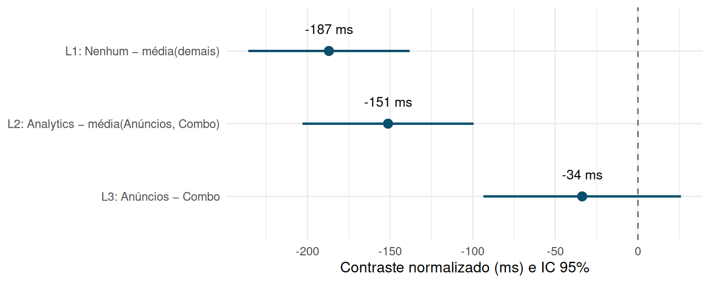
<p class="caption">(\#fig:c3c-plot-contrastes-ic)Os três contrastes planejados na escala de ms (coeficientes normalizados), com intervalos de confiança de 95%. A linha tracejada marca o zero (ausência de diferença).</p>
</div>

<div class="figure" style="text-align: center">
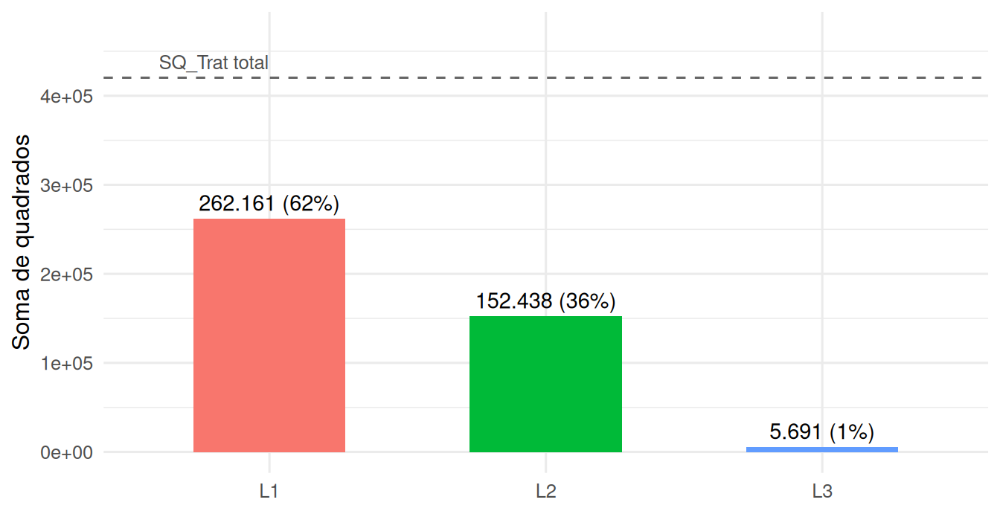
<p class="caption">(\#fig:c3c-plot-contrastes-sq)Partição da soma de quadrados (SQ) de tratamentos pelos três contrastes ortogonais: as barras somam exatamente a linha tracejada; o rótulo dá a SQ de cada contraste e sua porcentagem da SQ de tratamentos.</p>
</div>

A leitura é direta. $L_1$ e $L_2$ têm intervalos inteiramente abaixo de zero: scripts de
terceiros atrasam a página, e Analytics atrasa bem menos que as configurações com anúncio. Em
termos de variação, 62% de toda a diferença entre configurações é
"ter ou não ter script", 36% é "anúncio ou não", e apenas
1% é "chat em cima do anúncio". $L_3$ não é significativo, mas
o seu intervalo, de -94 a 26 ms, merece mais atenção do
que o p-valor: "não significativo" **não** quer dizer "igual". Os dados são compatíveis tanto com o
Combo carregando um pouco mais rápido que Anúncios quanto com ele carregando até
94 ms mais lento — e, para uma página de produto, 90 ms podem importar.

### Contrastes não ortogonais {#contrastes-nao-ortogonais}

Nada impede testar contrastes não ortogonais; cada um continua sendo um teste válido de 1 grau de
liberdade. O que se perde é a contabilidade. Considere a família natural "cada configuração contra
o controle", com coeficientes $(-1,1,0,0)$, $(-1,0,1,0)$ e $(-1,0,0,1)$: o produto interno de
quaisquer dois deles é $(-1)(-1) = 1 \ne 0$, porque todos reutilizam a média do controle.


``` r
coefs_ctrl <- list(`Analytics−Nenhum` = c(-1, 1, 0, 0), `Anúncios−Nenhum` = c(-1, 0, 1, 0),
                   `Combo−Nenhum` = c(-1, 0, 0, 1))
sq_ctrl <- sapply(coefs_ctrl, function(cc) sum(cc * medias)^2 / sum(cc^2 / ns))
round(c(sq_ctrl, soma = sum(sq_ctrl), SQ_Trat = sq_trat_s))
```

```
## Analytics−Nenhum  Anúncios−Nenhum     Combo−Nenhum             soma 
##            37111           243095           323180           603386 
##          SQ_Trat 
##           420290
```

A soma das três $SQ$ (603.386) passa de $SQ_{\text{Trat}}$ (420.290) em
44%: a média do controle, a mais baixa de todas, entra nas três perguntas,
e sua distância às demais é contada três vezes. Não há erro de conta — há sobreposição de
informação. Cada teste segue válido isoladamente; o que deixa de valer é ler as $SQ$ como fatias
da variação. E, como os três testes são correlacionados positivamente (compartilham
$\bar y_{\text{Nenhum}}$), a correção adequada para tratá-los como família não é a de Bonferroni,
que ignora a correlação, e sim a de Dunnett, que a usa (Seção \@ref(comparacoes-multiplas)).

### O que os contrastes respondem nestes dados {#contrastes-respostas}

Voltando às três perguntas do protocolo:

1. **Scripts de terceiros atrasam a página?** Sim: em média 187 ms
   (IC 95%: 138 a 236 ms), cerca de
   22% do tempo da página limpa.
2. **Se for para ter um script, Analytics é o mais leve?** Sim: Analytics carrega
   151 ms mais rápido que a média das duas opções com anúncio
   (IC: 99 a 203 ms).
3. **Acrescentar o chat aos anúncios custa caro?** Os dados não permitem afirmar nem negar. A
   diferença estimada é de 34 ms, com intervalo que inclui zero. Com o
   desvio-padrão observado, detectar uma diferença de 30 ms com poder de 80% exigiria cerca de
   77 carregamentos por configuração
   (`power.t.test(delta = 30, sd = sqrt(qme), power = 0.8)`), e não 10: a pergunta (iii) estava
   subdimensionada no desenho, um lembrete da Seção \@ref(numero-replicas-dca).

Os três testes estão protegidos sem correção adicional porque são planejados, ortogonais e em
número de $t-1$: cada um usa uma fatia diferente de $SQ_{\text{Trat}}$.

## Procedimentos de comparação múltipla {#comparacoes-multiplas}

Contrastes ortogonais planejados a priori resolvem o problema de forma elegante quando o número
de perguntas é pequeno e conhecido antes da coleta de dados. Mas frequentemente queremos comparar
**todos os pares de médias**, ou comparar cada tratamento contra um grupo controle, sem ter
decidido de antemão exatamente quais comparações importam. Fazer isso com testes $t$ repetidos,
um por par, é perigoso: com $t=4$ grupos há $\binom{4}{2}=6$ comparações possíveis, e mesmo que
$H_0$ seja verdadeira em todas elas, se os seis testes fossem independentes a probabilidade de pelo
menos um falso positivo ao nível nominal $\alpha=0{,}05$ por teste seria

$$P(\text{pelo menos 1 falso positivo}) = 1 - (1-\alpha)^{6} \approx 1 - 0{,}95^6 \approx 0{,}26,$$

mais de cinco vezes o nível nominal. Como os seis testes compartilham médias e o mesmo $QME$, eles
não são independentes e o valor exato é um pouco menor — a simulação da Seção
\@ref(fwer-simulada) dá cerca de 19% —, mas a ordem de grandeza do problema é essa. Duas taxas de
erro precisam ser distinguidas:

| Taxa de erro | Definição | Controlada por |
|---|---|---|
| por comparação | $P(\text{erro tipo I em um teste})$ | LSD (*least significant difference*) de Fisher, testes $t$ repetidos |
| por família (FWER, *family-wise error rate*) | $P(\text{pelo menos 1 erro tipo I na família})$ | Tukey, Dunnett, Bonferroni, Scheffé |

Essa inflação da **taxa de erro por família** (*family-wise error rate*, FWER) é o problema que os
procedimentos a seguir resolvem, cada um com um compromisso diferente entre conservadorismo e
poder [@hsu1996multiple].

### O que significa controlar a taxa de erro por família {#fwer}

A sigla merece uma explicação sem fórmulas antes de qualquer procedimento. A **família** é o
conjunto de todas as comparações que serão feitas e relatadas sobre um experimento — no exemplo de
scripts, com a pergunta "quais pares diferem?", os seis pares. A família **erra** quando pelo menos
uma dessas comparações declara uma diferença que não existe; não importa qual, nem quantas. O FWER
é a probabilidade desse evento,

$$\text{FWER} = P(A_1 \cup A_2 \cup \cdots \cup A_m), \qquad A_k = \{\text{falso positivo na } k\text{-ésima comparação}\}.$$

Uma analogia ajuda: uma casa com seis cômodos, cada um com um detector de fumaça que dispara à toa
em 5% das noites. Cada detector, isoladamente, é bom; mas a chance de a casa ser acordada sem
incêndio numa noite qualquer é de cerca de $1-0{,}95^6 \approx 26\%$. **Controlar o FWER em 5%** é
garantir que, em 95% dos experimentos, **nenhuma** das comparações relatadas seja um alarme falso —
uma garantia sobre o relatório inteiro, não sobre cada linha dele.

A Figura \@ref(fig:c3c-fwer-grade) torna isso visível. Simulamos 100 experimentos com o desenho do
exemplo ($t=4$, $n=10$, $\sigma=70$ ms) em que as quatro médias verdadeiras são **iguais**, e em
cada um comparamos os seis pares por testes $t$ ao nível de 5% e por Tukey.

<div class="figure" style="text-align: center">
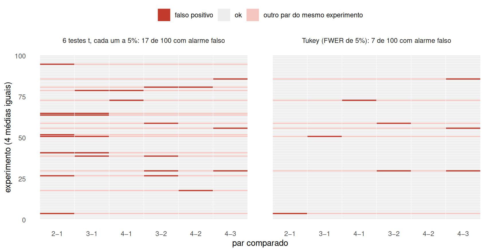
<p class="caption">(\#fig:c3c-fwer-grade)Cem experimentos simulados sem efeito nenhum (linhas) e os seis pares comparados em cada um (colunas). Vermelho: par declarado diferente (falso positivo); rosa: os demais pares de um experimento que teve algum falso positivo. Esquerda: seis testes t, cada um a 5%; direita: Tukey.</p>
</div>

Cada **casa** vermelha é rara — cerca de 5% das casas da esquerda, como prometido por cada teste
$t$. Mas cada **linha** com alguma casa vermelha não é: 17 dos 100 experimentos produziriam
pelo menos uma "descoberta" falsa com testes $t$ (o valor esperado é perto de 20%), contra
7 com Tukey (esperado: 5%). E o problema cresce rapidamente com o número de tratamentos
(Figura \@ref(fig:c3c-fwer-curva)): com 10 tratamentos e 45 pares, achar alguma diferença por acaso é
quase certo.

<div class="figure" style="text-align: center">
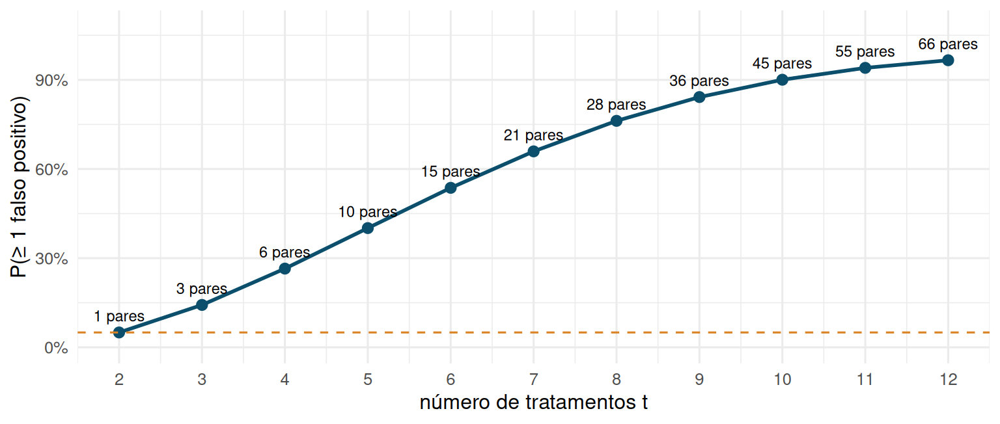
<p class="caption">(\#fig:c3c-fwer-curva)Probabilidade de pelo menos um falso positivo ao fazer todos os pares com testes t a 5%, tratados como independentes, em função do número de tratamentos; o rótulo dá o número de pares e a linha tracejada marca 5%.</p>
</div>

Há dois sentidos de "controlar". O controle **fraco** vale só quando **todas** as médias são
iguais; o controle **forte** vale qualquer que seja o padrão de médias iguais e diferentes — que é
o caso relevante, porque, depois de rejeitar o $F$ global, sabemos justamente que nem todas são
iguais. Tukey, Dunnett, Bonferroni e Scheffé controlam o FWER no sentido forte; o LSD protegido e o
SNK (Student-Newman-Keuls), só no fraco; o Duncan, em nenhum dos dois. A Seção \@ref(fwer-simulada) mostra isso numa
simulação com os dois cenários.

### O perigo do "data snooping" {#data-snooping}

Antes de listar os procedimentos, vale nomear explicitamente o problema mais sutil que eles
resolvem — não apenas "muitos testes $t$", mas a prática de decidir **qual** comparação fazer
depois de já ter visto os dados. O método científico usual segue a ordem hipótese $\to$
delineamento $\to$ coleta $\to$ análise; o **"data snooping"** ("espionagem de dados", ou
garimpagem de hipóteses) inverte essa ordem: primeiro se exploram os dados em busca de qualquer
padrão que pareça interessante, e só então se formula — e se "testa" — uma hipótese construída
sob medida para aquele padrão, usando os **mesmos** dados que a sugeriram.

O problema não é hipotético. Suponha $t$ grupos cujas médias populacionais são, na verdade,
idênticas. Por puro ruído amostral, as $t$ médias observadas nunca serão exatamente iguais; haverá
sempre um par de médias mais distante entre si do que os demais. Se o pesquisador percorre os
dados à procura do par mais discrepante e só então formula a hipótese "esses dois grupos
diferem", o teste $t$ usual sobre esse par específico quase certamente rejeitará $H_0$ com
frequência bem maior que $\alpha$ — não porque exista um efeito real, mas porque **escolher o
maior de vários desvios aleatórios e testá-lo como se fosse a única comparação planejada** ignora
toda a variabilidade dos $\binom{t}{2}-1$ pares que não foram escolhidos. A analogia usual é a do
atirador que dispara uma flecha na parede e só depois desenha o alvo ao redor do ponto de impacto:
ele acerta o "alvo" sempre, mas isso nada prova sobre sua pontaria.

Os procedimentos planejados a priori (contrastes ortogonais da Seção \@ref(contrastes), Tukey,
Dunnett, Bonferroni) protegem apenas o conjunto de comparações **especificado antes** de examinar
os dados — nenhum deles oferece garantia alguma sobre um contraste "descoberto" depois. O método
de Scheffé, a seguir, é a resposta formal a essa lacuna: ele protege simultaneamente **todo** o
espaço infinito de contrastes lineares possíveis, de modo que, mesmo que o pesquisador escolha o
contraste mais favorável depois de olhar os dados, o FWER continua controlado em $\alpha$.

### A estrutura comum: a diferença mínima significativa {#dms}

Com dados balanceados ($n_i = n$), quase todos os procedimentos par a par têm a mesma forma:
declaram $\mu_i \ne \mu_j$ quando a diferença observada $|\bar y_{i\cdot} - \bar y_{j\cdot}|$ supera
uma **diferença mínima significativa** (DMS), que é um multiplicador vezes um erro-padrão. O que
distingue os procedimentos é apenas o multiplicador — e, com ele, a garantia oferecida. Com
$\nu = gl_{\text{erro}}$:

| Procedimento | DMS | Controla |
|---|---|---|
| LSD de Fisher | $t_{\alpha/2,\nu}\sqrt{2QME/n}$ | taxa por comparação |
| Bonferroni ($m$ comparações) | $t_{\alpha/(2m),\nu}\sqrt{2QME/n}$ | FWER, de forma conservadora |
| Tukey HSD (*honestly significant difference*) | $q_{\alpha;\,t,\nu}\sqrt{QME/n}$ | FWER, todos os pares |
| Dunnett | $d_{\alpha;\,t-1,\nu}\sqrt{2QME/n}$ | FWER, cada tratamento vs. controle |
| Scheffé | $\sqrt{(t-1)F_{\alpha;\,t-1,\nu}}\,\sqrt{2QME/n}$ | FWER, todo contraste |
| SNK | $q_{\alpha;\,p,\nu}\sqrt{QME/n}$, $p$ = amplitude | FWER só sob $H_0$ completa |
| Duncan | $q_{\alpha_p;\,p,\nu}\sqrt{QME/n}$, $\alpha_p = 1-(1-\alpha)^{p-1}$ | não controla o FWER |

Ver os procedimentos como **réguas** de comprimentos diferentes, aplicadas às mesmas diferenças, é
a forma mais útil de compará-los — e é o que faremos com os dados na Seção \@ref(reguas-dados).

### LSD de Fisher

O procedimento mais antigo é a *least significant difference* de Fisher [@fisher1935design]: o
teste $t$ de duas médias, usando o $QME$ da ANOVA como estimativa de $\sigma^2$ (o que dá mais
graus de liberdade que um teste $t$ com só os dois grupos). Controla apenas a taxa de erro **por
comparação**. Na versão **protegida**, o LSD só é aplicado se o $F$ global rejeitar $H_0$; isso
controla o FWER quando **todas** as médias são iguais (porque então só se chega aos pares com
probabilidade $\alpha$), mas não quando apenas algumas são — um ponto que a simulação da Seção
\@ref(fwer-simulada) torna concreto.

### Método de Scheffé

Controla o FWER para **qualquer** contraste que se queira testar, incluindo contrastes definidos
*depois* de examinar os dados (comparações não planejadas, ou "garimpadas", na linha da Seção
\@ref(data-snooping)) — é o procedimento mais geral e, por isso, o mais conservador. Rejeita-se
$H_0: L=0$ se

$$\frac{SQ_L}{QME} > (t-1)\, F_{\alpha;\, t-1,\, gl_{\text{erro}}}.$$

De onde vem o fator $(t-1)$? Para dados balanceados e qualquer contraste ($\sum c_i = 0$), a
desigualdade de Cauchy-Schwarz dá

$$\hat L^2 = \Big(\sum_{i=1}^t c_i(\bar y_{i\cdot} - \bar y_{\cdot\cdot})\Big)^2 \le \sum_{i=1}^t c_i^2 \cdot \sum_{i=1}^t (\bar y_{i\cdot}-\bar y_{\cdot\cdot})^2 \quad\Longrightarrow\quad SQ_L = \frac{n\hat L^2}{\sum_i c_i^2} \le n\sum_{i=1}^t(\bar y_{i\cdot}-\bar y_{\cdot\cdot})^2 = SQ_{\text{Trat}},$$

em que a primeira igualdade usa $\sum c_i = 0$ para subtrair $\bar y_{\cdot\cdot}$ de graça. Logo, o
maior $F$ de contraste possível — o do contraste mais favorável, escolhido depois de ver os dados —
é

$$\max_{\mathbf c}\ \frac{SQ_L}{QME} = \frac{SQ_{\text{Trat}}}{QME} = (t-1)\,F_{\text{obs}},$$

atingido pelo contraste com $c_i \propto \bar y_{i\cdot} - \bar y_{\cdot\cdot}$. (Sob uma hipótese
geral, aplica-se o mesmo argumento a $\bar y_{i\cdot} - \mu_i$.) Comparar cada $SQ_L/QME$ com
$(t-1)F_{\alpha;t-1,\nu}$ equivale, portanto, a exigir que o contraste supere o que o **maior** de
todos os contrastes atingiria por acaso com probabilidade $\alpha$ — e o FWER fica exatamente em
$\alpha$ sobre uma família infinita [@scheffe1959analysis]. Duas consequências: nenhum contraste é
significativo por Scheffé se o $F$ global não for (o Scheffé é o teste $F$ global "desdobrado" em
direções); e é esse fator extra que torna Scheffé a "licença para bisbilhotar os dados" de forma
estatisticamente honesta.

### Método de Bonferroni

O método de Bonferroni [-@bonferroni1936] divide o nível de significância global $\alpha$
igualmente entre as $m$ comparações planejadas: cada teste individual é avaliado contra $\alpha/m$
(equivalentemente, cada p-valor é multiplicado por $m$). A justificativa é a desigualdade de Boole:
se $A_k$ é o evento "erro tipo I na $k$-ésima comparação",

$$\text{FWER} = P\Big(\bigcup_{k=1}^m A_k\Big) \le \sum_{k=1}^m P(A_k) = m\cdot\frac{\alpha}{m} = \alpha.$$

É simples, aplica-se a qualquer conjunto pré-especificado de comparações (não só pares), mas é
conservador quando $m$ é grande ou quando as comparações são correlacionadas — a desigualdade de
Boole é estrita sempre que os eventos $A_k$ se intersectam, o que ocorre sempre que as comparações
compartilham médias e o $QME$.

### Tukey HSD (*honestly significant difference*)

Desenhado especificamente para **todas as comparações par a par** entre $t$ médias, usa a
distribuição da **amplitude estudentizada** (*studentized range*) em vez da distribuição $t$
[@tukey1949comparing]. Com dados balanceados, a estatística

$$Q = \frac{\max_i(\bar y_{i\cdot}-\mu_i) - \min_i(\bar y_{i\cdot}-\mu_i)}{\sqrt{QME/n}} \sim q_{t,\nu}$$

tem distribuição tabelada (é a amplitude de $t$ normais independentes dividida por um desvio-padrão
independente com $\nu$ gl). O argumento de Tukey é de uma linha: se a **maior** das $\binom t2$
diferenças padronizadas fica abaixo de $q_{\alpha;t,\nu}$, todas as outras também ficam. Logo
$P(\text{nenhum falso positivo}) = P(Q \le q_{\alpha;t,\nu}) = 1-\alpha$ — o FWER é **exatamente**
$\alpha$ para a família de todos os pares. É por isso que Tukey é mais poderoso que Bonferroni
nessa família: Bonferroni usa uma desigualdade, Tukey usa a distribuição exata do máximo. É o
procedimento padrão quando o objetivo é "comparar tudo com tudo" sem um grupo controle
privilegiado.

### Comparação com um grupo controle: Dunnett

Quando o interesse não é comparar todos os pares, mas sim **cada tratamento contra um único grupo
controle** (como "Nenhum" no exemplo de scripts), o número de comparações cai de $\binom{t}{2}$
para $t-1$, e essas comparações são correlacionadas entre si (todas compartilham o mesmo grupo
controle; com $n$ iguais a correlação entre duas delas é $1/2$). O teste de Dunnett usa a
distribuição conjunta dessas $t-1$ estatísticas $t$ (uma $t$ multivariada) para obter o valor
crítico $d_{\alpha;t-1,\nu}$, sendo mais poderoso que Tukey ou Bonferroni para esse propósito
específico [@dunnett1955multiple]. Admite também a versão **unilateral**, quando a pergunta tem
direção ("o tratamento piora?") — desde que a direção seja fixada no protocolo, antes dos dados.

### Teste de amplitude múltipla de Duncan

Todos os procedimentos anteriores usam um **único** valor crítico para julgar qualquer par de
médias. O teste de **Duncan** [@duncan1955multiple] rompe com essa ideia: ordena as $t$ médias
amostrais, $\bar y_{(1)} \le \cdots \le \bar y_{(t)}$, e define a **amplitude** $p$ de uma
comparação como o número de médias ordenadas que ela abrange ($p=2$ para médias adjacentes,
$p=t$ para a maior contra a menor). Para cada amplitude $p = 2, \ldots, t$, calcula-se um valor
crítico próprio — a **amplitude mínima significativa**

$$R_p = r_{\alpha,\,p,\,gl_{\text{erro}}} \sqrt{\frac{QME}{n}},$$

em que $r_{\alpha,p,\nu} = q_{\alpha_p;\,p,\nu}$ vem de uma tabela específica de Duncan
(implementada, por exemplo, em `agricolae::duncan.test()`) e cresce com $p$:
$R_2 < R_3 < \cdots < R_t$. A diferença $\bar y_{(j)} - \bar y_{(i)}$ é declarada significativa se
exceder $R_{j-i+1}$ — médias adjacentes ($p=2$) só precisam superar o menor valor crítico da lista,
enquanto a diferença entre a maior e a menor média precisa superar o maior.

Essa escala móvel equivale a proteger cada amplitude $p$ com um nível $\alpha_p = 1 -
(1-\alpha)^{p-1}$, que **cresce** com $p$ em vez de permanecer fixo em $\alpha$ — ao contrário de
Tukey, que usa o mesmo nível $\alpha$ para toda comparação par a par, qualquer que seja sua
amplitude. Com $\alpha = 0{,}05$ e $t=4$, $\alpha_4 = 1-0{,}95^3 \approx 0{,}143$: sob $H_0$
completa, a chance de o Duncan declarar **alguma** diferença é de 14%, não de 5%. Na prática, isso
torna Duncan sistematicamente mais liberal (mais poder, mais comparações declaradas
significativas) do que Tukey, mas ao custo de **não controlar o FWER** no nível nominal $\alpha$
para o conjunto de comparações como um todo. Por essa razão, seu uso vem sendo desaconselhado na
literatura em favor de procedimentos que controlam o FWER de forma rigorosa (Tukey para pares,
Dunnett contra um controle); ainda assim, permanece comum em periódicos de ciências agrárias, o que
torna sua interpretação correta — inclusive de suas limitações — relevante para quem for ler ou
revisar esse tipo de trabalho.

### Student-Newman-Keuls (SNK)

O SNK [@newman1939distribution; @keuls1952use] tem a mesma estrutura em etapas de Duncan, mas usa
o nível $\alpha$ fixo em cada amplitude: $R_p = q_{\alpha;\,p,\nu}\sqrt{QME/n}$. Para $p = t$ ele
coincide com Tukey; para $p=2$, com Duncan e com o LSD. Fica, portanto, entre os dois. O SNK
controla o FWER sob $H_0$ **completa** (todas as médias iguais), porque então tudo depende do
primeiro teste, o da amplitude $t$, feito ao nível $\alpha$. Mas sob $H_0$ **parcial** — algumas
médias iguais, outras não — os pares de médias iguais que ficam vizinhos depois do ordenamento são
testados, cada um, ao nível $\alpha$, e o FWER cresce com o número desses pares.

### O teste de Duncan passo a passo, com dados reais {#duncan-passo-a-passo}

A descrição do Duncan acima é compacta demais para quem o vê pela primeira vez. Esta subseção o
executa inteiro, passo a passo e com gráficos, sobre os dados **reais** de fertilizantes em feijão
da Seção \@ref(dca-feijao) — escolhidos porque, neles, Duncan e Tukey **discordam**, o que torna
visível o efeito de cada escolha do procedimento. Em uma frase, o Duncan **ordena as médias e
compara cada par com uma régua que depende de quantas médias o par abrange, começando pelo par
mais afastado e só descendo enquanto as comparações maiores forem significativas.**

<table class="table" style="width: auto !important; margin-left: auto; margin-right: auto;">
<caption>(\#tab:c3c-feij-dados)Produção de feijão (kg) nas 20 parcelas, por fertilizante</caption>
 <thead>
  <tr>
   <th style="text-align:right;"> Parcela </th>
   <th style="text-align:right;"> F1 </th>
   <th style="text-align:right;"> F2 </th>
   <th style="text-align:right;"> F3 </th>
   <th style="text-align:right;"> F4 </th>
  </tr>
 </thead>
<tbody>
  <tr>
   <td style="text-align:right;"> 1 </td>
   <td style="text-align:right;"> 5.91 </td>
   <td style="text-align:right;"> 6.81 </td>
   <td style="text-align:right;"> 1.69 </td>
   <td style="text-align:right;"> 8.31 </td>
  </tr>
  <tr>
   <td style="text-align:right;"> 2 </td>
   <td style="text-align:right;"> 3.76 </td>
   <td style="text-align:right;"> 7.95 </td>
   <td style="text-align:right;"> 5.69 </td>
   <td style="text-align:right;"> 8.46 </td>
  </tr>
  <tr>
   <td style="text-align:right;"> 3 </td>
   <td style="text-align:right;"> 4.04 </td>
   <td style="text-align:right;"> 6.75 </td>
   <td style="text-align:right;"> 7.18 </td>
   <td style="text-align:right;"> 8.51 </td>
  </tr>
  <tr>
   <td style="text-align:right;"> 4 </td>
   <td style="text-align:right;"> 5.37 </td>
   <td style="text-align:right;"> 7.57 </td>
   <td style="text-align:right;"> 5.70 </td>
   <td style="text-align:right;"> 9.59 </td>
  </tr>
  <tr>
   <td style="text-align:right;"> 5 </td>
   <td style="text-align:right;"> 5.68 </td>
   <td style="text-align:right;"> 7.51 </td>
   <td style="text-align:right;"> 7.47 </td>
   <td style="text-align:right;"> 11.07 </td>
  </tr>
</tbody>
</table>

A ANOVA da Seção \@ref(dca-feijao) deu $F = 9{,}21$ com (3, 16) gl e
$QME = 1{,}982$. As médias são F1 = 4,952, F2 = 7,318,
F3 = 5,546 e F4 = 9,188 kg, e o erro-padrão de uma média é
$\sqrt{QME/n} = \sqrt{1{,}982/5} = 0{,}630$ kg — a unidade em que todas as réguas desta
subseção são expressas.

**Passo 1 — ordenar.** A Figura \@ref(fig:c3c-feij-regua) põe as quatro médias no eixo da produção,
em ordem crescente, com a posição de cada uma entre parênteses. A ordem não é a dos rótulos: F3 vem
antes de F2. As distâncias entre vizinhas são 0,59 (F3 − F1),
1,77 (F2 − F3) e 1,87 kg (F4 − F2).

<div class="figure" style="text-align: center">
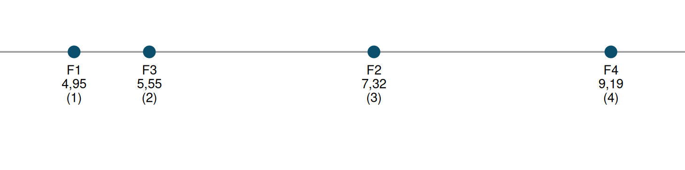
<p class="caption">(\#fig:c3c-feij-regua)As quatro médias de produção de feijão (kg) ordenadas no eixo da resposta; entre parênteses, a posição de cada uma na ordenação.</p>
</div>

**Passo 2 — contar a amplitude.** A **amplitude** $p$ de um par é o número de médias ordenadas que
ele abrange, incluindo as duas pontas. Na Figura \@ref(fig:c3c-feij-arcos) cada par é um arco, com
altura e cor dadas pela amplitude: o único par de amplitude 4 é F4 − F1 (maior contra menor); os de
amplitude 3, F2 − F1 e F4 − F3, têm uma média entre as pontas; os três de amplitude 2 são vizinhos.

<div class="figure" style="text-align: center">
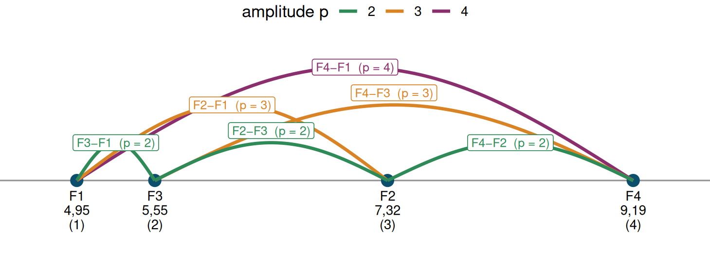
<p class="caption">(\#fig:c3c-feij-arcos)Os seis pares de médias como arcos sobre o eixo das médias ordenadas; altura e cor indicam a amplitude p do par (2: vizinhas; 3: uma média entre as pontas; 4: maior contra menor).</p>
</div>

**Por que a régua deveria crescer com $p$.** A Figura \@ref(fig:c3c-feij-intuicao) responde com uma
simulação: sorteamos $p$ médias **sem efeito nenhum** e medimos a distância entre a maior e a menor,
em erros-padrão. Com mais médias, os extremos se afastam só por acaso; o percentil 95% de cada
distribuição — 3,00, 3,65 e
4,08 para $p = 2, 3, 4$ — é exatamente o valor tabelado
$q_{0,05;\,p,16}$ da amplitude estudentizada. Daí a ideia dos procedimentos em etapas: exigir mais
de um par que abrange mais médias, porque ele "tem mais chance" de parecer afastado sem ser.

<div class="figure" style="text-align: center">
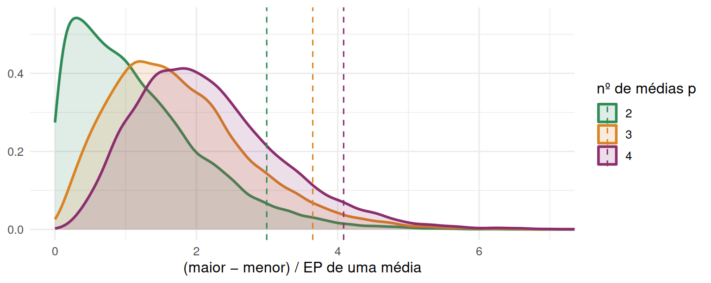
<p class="caption">(\#fig:c3c-feij-intuicao)Distribuição simulada da distância entre a maior e a menor de p médias, em erros-padrão, quando todas as médias verdadeiras são iguais (16 gl para o erro); as linhas tracejadas marcam o percentil 95% de cada distribuição.</p>
</div>

**Passo 3 — uma régua por amplitude.** Para cada $p$, $R_p = r_p\sqrt{QME/n}$, em que o $r_p$ de
Duncan é o quantil da amplitude estudentizada no nível $1-\alpha_p$, com $\alpha_p = 1-(1-\alpha)^{p-1}$
(no R, `qtukey((1 - 0.05)^(p - 1), p, gl)`). A Tabela \@ref(tab:c3c-feij-reguas) traz as réguas de
Duncan, SNK e Tukey, e a Figura \@ref(fig:c3c-feij-escada) as compara.

<table class="table" style="width: auto !important; margin-left: auto; margin-right: auto;">
<caption>(\#tab:c3c-feij-reguas)Réguas (kg) de Duncan, SNK e Tukey para os dados de feijão, por amplitude</caption>
 <thead>
  <tr>
   <th style="text-align:center;"> Amplitude p </th>
   <th style="text-align:center;"> Nível de proteção αp </th>
   <th style="text-align:center;"> r_p (Duncan) </th>
   <th style="text-align:center;"> R_p Duncan </th>
   <th style="text-align:center;"> R_p SNK </th>
   <th style="text-align:center;"> Tukey (fixa) </th>
  </tr>
 </thead>
<tbody>
  <tr>
   <td style="text-align:center;"> 2 </td>
   <td style="text-align:center;"> 5,00% </td>
   <td style="text-align:center;"> 2,998 </td>
   <td style="text-align:center;"> 1,887 </td>
   <td style="text-align:center;"> 1,887 </td>
   <td style="text-align:center;"> 2,547 </td>
  </tr>
  <tr>
   <td style="text-align:center;"> 3 </td>
   <td style="text-align:center;"> 9,75% </td>
   <td style="text-align:center;"> 3,144 </td>
   <td style="text-align:center;"> 1,979 </td>
   <td style="text-align:center;"> 2,297 </td>
   <td style="text-align:center;"> 2,547 </td>
  </tr>
  <tr>
   <td style="text-align:center;"> 4 </td>
   <td style="text-align:center;"> 14,26% </td>
   <td style="text-align:center;"> 3,235 </td>
   <td style="text-align:center;"> 2,036 </td>
   <td style="text-align:center;"> 2,547 </td>
   <td style="text-align:center;"> 2,547 </td>
  </tr>
</tbody>
</table>

<div class="figure" style="text-align: center">
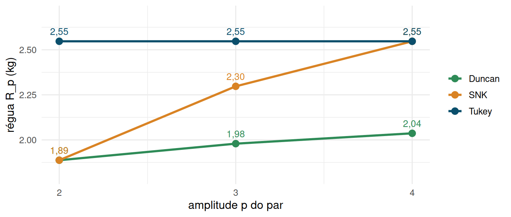
<p class="caption">(\#fig:c3c-feij-escada)Régua (diferença mínima significativa, em kg) de Duncan, SNK e Tukey em função da amplitude p do par, para os dados de feijão.</p>
</div>

Para pares vizinhos ($p=2$), Duncan, SNK e LSD usam a mesma régua. Com $p$ crescente, o Duncan
cresce devagar (de 1,89 a 2,04 kg), porque relaxa o nível
($\alpha_p$ sobe de 5% para 14,3%); o SNK cresce mais, até alcançar Tukey em
$p=t$; e Tukey usa a régua máxima para todos os pares. É nos pares de amplitude intermediária e
grande que o Duncan se afasta do Tukey.

**Passo 4 — testar de cima para baixo.** A Figura \@ref(fig:c3c-feij-etapas) mostra as três etapas.
Na primeira ($p=4$), $\bar y_{F4} - \bar y_{F1} = 4{,}24 > R_4 = 2{,}04$: F4 e F1
diferem, e isso libera para teste os dois pares de amplitude 3 que ficam "dentro" desse arco. Na
segunda ($p=3$), F2 − F1 = 2,37 e F4 − F3 = 3,64 são comparados com
$R_3 = 1{,}98$, e os dois diferem. Na terceira ($p=2$), os três pares vizinhos são comparados
com $R_2 = 1{,}89$: F3 − F1 = 0,59, F2 − F3 = 1,77 e
F4 − F2 = 1,870; nenhum difere. O último fica a apenas
0,017 kg da régua — uma decisão frágil, que uma única parcela poderia inverter,
e que por isso deve ser reportada com a diferença e seu intervalo, não só com "=".

<div class="figure" style="text-align: center">
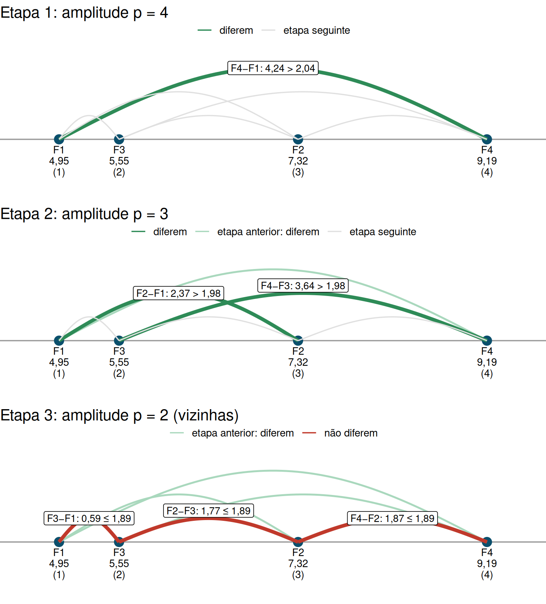
<p class="caption">(\#fig:c3c-feij-etapas)As três etapas do teste de Duncan nos dados de feijão. Em cada painel, os arcos da etapa corrente estão em destaque (verde: diferença significativa; vermelho: não significativa) com a diferença observada e a régua; arcos de etapas anteriores aparecem claros, coloridos pelo resultado, e os das etapas seguintes em cinza.</p>
</div>

**A regra de coerência em ação.** Nos dados reais, todas as comparações das etapas 1 e 2 foram
significativas, e a regra de coerência não chegou a atuar. Para vê-la funcionar, imagine o mesmo
experimento com as **mesmas médias**, mas muito mais ruidoso, com $QME = 9$ (Figura
\@ref(fig:c3c-feij-coerencia)). Agora a comparação de ponta a ponta já falha, e os pares de
amplitude 3 e 2 **nem são testados**: se nem as médias mais afastadas diferem, nenhum par contido
entre elas pode diferir. É essa regra que impede o procedimento de produzir a contradição "F1 e F4
são iguais, mas F1 e F2 diferem".

<div class="figure" style="text-align: center">
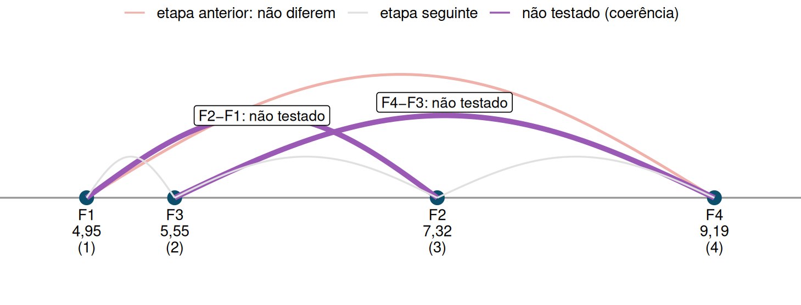
<p class="caption">(\#fig:c3c-feij-coerencia)Cenário hipotético com as mesmas médias de feijão e QME = 9: a comparação de amplitude 4 não é significativa (arco claro avermelhado) e, pela regra de coerência, os pares de amplitude 3 (roxo) e 2 não são testados.</p>
</div>

**Passo 5 — das decisões aos traços e às letras.** O resultado se resume num diagrama de **traços**
(Figura \@ref(fig:c3c-feij-tracos)): um traço sob um grupo de médias consecutivas indica que nenhum
par dentro dele difere. Cada traço vira uma **letra** (a para o grupo que contém a maior média). Pelo
Duncan, os grupos são {F1, F3}, {F3, F2} e {F2, F4}, donde F1 = c, F3 = bc, F2 = ab e F4 = a. Pelo
Tukey, os grupos são {F1, F3, F2} e {F2, F4}, donde F1 = b, F3 = b, F2 = ab e F4 = a.

<div class="figure" style="text-align: center">
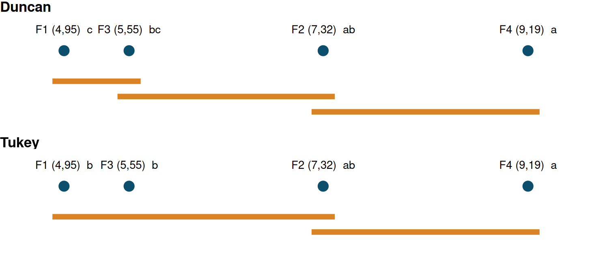
<p class="caption">(\#fig:c3c-feij-tracos)Diagrama de traços para os dados de feijão pelo Duncan (acima) e pelo Tukey (abaixo): médias ligadas por um mesmo traço não diferem pelo critério correspondente; ao lado de cada média, a letra resultante.</p>
</div>

A conferência com o `agricolae` reproduz os valores de $r_p$ e $R_p$ e as letras; o que o pacote
não mostra é o caminho — as etapas e a regra de coerência —, que é justamente o que explica o
resultado:


``` r
dt <- agricolae::duncan.test(mod_feijao, "Fertilizante", console = FALSE)
dt$duncan            # r_p ("Table") e R_p ("CriticalRange") para p = 2, 3, 4
```

```
##      Table CriticalRange
## 2 2.997999      1.887328
## 3 3.143802      1.979115
## 4 3.234945      2.036492
```

``` r
dt$groups            # médias ordenadas da maior para a menor, com as letras
```

```
##    Producao groups
## F4    9.188      a
## F2    7.318     ab
## F3    5.546     bc
## F1    4.952      c
```

**Onde Duncan e Tukey discordam.** O par F2 − F1, com 2,37 kg, é
declarado diferente pelo Duncan e pelo SNK e não pelo Tukey, pelo Bonferroni nem pelo Scheffé
(Figura \@ref(fig:c3c-feij-discorda)). Os dados não mudaram; mudou a **garantia** pedida. O Duncan
julga esse par com proteção $\alpha_3 = 1-0{,}95^2 \approx 9{,}75\%$, e a família de comparações, sob
$H_0$ completa, com $\alpha_4 \approx 14\%$.

<div class="figure" style="text-align: center">
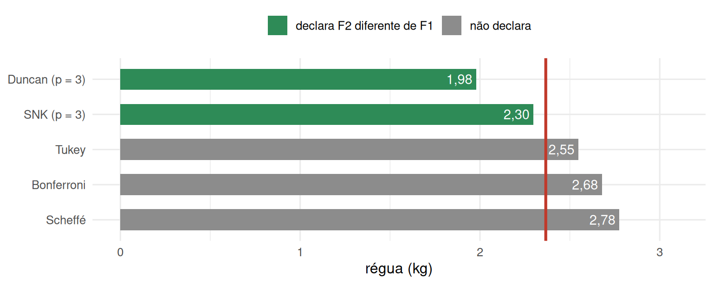
<p class="caption">(\#fig:c3c-feij-discorda)A diferença observada entre F2 e F1 (linha vermelha) contra a régua de cada procedimento: barras verdes são réguas menores que a diferença (o procedimento declara F2 diferente de F1), barras cinza, réguas maiores.</p>
</div>

A leitura prática é a de sempre, agora com um exemplo concreto: o Duncan é uma ferramenta de
**triagem** — útil para apontar candidatos promissores para um próximo experimento —, mas uma
**conclusão** que vai virar recomendação a produtores ("F2 rende mais que F1") precisa de um
procedimento que controle o FWER, como Tukey, ou Dunnett se houver uma testemunha. A função
`passos_amplitude()` de `comparacoes_helpers.R`, usada nas figuras desta subseção, devolve a tabela
completa de etapas para qualquer conjunto de médias, com `metodo = "Duncan"` ou `"SNK"`.

### A questão do ordenamento: procedimentos em etapas {#ordenamento}

Duncan e SNK dependem da **ordem** das médias observadas, e isso merece uma discussão própria,
porque é onde mora tanto a sua lógica quanto o seu problema.

**Por que faz sentido a régua depender da posição.** Sob $H_0$, a distância esperada entre o
maior e o menor de $p$ valores aleatórios cresce com $p$. Uma diferença de 70 ms entre duas médias
vizinhas na ordenação é, portanto, mais surpreendente do que a mesma diferença entre os extremos de
quatro médias — os extremos estão longe "por construção". Os procedimentos em etapas exigem mais
das amplitudes maiores por essa razão.

**A regra de coerência.** O teste começa pela amplitude $t$ (maior contra menor); uma amplitude
menor só é examinada se **todas** as amplitudes que a contêm tiverem sido significativas. Isso
evita a contradição de declarar diferentes duas médias que estão dentro de um grupo já declarado
homogêneo.

**O problema conceitual.** A posição $p$ de um par é **ela própria aleatória**: depende das médias
observadas, não de algo fixado antes dos dados. A garantia de Duncan e SNK vale para "amplitudes
de médias ordenadas", não para pares de tratamentos escolhidos de antemão — e é por isso que
nenhum dos dois controla o FWER em geral. Tukey evita o problema aplicando a todos os pares a régua
dos extremos, o pior caso.

**Ordenar também é uma pergunta.** Em muitas aplicações a pergunta não é "quais pares diferem?",
e sim "qual é o melhor (ou o pior) tratamento?". Um ranking só se sustenta onde as médias se
separam com segurança; quando duas médias vizinhas não se distinguem, a ordem entre elas é
essencialmente aleatória. A Seção \@ref(ranking-scripts) quantifica isso nos dados.

### Todos os procedimentos nos mesmos dados {#reguas-dados}

A Tabela \@ref(tab:c3c-difs) lista as seis diferenças observadas, da menor para a maior, com a
amplitude de cada par na ordenação Nenhum < Analytics < Anúncios < Combo.

<table class="table" style="width: auto !important; margin-left: auto; margin-right: auto;">
<caption>(\#tab:c3c-difs)As seis diferenças entre médias, ordenadas, com a amplitude de cada par e o teste t sem correção</caption>
 <thead>
  <tr>
   <th style="text-align:left;"> Par </th>
   <th style="text-align:right;"> Diferença (ms) </th>
   <th style="text-align:center;"> Amplitude p </th>
   <th style="text-align:right;"> t </th>
   <th style="text-align:right;"> p (sem correção) </th>
  </tr>
 </thead>
<tbody>
  <tr>
   <td style="text-align:left;"> Combo − Anúncios </td>
   <td style="text-align:right;"> 33,7 </td>
   <td style="text-align:center;"> 2 </td>
   <td style="text-align:right;"> 1,14 </td>
   <td style="text-align:right;"> 0,2601 </td>
  </tr>
  <tr>
   <td style="text-align:left;"> Analytics − Nenhum </td>
   <td style="text-align:right;"> 86,2 </td>
   <td style="text-align:center;"> 2 </td>
   <td style="text-align:right;"> 2,92 </td>
   <td style="text-align:right;"> 0,0060 </td>
  </tr>
  <tr>
   <td style="text-align:left;"> Anúncios − Analytics </td>
   <td style="text-align:right;"> 134,3 </td>
   <td style="text-align:center;"> 2 </td>
   <td style="text-align:right;"> 4,56 </td>
   <td style="text-align:right;"> &lt; 0,0001 </td>
  </tr>
  <tr>
   <td style="text-align:left;"> Combo − Analytics </td>
   <td style="text-align:right;"> 168,1 </td>
   <td style="text-align:center;"> 3 </td>
   <td style="text-align:right;"> 5,70 </td>
   <td style="text-align:right;"> &lt; 0,0001 </td>
  </tr>
  <tr>
   <td style="text-align:left;"> Anúncios − Nenhum </td>
   <td style="text-align:right;"> 220,5 </td>
   <td style="text-align:center;"> 3 </td>
   <td style="text-align:right;"> 7,48 </td>
   <td style="text-align:right;"> &lt; 0,0001 </td>
  </tr>
  <tr>
   <td style="text-align:left;"> Combo − Nenhum </td>
   <td style="text-align:right;"> 254,2 </td>
   <td style="text-align:center;"> 4 </td>
   <td style="text-align:right;"> 8,62 </td>
   <td style="text-align:right;"> &lt; 0,0001 </td>
  </tr>
</tbody>
</table>

Todas as diferenças têm o mesmo erro-padrão, $\sqrt{2QME/10} = 29{,}5$ ms. O código a
seguir calcula a régua (DMS) de cada procedimento nestes dados:


``` r
ep1 <- sqrt(qme / 10); ep2 <- sqrt(2 * qme / 10); nu <- 36; tt <- 4; m_par <- choose(4, 2)
d_dunnett <- attr(confint(glht(mod_scripts, linfct = mcp(config = "Dunnett")))$confint, "calpha")
reguas <- tibble(
  Procedimento = c("LSD", "Duncan p=2", "Duncan p=3", "Duncan p=4", "SNK p=2", "SNK p=3",
                   "SNK p=4", "Dunnett", "Tukey", "Bonferroni", "Scheffé"),
  DMS = c(qt(0.975, nu) * ep2,
          sapply(2:4, function(p) qtukey(0.95^(p - 1), p, nu)) * ep1,  # Duncan: nível alpha_p
          sapply(2:4, function(p) qtukey(0.95, p, nu)) * ep1,          # SNK: nível alpha fixo
          d_dunnett * ep2, qtukey(0.95, tt, nu) * ep1,
          qt(1 - 0.05 / (2 * m_par), nu) * ep2, sqrt((tt - 1) * qf(0.95, tt - 1, nu)) * ep2))
reguas %>% mutate(DMS = round(DMS, 1)) %>% as.data.frame()
```

```
##    Procedimento  DMS
## 1           LSD 59.8
## 2    Duncan p=2 59.8
## 3    Duncan p=3 62.9
## 4    Duncan p=4 64.9
## 5       SNK p=2 59.8
## 6       SNK p=3 72.1
## 7       SNK p=4 79.4
## 8       Dunnett 72.3
## 9         Tukey 79.4
## 10   Bonferroni 82.3
## 11      Scheffé 86.5
```

Do LSD (59,8 ms) ao Scheffé (86,5 ms) a régua fica
45% mais longa. A Figura \@ref(fig:c3c-plot-reguas) põe todas as
réguas contra as diferenças observadas.

<div class="figure" style="text-align: center">
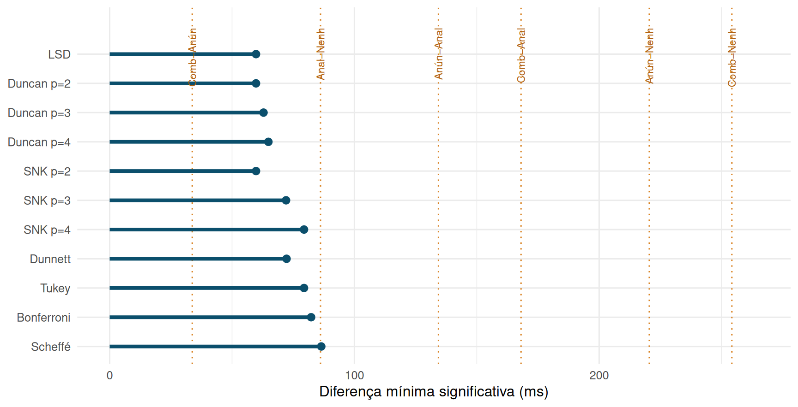
<p class="caption">(\#fig:c3c-plot-reguas)Diferença mínima significativa de cada procedimento (barras azuis) e as seis diferenças observadas entre médias (linhas pontilhadas laranja, rotuladas no topo). Um par é declarado diferente pelo procedimento quando sua linha pontilhada fica à direita do fim da barra.</p>
</div>


<table class="table" style="width: auto !important; margin-left: auto; margin-right: auto;">
<caption>(\#tab:c3c-decisoes)Decisão de cada procedimento para cada par (≠: diferença declarada significativa a 5%)</caption>
 <thead>
  <tr>
   <th style="text-align:left;"> Par </th>
   <th style="text-align:right;"> Diferença </th>
   <th style="text-align:center;"> LSD sem proteção </th>
   <th style="text-align:center;"> LSD protegido </th>
   <th style="text-align:center;"> Duncan </th>
   <th style="text-align:center;"> SNK </th>
   <th style="text-align:center;"> Tukey </th>
   <th style="text-align:center;"> Bonferroni </th>
   <th style="text-align:center;"> Scheffé </th>
  </tr>
 </thead>
<tbody>
  <tr>
   <td style="text-align:left;font-weight: bold;"> Analytics − Nenhum </td>
   <td style="text-align:right;font-weight: bold;"> 86,2 </td>
   <td style="text-align:center;font-weight: bold;"> ≠ </td>
   <td style="text-align:center;font-weight: bold;"> ≠ </td>
   <td style="text-align:center;font-weight: bold;"> ≠ </td>
   <td style="text-align:center;font-weight: bold;"> ≠ </td>
   <td style="text-align:center;font-weight: bold;"> ≠ </td>
   <td style="text-align:center;font-weight: bold;"> ≠ </td>
   <td style="text-align:center;font-weight: bold;"> = </td>
  </tr>
  <tr>
   <td style="text-align:left;"> Anúncios − Nenhum </td>
   <td style="text-align:right;"> 220,5 </td>
   <td style="text-align:center;"> ≠ </td>
   <td style="text-align:center;"> ≠ </td>
   <td style="text-align:center;"> ≠ </td>
   <td style="text-align:center;"> ≠ </td>
   <td style="text-align:center;"> ≠ </td>
   <td style="text-align:center;"> ≠ </td>
   <td style="text-align:center;"> ≠ </td>
  </tr>
  <tr>
   <td style="text-align:left;"> Combo − Nenhum </td>
   <td style="text-align:right;"> 254,2 </td>
   <td style="text-align:center;"> ≠ </td>
   <td style="text-align:center;"> ≠ </td>
   <td style="text-align:center;"> ≠ </td>
   <td style="text-align:center;"> ≠ </td>
   <td style="text-align:center;"> ≠ </td>
   <td style="text-align:center;"> ≠ </td>
   <td style="text-align:center;"> ≠ </td>
  </tr>
  <tr>
   <td style="text-align:left;"> Anúncios − Analytics </td>
   <td style="text-align:right;"> 134,3 </td>
   <td style="text-align:center;"> ≠ </td>
   <td style="text-align:center;"> ≠ </td>
   <td style="text-align:center;"> ≠ </td>
   <td style="text-align:center;"> ≠ </td>
   <td style="text-align:center;"> ≠ </td>
   <td style="text-align:center;"> ≠ </td>
   <td style="text-align:center;"> ≠ </td>
  </tr>
  <tr>
   <td style="text-align:left;"> Combo − Analytics </td>
   <td style="text-align:right;"> 168,1 </td>
   <td style="text-align:center;"> ≠ </td>
   <td style="text-align:center;"> ≠ </td>
   <td style="text-align:center;"> ≠ </td>
   <td style="text-align:center;"> ≠ </td>
   <td style="text-align:center;"> ≠ </td>
   <td style="text-align:center;"> ≠ </td>
   <td style="text-align:center;"> ≠ </td>
  </tr>
  <tr>
   <td style="text-align:left;"> Combo − Anúncios </td>
   <td style="text-align:right;"> 33,7 </td>
   <td style="text-align:center;"> = </td>
   <td style="text-align:center;"> = </td>
   <td style="text-align:center;"> = </td>
   <td style="text-align:center;"> = </td>
   <td style="text-align:center;"> = </td>
   <td style="text-align:center;"> = </td>
   <td style="text-align:center;"> = </td>
  </tr>
</tbody>
</table>

Os procedimentos concordam em cinco dos seis pares: as diferenças grandes (acima de 130 ms)
sobrevivem a qualquer correção, e Anúncios − Combo (33,7 ms) não é significativa por
nenhum método. Toda a divergência está no par **Analytics − Nenhum** (86,2 ms), que
cai entre a régua de Bonferroni (82,3 ms) e a de Scheffé (86,5 ms): é
declarado diferente por LSD, Duncan, SNK, Dunnett, Tukey e Bonferroni, e só o Scheffé não o
declara. O exemplo ilustra bem a hierarquia das réguas e o fato de que a escolha do procedimento só
importa nos casos de fronteira — razão a mais para fixá-la no protocolo.

A Tabela \@ref(tab:c3c-snk-passos) mostra o SNK aplicado passo a passo, com a regra de coerência:
começa-se pela amplitude 4 (Combo − Nenhum); só porque ela foi significativa as amplitudes 3 são
testadas, e só porque estas foram as vizinhas são testadas.

<table class="table" style="width: auto !important; margin-left: auto; margin-right: auto;">
<caption>(\#tab:c3c-snk-passos)SNK em etapas: da maior amplitude para a menor</caption>
 <thead>
  <tr>
   <th style="text-align:center;"> Etapa </th>
   <th style="text-align:left;"> Par </th>
   <th style="text-align:center;"> Amplitude p </th>
   <th style="text-align:right;"> Diferença </th>
   <th style="text-align:right;"> DMS (SNK) </th>
   <th style="text-align:center;"> Decisão </th>
  </tr>
 </thead>
<tbody>
  <tr>
   <td style="text-align:center;"> 1 </td>
   <td style="text-align:left;"> Combo − Nenhum </td>
   <td style="text-align:center;"> 4 </td>
   <td style="text-align:right;"> 254,2 </td>
   <td style="text-align:right;"> 79,4 </td>
   <td style="text-align:center;"> ≠ </td>
  </tr>
  <tr>
   <td style="text-align:center;"> 2 </td>
   <td style="text-align:left;"> Anúncios − Nenhum </td>
   <td style="text-align:center;"> 3 </td>
   <td style="text-align:right;"> 220,5 </td>
   <td style="text-align:right;"> 72,1 </td>
   <td style="text-align:center;"> ≠ </td>
  </tr>
  <tr>
   <td style="text-align:center;"> 3 </td>
   <td style="text-align:left;"> Combo − Analytics </td>
   <td style="text-align:center;"> 3 </td>
   <td style="text-align:right;"> 168,1 </td>
   <td style="text-align:right;"> 72,1 </td>
   <td style="text-align:center;"> ≠ </td>
  </tr>
  <tr>
   <td style="text-align:center;"> 4 </td>
   <td style="text-align:left;"> Anúncios − Analytics </td>
   <td style="text-align:center;"> 2 </td>
   <td style="text-align:right;"> 134,3 </td>
   <td style="text-align:right;"> 59,8 </td>
   <td style="text-align:center;"> ≠ </td>
  </tr>
  <tr>
   <td style="text-align:center;"> 5 </td>
   <td style="text-align:left;"> Analytics − Nenhum </td>
   <td style="text-align:center;"> 2 </td>
   <td style="text-align:right;"> 86,2 </td>
   <td style="text-align:right;"> 59,8 </td>
   <td style="text-align:center;"> ≠ </td>
  </tr>
  <tr>
   <td style="text-align:center;"> 6 </td>
   <td style="text-align:left;"> Combo − Anúncios </td>
   <td style="text-align:center;"> 2 </td>
   <td style="text-align:right;"> 33,7 </td>
   <td style="text-align:right;"> 59,8 </td>
   <td style="text-align:center;"> = </td>
  </tr>
</tbody>
</table>

E a dependência da posição fica explícita imaginando uma diferença hipotética de 75 ms: pelo SNK
ela seria significativa entre médias vizinhas (régua de 59,8 ms) ou separadas por
uma média (72,1 ms), mas não entre os extremos (79,4 ms); por Tukey,
a régua é 79,4 ms para qualquer posição, e os 75 ms nunca seriam significativos.

```{=html}
<div class="caixa-r"><strong>Uso do R</strong> — Tukey, Bonferroni, Scheffé, Dunnett, Duncan e agrupamento</div>
```


``` r
emm_scripts <- emmeans(mod_scripts, ~ config)

# todos os pares, três correções diferentes
pairs(emm_scripts, adjust = "tukey")
```

```
##  contrast             estimate   SE df t.ratio p.value
##  Nenhum - Analytics      -86.2 29.5 36  -2.922  0.0291
##  Nenhum - Anúncios      -220.5 29.5 36  -7.478 <0.0001
##  Nenhum - Combo         -254.2 29.5 36  -8.623 <0.0001
##  Analytics - Anúncios   -134.3 29.5 36  -4.556  0.0003
##  Analytics - Combo      -168.1 29.5 36  -5.701 <0.0001
##  Anúncios - Combo        -33.7 29.5 36  -1.144  0.6650
## 
## P value adjustment: tukey method for comparing a family of 4 estimates
```

``` r
pairs(emm_scripts, adjust = "bonferroni")
```

```
##  contrast             estimate   SE df t.ratio p.value
##  Nenhum - Analytics      -86.2 29.5 36  -2.922  0.0359
##  Nenhum - Anúncios      -220.5 29.5 36  -7.478 <0.0001
##  Nenhum - Combo         -254.2 29.5 36  -8.623 <0.0001
##  Analytics - Anúncios   -134.3 29.5 36  -4.556  0.0003
##  Analytics - Combo      -168.1 29.5 36  -5.701 <0.0001
##  Anúncios - Combo        -33.7 29.5 36  -1.144  1.0000
## 
## P value adjustment: bonferroni method for 6 tests
```

``` r
pairs(emm_scripts, adjust = "scheffe")
```

```
##  contrast             estimate   SE df t.ratio p.value
##  Nenhum - Analytics      -86.2 29.5 36  -2.922  0.0511
##  Nenhum - Anúncios      -220.5 29.5 36  -7.478 <0.0001
##  Nenhum - Combo         -254.2 29.5 36  -8.623 <0.0001
##  Analytics - Anúncios   -134.3 29.5 36  -4.556  0.0009
##  Analytics - Combo      -168.1 29.5 36  -5.701 <0.0001
##  Anúncios - Combo        -33.7 29.5 36  -1.144  0.7282
## 
## P value adjustment: scheffe method with rank 3
```

``` r
# cada tratamento vs. o controle "Nenhum" (Dunnett)
contrast(emm_scripts, method = "trt.vs.ctrl", ref = "Nenhum", adjust = "dunnettx")
```

```
##  contrast           estimate   SE df t.ratio p.value
##  Analytics - Nenhum     86.2 29.5 36   2.922  0.0167
##  Anúncios - Nenhum     220.5 29.5 36   7.478 <0.0001
##  Combo - Nenhum        254.2 29.5 36   8.623 <0.0001
## 
## P value adjustment: dunnettx method for 3 tests
```

``` r
# agrupamento compacto por letras (compact letter display)
multcomp::cld(emm_scripts, Letters = letters, adjust = "tukey")
```

```
##  config    emmean   SE df lower.CL upper.CL .group
##  Nenhum       859 20.8 36      805      914  a    
##  Analytics    946 20.8 36      891     1000   b   
##  Anúncios    1080 20.8 36     1025     1135    c  
##  Combo       1114 20.8 36     1059     1168    c  
## 
## Confidence level used: 0.95 
## Conf-level adjustment: sidak method for 4 estimates 
## P value adjustment: tukey method for comparing a family of 4 estimates 
## significance level used: alpha = 0.05 
## NOTE: If two or more means share the same grouping symbol,
##       then we cannot show them to be different.
##       But we also did not show them to be the same.
```


``` r
# Teste de Duncan (amplitude múltipla): fora do R base, via agricolae
duncan_scripts <- agricolae::duncan.test(mod_scripts, "config", console = FALSE)
duncan_scripts$groups   # médias ordenadas + agrupamento por letras (Duncan)
```

```
##            tempo_ms groups
## Combo     1113.6160      a
## Anúncios  1079.8775      a
## Analytics  945.5325      b
## Nenhum     859.3801      c
```

``` r
duncan_scripts$duncan   # amplitudes mínimas significativas R_p para p = 2, 3, 4
```

```
##      Table CriticalRange
## 2 2.868158      59.79713
## 3 3.015218      62.86313
## 4 3.111132      64.86280
```


``` r
# Dunnett unilateral: a pergunta do protocolo é "o script PIORA o tempo?"
g_uni <- glht(mod_scripts, linfct = mcp(config = "Dunnett"), alternative = "greater")
summary(g_uni)
```

```
## 
## 	 Simultaneous Tests for General Linear Hypotheses
## 
## Multiple Comparisons of Means: Dunnett Contrasts
## 
## 
## Fit: aov(formula = tempo_ms ~ config, data = dados_scripts)
## 
## Linear Hypotheses:
##                         Estimate Std. Error t value  Pr(>t)    
## Analytics - Nenhum <= 0    86.15      29.48   2.922 0.00801 ** 
## Anúncios - Nenhum <= 0    220.50      29.48   7.478 < 0.001 ***
## Combo - Nenhum <= 0       254.24      29.48   8.623 < 0.001 ***
## ---
## Signif. codes:  0 '***' 0.001 '**' 0.01 '*' 0.05 '.' 0.1 ' ' 1
## (Adjusted p values reported -- single-step method)
```

Dois detalhes desta saída merecem comentário. Primeiro, o par Analytics − Nenhum tem p ≈ 0,017 por
Dunnett e p ≈ 0,029 por Tukey: Dunnett corrige para três comparações (só contra o controle), Tukey
para seis. Se a pergunta do protocolo é apenas "cada script piora em relação a nenhum?", pagar por
seis comparações é desperdiçar poder. Segundo, na versão unilateral o p-valor desse par cai para
cerca de metade — legítimo aqui porque nenhum script de terceiros **acelera** uma página e a
direção foi fixada antes da coleta; escolher "unilateral" depois de ver o sinal da diferença seria
mais uma forma de *data snooping*.

O agrupamento de Duncan reaparece na coluna `groups` acima: neste conjunto de dados, ele coincide
com o `cld()` de Tukey exibido antes (mesma partição em três grupos), porque os efeitos de
configuração são grandes o bastante para que até o critério mais rigoroso de Tukey já os separe.
A diferença entre os dois métodos fica visível justamente nos casos de fronteira — pares cuja
diferença observada fica **entre** o valor crítico mais liberal de Duncan para aquela amplitude e o
valor crítico único, mais conservador, de Tukey (aqui, entre 59,8 e
79,4 ms para vizinhas); nesses casos, e só neles, Duncan declara significativo um par
que Tukey não declara.

<div class="figure" style="text-align: center">
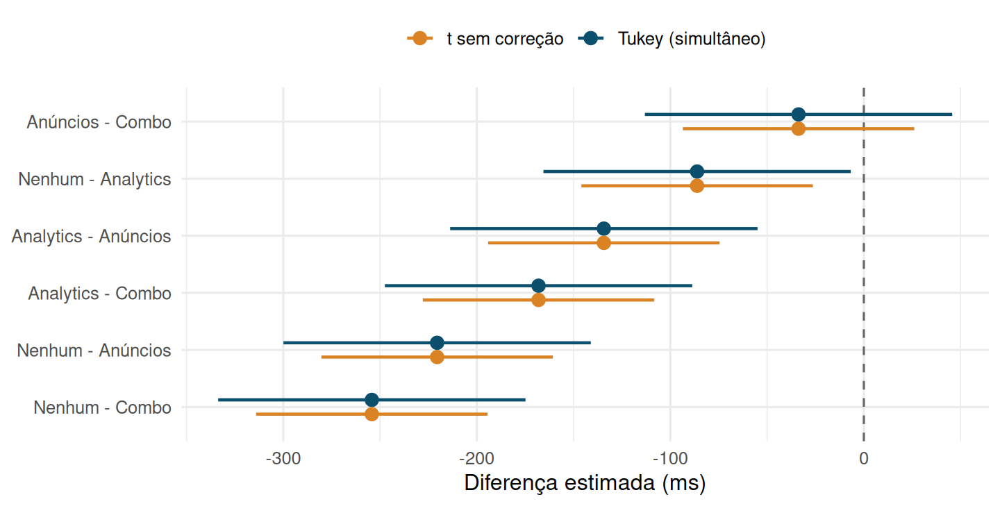
<p class="caption">(\#fig:c3b-plot-tukey-ic)Intervalos de confiança de 95% para as seis diferenças entre médias: simultâneos de Tukey (azul) e individuais, sem correção (laranja). Um par difere quando o intervalo não cruza o zero (linha tracejada).</p>
</div>

Os intervalos de Tukey são 33% mais largos que os
individuais: é o preço de a garantia de 95% valer para os seis ao mesmo tempo. Só
"Anúncios − Combo" cruza zero nos dois casos, confirmando o $SQ_{L_3}$ não significativo da partição
por contrastes ortogonais.

### Agrupamento de tratamentos (*compact letter display*)

Uma forma compacta de reportar o resultado de comparações múltiplas par a par é atribuir letras
às médias: tratamentos que compartilham pelo menos uma letra **não** diferem significativamente
entre si; tratamentos sem letra em comum diferem. Essa representação (*compact letter display*,
CLD) é extremamente comum em tabelas de resultados agronômicos e biológicos. As letras em si são
arbitrárias — o `cld()` do `multcomp` começa pela menor média, o `agricolae` pela maior —; o que
importa é se há letra em comum. A Figura \@ref(fig:c3c-plot-letras) é a forma de relatório: dados,
médias com intervalo e letras de Tukey numa só figura.

<div class="figure" style="text-align: center">
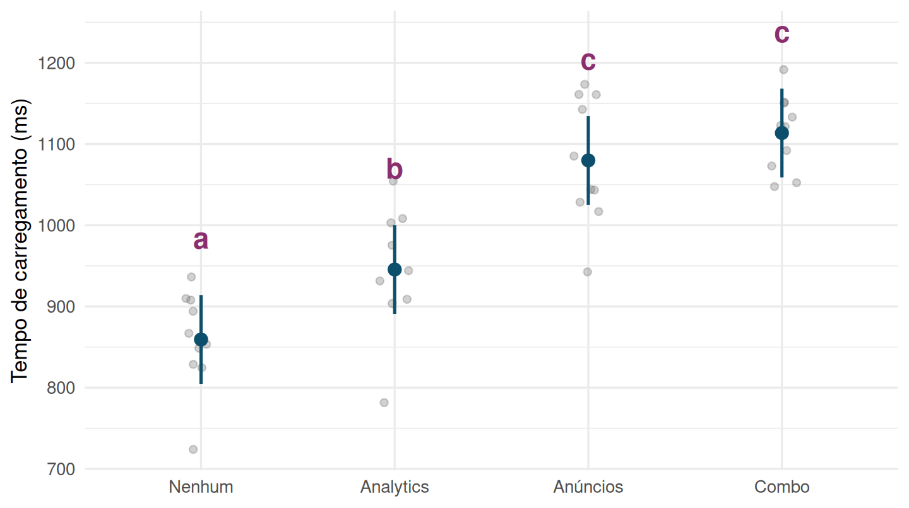
<p class="caption">(\#fig:c3c-plot-letras)Tempos individuais (cinza), médias com IC de 95% (azul) e letras do agrupamento de Tukey: configurações com letra em comum não diferem a 5% (FWER).</p>
</div>

O CLD tem, porém, um defeito conhecido: um tratamento pode receber **duas** letras ("ab"), ficando
"igual" a dois grupos que são diferentes entre si — o que não é ambiguidade dos dados, e sim do
procedimento, que testa pares e depois tenta resumir os resultados em grupos. Veremos isso
acontecer nos dados de cafeína, na próxima seção.

### Scott-Knott: grupos que não se sobrepõem {#scott-knott}

O método de Scott e Knott [-@scottknott1974cluster] ataca o problema por outro caminho: em vez de
testar pares, **particiona** o conjunto de médias ordenadas em grupos disjuntos, por um critério de
máxima verossimilhança. O algoritmo é recursivo: (1) ordenar as $k$ médias; (2) entre as $k-1$
bipartições possíveis que respeitam a ordem, achar a que maximiza a soma de quadrados entre os dois
grupos, $B_0$; (3) testar se $B_0$ é grande demais para ser acaso, pela estatística

$$\lambda=\frac{\pi}{2(\pi-2)}\cdot\frac{B_0}{\hat\sigma_0^2} \;\dot\sim\; \chi^2_{\,k/(\pi-2)}, \qquad \hat\sigma_0^2=\frac{\sum_i n_i(\bar y_i-\bar y)^2+\nu\,QME}{k+\nu};$$

(4) se for, dividir e repetir o procedimento em cada parte. O algoritmo cabe em poucas linhas:


``` r
sk <- function(med, n_i, QME, gl, alpha = 0.05) {
  grupo <- rep(1L, length(med)); prox <- 2L
  parte <- function(idx) {
    if (length(idx) < 2) return(invisible(NULL))
    m_ <- med[idx]; n_ <- n_i[idx]; k <- length(idx)
    B0 <- sapply(1:(k - 1), function(j) {
      T1 <- sum(n_[1:j] * m_[1:j]); T2 <- sum(n_[(j+1):k] * m_[(j+1):k])
      T1^2 / sum(n_[1:j]) + T2^2 / sum(n_[(j+1):k]) - (T1 + T2)^2 / sum(n_)
    })
    j <- which.max(B0)
    s2_0   <- (sum(n_ * (m_ - mean(m_))^2) + gl * QME) / (k + gl)
    lambda <- (pi / (2 * (pi - 2))) * max(B0) / s2_0
    if (lambda > qchisq(1 - alpha, k / (pi - 2))) {      # divide e recorre
      novos <- idx[(j+1):k]; grupo[novos] <<- prox; prox <<- prox + 1L
      parte(idx[1:j]); parte(novos)
    }
  }
  parte(seq_along(med)); grupo
}
med_ord <- sort(medias); g_sk <- sk(med_ord, ns[names(med_ord)], qme, gl_erro)
tibble(`Configuração` = names(med_ord), `Média (ms)` = round(med_ord, 1),
       `Scott-Knott` = LETTERS[match(g_sk, unique(g_sk))])
```

```
## # A tibble: 4 × 3
##   Configuração `Média (ms)` `Scott-Knott`
##   <chr>           <dbl[1d]> <chr>        
## 1 Nenhum               859. A            
## 2 Analytics            946. B            
## 3 Anúncios            1080. C            
## 4 Combo               1114. C
```

Três grupos disjuntos, os mesmos de Tukey aqui. O pacote `ScottKnott` (função `SK()`) devolve o
mesmo resultado; implementá-lo à mão é deliberado, para que a lógica de partição fique visível.

### Ordenamento como pergunta: quem é o mais lento? {#ranking-scripts}

A ordem observada das médias é Combo > Anúncios > Analytics > Nenhum. Com que segurança se pode
dizer que o Combo é a configuração mais lenta? Uma forma simples de responder é tratar as médias
verdadeiras como incertas, com $\mu_i \sim N(\bar y_{i\cdot}, QME/n)$ — uma aproximação de bootstrap
paramétrico (ou a posteriori com priori plana) —, sortear muitas vezes as quatro médias e registrar
a posição de cada configuração no ranking.


``` r
set.seed(11)
sim_m <- sapply(medias, function(mu) rnorm(10000, mu, sqrt(qme / 10)))
pos <- t(apply(-sim_m, 1, rank))       # posição 1 = mais lenta
prob_rank <- map_dfr(colnames(pos), function(cfg)
  tibble(config = cfg, posicao = 1:4, prob = sapply(1:4, function(k) mean(pos[, cfg] == k))))
ggplot(prob_rank, aes(factor(posicao), factor(config, levels = rev(names(medias))), fill = prob)) +
  geom_tile(color = "white") + geom_text(aes(label = scales::percent(prob, 1)), size = 4.2) +
  scale_fill_gradient(low = "white", high = "#0B4F6C", guide = "none") +
  labs(x = "Posição no ranking (1 = mais lenta)", y = NULL) + theme_minimal(base_size = 12)
```

<div class="figure" style="text-align: center">
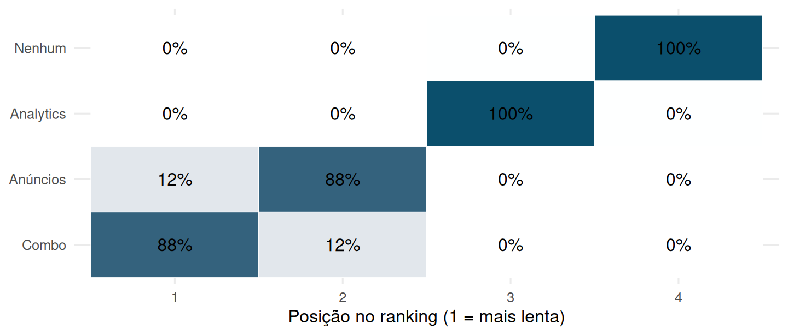
<p class="caption">(\#fig:c3c-rank-prob)Probabilidade aproximada de cada configuração ocupar cada posição no ranking de tempo de carregamento (1 = mais lenta), obtida sorteando 10.000 vezes as médias de N(média observada, QME/n).</p>
</div>

Nenhum é a mais rápida e Analytics a segunda com probabilidade praticamente 1. Mas o Combo é o mais
lento em só cerca de 88% dos sorteios: a ordem entre Combo e Anúncios não é
sustentada pelos dados, o mesmo que dizem Tukey, o contraste $L_3$ e o intervalo de confiança da
diferença. O ranking que os dados permitem é parcial: Nenhum < Analytics < {Anúncios, Combo}.

### Quanto custa ser liberal: o FWER simulado {#fwer-simulada}

A discussão sobre quem controla o FWER e em que condições fica concreta com uma simulação.
Repetimos 2.000 vezes um experimento com o mesmo desenho ($t = 4$, $n = 10$, $\sigma = 70$ ms) em
dois cenários: $H_0$ completa (quatro médias iguais) e $H_0$ parcial (duas configurações iguais
entre si, outras duas iguais entre si, com 200 ms entre os pares). Em cada repetição registramos se
**algum par de médias verdadeiramente iguais** foi declarado diferente.


``` r
fwer_sim <- function(mu, n = 10, sigma = 70, B = 2000) {
  t <- length(mu); pares <- combn(t, 2); nulos <- mu[pares[1, ]] == mu[pares[2, ]]
  rowMeans(replicate(B, {
    y <- matrix(rnorm(n * t, rep(mu, each = n), sigma), n)
    sapply(decide_pares(colMeans(y), mean(apply(y, 2, var)), n, t * (n - 1)),
           function(d) any(d[nulos]))
  }))
}
set.seed(2027)
fw <- bind_rows(
  enframe(fwer_sim(c(0, 0, 0, 0)), "metodo", "fwer") %>% mutate(cenario = "H0 completa: 4 médias iguais"),
  enframe(fwer_sim(c(0, 0, 200, 200)), "metodo", "fwer") %>%
    mutate(cenario = "H0 parcial: 2 pares iguais, 200 ms entre pares"))
ggplot(fw, aes(fwer, factor(metodo, levels = rev(names(dec))))) +
  geom_col(fill = "#0B4F6C", width = 0.65) +
  geom_vline(xintercept = 0.05, color = "#d98324", linetype = "dashed") +
  geom_text(aes(label = scales::percent(fwer, 0.1, decimal.mark = ",")), hjust = -0.15, size = 3.3) +
  facet_wrap(~ cenario) + scale_x_continuous(labels = scales::percent, limits = c(0, 0.25)) +
  labs(x = "FWER simulado", y = NULL) + theme_minimal(base_size = 11)
```

<div class="figure" style="text-align: center">
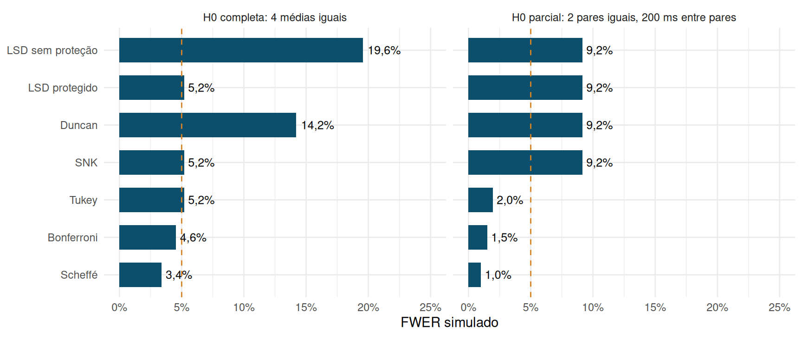
<p class="caption">(\#fig:c3c-sim-fwer)Taxa de erro por família (FWER) estimada em 2.000 repetições do experimento para cada procedimento, sob H0 completa (esquerda) e sob H0 parcial (direita). A linha tracejada marca o nível nominal de 5%.</p>
</div>


O resultado organiza toda a discussão anterior. Sob $H_0$ completa, os testes $t$ sem correção
erram em 20% das repetições e o Duncan em
14% (o valor teórico é $\alpha_4 \approx 14{,}3\%$), enquanto LSD protegido,
SNK e Tukey ficam em torno de 5% e Bonferroni e Scheffé abaixo disso. Sob $H_0$ **parcial**, porém,
LSD protegido e SNK sobem para 9%: o $F$ global é sempre significativo (há
200 ms entre os pares), de modo que a "proteção" desaparece, e os dois pares de médias iguais, que
ficam vizinhos na ordenação, são testados cada um ao nível de 5% — $1-0{,}95^2 \approx 9{,}75\%$.
Tukey, Bonferroni e Scheffé ficam abaixo de 5% nos dois cenários: é isso que significa "controlar o
FWER em sentido forte".

### *Data snooping* na prática {#snooping-pratica}

Suponha agora que a comparação Analytics − Nenhum **não** estivesse no protocolo: alguém olhou a
Figura \@ref(fig:c3c-plot-dados-scripts) e decidiu testá-la. A régua honesta para um contraste
sugerido pelos dados é a de Scheffé.


``` r
L_an <- medias["Analytics"] - medias["Nenhum"]; t_an <- unname(L_an / sqrt(2 * qme / 10))
c(t_obs = t_an, t_crit_planejado = qt(0.975, 36), t_crit_Scheffe = sqrt(3 * qf(0.95, 3, 36)))
```

```
##            t_obs t_crit_planejado   t_crit_Scheffe 
##         2.921968         2.028094         2.932370
```

``` r
c_snoop <- c(1, 1, -1, -1) / 2        # "sem anúncio" vs. "com anúncio", também sugerido pelo gráfico
abs(sum(c_snoop * medias)) / sqrt(qme * sum(c_snoop^2) / 10)
```

```
## [1] 9.319104
```

Como contraste planejado, $t = 2{,}92$ passaria folgado do valor crítico
2,03; como contraste sugerido pelos dados, o critério de Scheffé exige
2,93, e o par fica por um fio abaixo dele. Já o contraste "sem anúncio
vs. com anúncio", também inspirado pelo gráfico, dá
$t = 9{,}3$ e passa por qualquer régua. A
lição é geral: efeitos grandes não precisam de planejamento para sobreviver a uma correção honesta;
os de fronteira, sim.

### O que as comparações múltiplas respondem nestes dados {#comparacoes-respostas}

1. **Quais configurações diferem entre si?** Todas, exceto Anúncios e Combo (Tukey, FWER de 5%). A
   conclusão sobre Analytics × Nenhum depende do procedimento: só o Scheffé não a sustenta.
2. **Cada script piora em relação a nenhum?** Sim, os três (Dunnett): Analytics
   +86 ms, Anúncios +220 ms, Combo +254 ms.
3. **É possível ordenar as quatro configurações?** Só parcialmente: Nenhum < Analytics <
   {Anúncios, Combo}; afirmar que "o Combo é o pior" não é sustentado.
4. **Que procedimento reportar?** O que responde à pergunta do protocolo — Dunnett para "contra o
   controle", Tukey para "todos os pares". Reportar o procedimento que produziu mais asteriscos é
   *data snooping* de procedimento.

```{=html}
<div class="caixa-discussao">
<strong>Para discutir</strong>
<ol>
<li>Por que faz sentido usar Dunnett (não Tukey) quando a única pergunta de interesse é "cada
configuração aumenta o tempo de carregamento em relação a não usar nenhum script?" E por que, nesse
caso, a versão unilateral é legítima?</li>
<li>Um pesquisador roda a ANOVA, olha os dados, percebe uma diferença "interessante" entre dois
grupos que não tinha planejado comparar, e testa essa diferença com um teste $t$ comum. Por que
isso viola as premissas por trás de todos os procedimentos desta seção, mesmo que o p-valor
reportado pareça pequeno? O que muda se ele usar Scheffé?</li>
<li>O contraste $L_3$ (Anúncios contra Combo) não foi significativo, e um gerente conclui que "o
chat não custa nada". O que você responderia, usando o intervalo de confiança de $L_3$ e o cálculo
de tamanho amostral?</li>
<li>Os três contrastes "cada script contra Nenhum" somaram mais que $SQ_{Trat}$. Isso indica um erro
de conta? O que representa a soma "a mais"?</li>
<li>Na simulação, LSD protegido e SNK controlaram o FWER sob $H_0$ completa, mas não sob $H_0$
parcial. Explique o mecanismo, com base no teste $F$ preliminar e na regra de coerência.</li>
<li>O teste de Duncan é mais liberal que Tukey porque usa um nível de proteção $\alpha_p$ que
cresce com a amplitude $p$ da comparação, em vez de manter $\alpha$ fixo. Isso é uma vantagem ou
uma desvantagem? Em que tipo de publicação você esperaria ver Duncan preferido a Tukey, apesar de
sua FWER não controlada?</li>
</ol>
</div>
```

## Polinômios ortogonais {#polinomios-ortogonais}

Quando os níveis do fator são **quantitativos e igualmente espaçados** — como doses de um
fármaco, ou concentrações de um insumo — comparar médias par a par desperdiça a informação de que
os níveis têm uma ordem e uma métrica. Nesses casos, é mais informativo perguntar: *a resposta
cresce linearmente com o nível? Há curvatura (efeito quadrático)? A curva se inverte de novo
(cúbico)?* Polinômios ortogonais decompõem $SQ_{\text{Trat}}$ exatamente nesses componentes.


``` r
set.seed(7)
dose_mg <- c(0, 50, 100, 150, 200)
n_dose  <- 8

# covariável: nível basal de atenção (medido ANTES da dose), usado adiante na ANCOVA
basal <- rnorm(5 * n_dose, mean = 60, sd = 8)
dose_f <- factor(rep(dose_mg, each = n_dose))

# efeito verdadeiro tem forma de "U invertido": atenção sobe com a dose até um
# ponto e depois cai (excesso de estimulação) -- um caso clássico de curvatura
efeito_dose <- function(d) 20 + 0.35 * d - 0.0013 * d^2

cafeina <- tibble(
  participante = 1:(5 * n_dose),
  dose         = dose_f,
  basal        = basal,
  atencao_pos  = 40 + 0.5 * basal + efeito_dose(as.numeric(as.character(dose_f))) +
    rnorm(5 * n_dose, mean = 0, sd = 5)
)
```

```{=html}
<div class="caixa-aplicacao">
<strong>Aplicação — Psicologia: dose de cafeína e atenção sustentada</strong><br>
Um laboratório testa o efeito da cafeína (0, 50, 100, 150 e 200 mg) sobre o desempenho em um
teste de atenção sustentada, aplicado 40 minutos após a ingestão. Quarenta participantes são
sorteados em 5 grupos de 8 (<strong>UE = participante</strong>). Os níveis do fator — a dose — são
quantitativos e igualmente espaçados em 50 mg, o cenário ideal para polinômios ortogonais. As
perguntas do laboratório: a atenção depende da dose? Mais cafeína é sempre melhor? Existe uma dose
ótima? Como os dados são simulados, conhecemos a curva verdadeira — uma parábola com pico em
0,35/(2 × 0,0013) ≈ 135 mg —, o que permitirá, ao final, avaliar o quanto a análise acertou.
</div>
```

A dose foi sorteada entre os participantes, e a atenção basal foi medida antes do sorteio. Por
isso, quando a Seção \@ref(ancova) ajustar pela atenção basal, o ajuste vai ganhar **precisão**, não
corrigir viés: o sorteio já garante que as doses não diferem, em média, na atenção basal.

### Os dados {#dados-cafeina}

<table class="table" style="width: auto !important; margin-left: auto; margin-right: auto;">
<caption>(\#tab:c3c-dados-cafeina)Escore de atenção sustentada dos 40 participantes, por dose de cafeína</caption>
 <thead>
  <tr>
   <th style="text-align:right;"> Participante </th>
   <th style="text-align:right;"> 0 mg </th>
   <th style="text-align:right;"> 50 mg </th>
   <th style="text-align:right;"> 100 mg </th>
   <th style="text-align:right;"> 150 mg </th>
   <th style="text-align:right;"> 200 mg </th>
  </tr>
 </thead>
<tbody>
  <tr>
   <td style="text-align:right;"> 1 </td>
   <td style="text-align:right;"> 105.2 </td>
   <td style="text-align:right;"> 105.4 </td>
   <td style="text-align:right;"> 100.6 </td>
   <td style="text-align:right;"> 119.9 </td>
   <td style="text-align:right;"> 105.4 </td>
  </tr>
  <tr>
   <td style="text-align:right;"> 2 </td>
   <td style="text-align:right;"> 81.7 </td>
   <td style="text-align:right;"> 117.7 </td>
   <td style="text-align:right;"> 112.4 </td>
   <td style="text-align:right;"> 119.5 </td>
   <td style="text-align:right;"> 103.4 </td>
  </tr>
  <tr>
   <td style="text-align:right;"> 3 </td>
   <td style="text-align:right;"> 85.8 </td>
   <td style="text-align:right;"> 104.4 </td>
   <td style="text-align:right;"> 112.8 </td>
   <td style="text-align:right;"> 120.1 </td>
   <td style="text-align:right;"> 98.1 </td>
  </tr>
  <tr>
   <td style="text-align:right;"> 4 </td>
   <td style="text-align:right;"> 81.8 </td>
   <td style="text-align:right;"> 115.1 </td>
   <td style="text-align:right;"> 111.5 </td>
   <td style="text-align:right;"> 121.4 </td>
   <td style="text-align:right;"> 99.1 </td>
  </tr>
  <tr>
   <td style="text-align:right;"> 5 </td>
   <td style="text-align:right;"> 84.2 </td>
   <td style="text-align:right;"> 115.2 </td>
   <td style="text-align:right;"> 115.7 </td>
   <td style="text-align:right;"> 115.6 </td>
   <td style="text-align:right;"> 107.5 </td>
  </tr>
  <tr>
   <td style="text-align:right;"> 6 </td>
   <td style="text-align:right;"> 84.2 </td>
   <td style="text-align:right;"> 114.1 </td>
   <td style="text-align:right;"> 115.6 </td>
   <td style="text-align:right;"> 115.6 </td>
   <td style="text-align:right;"> 100.8 </td>
  </tr>
  <tr>
   <td style="text-align:right;"> 7 </td>
   <td style="text-align:right;"> 99.7 </td>
   <td style="text-align:right;"> 115.5 </td>
   <td style="text-align:right;"> 119.9 </td>
   <td style="text-align:right;"> 111.9 </td>
   <td style="text-align:right;"> 107.1 </td>
  </tr>
  <tr>
   <td style="text-align:right;"> 8 </td>
   <td style="text-align:right;"> 92.5 </td>
   <td style="text-align:right;"> 108.5 </td>
   <td style="text-align:right;"> 110.0 </td>
   <td style="text-align:right;"> 111.5 </td>
   <td style="text-align:right;"> 121.4 </td>
  </tr>
</tbody>
</table>

<table class="table" style="width: auto !important; margin-left: auto; margin-right: auto;">
<caption>(\#tab:c3c-resumo-cafeina)Média e desvio-padrão do escore de atenção por dose</caption>
 <thead>
  <tr>
   <th style="text-align:left;"> Dose (mg) </th>
   <th style="text-align:right;"> n </th>
   <th style="text-align:right;"> Média </th>
   <th style="text-align:right;"> DP </th>
  </tr>
 </thead>
<tbody>
  <tr>
   <td style="text-align:left;"> 0 </td>
   <td style="text-align:right;"> 8 </td>
   <td style="text-align:right;"> 89.39 </td>
   <td style="text-align:right;"> 8.88 </td>
  </tr>
  <tr>
   <td style="text-align:left;"> 50 </td>
   <td style="text-align:right;"> 8 </td>
   <td style="text-align:right;"> 111.97 </td>
   <td style="text-align:right;"> 5.11 </td>
  </tr>
  <tr>
   <td style="text-align:left;"> 100 </td>
   <td style="text-align:right;"> 8 </td>
   <td style="text-align:right;"> 112.31 </td>
   <td style="text-align:right;"> 5.67 </td>
  </tr>
  <tr>
   <td style="text-align:left;"> 150 </td>
   <td style="text-align:right;"> 8 </td>
   <td style="text-align:right;"> 116.96 </td>
   <td style="text-align:right;"> 3.84 </td>
  </tr>
  <tr>
   <td style="text-align:left;"> 200 </td>
   <td style="text-align:right;"> 8 </td>
   <td style="text-align:right;"> 105.35 </td>
   <td style="text-align:right;"> 7.37 </td>
  </tr>
</tbody>
</table>

<div class="figure" style="text-align: center">
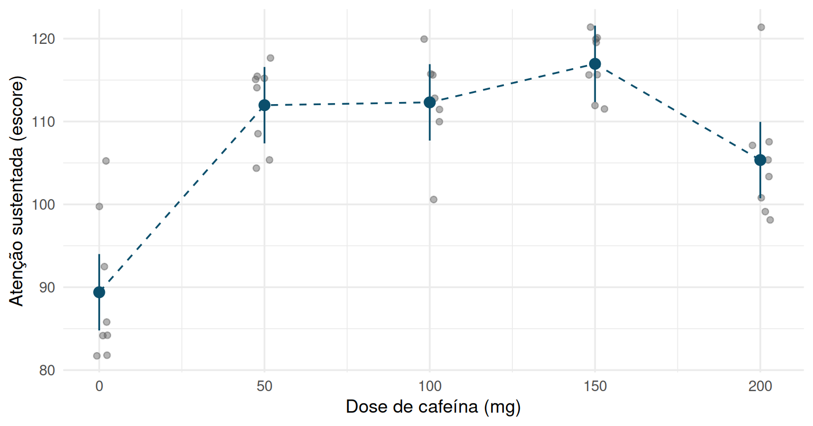
<p class="caption">(\#fig:c3c-plot-dados-cafeina)Escores individuais de atenção (cinza) e média por dose com IC de 95% calculado com o QME combinado (azul); a linha tracejada só liga as médias observadas, não é um modelo ajustado.</p>
</div>

A média sobe muito de 0 para 50 mg (+22,6 pontos), fica num
platô entre 50 e 150 mg e cai em 200 mg. O grupo de 0 mg é o mais disperso (desvio-padrão, DP, de
8,9), mas nenhum DP é mais que o dobro de outro, o que é compatível com a
homocedasticidade. Agora o eixo horizontal é **métrico**: a pergunta natural já não é "que doses
diferem?", e sim "qual é a forma da curva dose-resposta?".

A ANOVA global confirma o efeito da dose ($F = 22{,}5$ em (4, 35) gl,
$p < 0{,}0001$). Comparar as doses aos pares, porém, responde mal à pergunta:


``` r
emm_caf <- emmeans(mod_poly, ~ dose)
multcomp::cld(emm_caf, Letters = letters, adjust = "tukey") %>% as.data.frame() %>%
  arrange(dose) %>% dplyr::select(dose, emmean, .group)
```

```
##   dose   emmean .group
## 1    0  89.3932    a  
## 2   50 111.9680     bc
## 3  100 112.3104     bc
## 4  150 116.9588      c
## 5  200 105.3486     b
```

Tukey compara dez pares e devolve letras sobrepostas: 0 mg difere de todas as outras doses; 150 e
200 mg diferem entre si; mas 50 e 100 mg ficam "iguais" às duas (letras "bc") — exatamente o defeito
do CLD discutido na seção anterior. Além disso, a análise par a par ignora que 50 mg está **entre**
0 e 100 mg: trataria do mesmo modo doses rotuladas como "A", "B", "C". Os polinômios ortogonais
usam essa ordem e essa métrica.

### Esperança, variância e soma de quadrados

Para níveis quantitativos igualmente espaçados e $n$ constante por grupo, existe uma tabela
padrão de coeficientes ortogonais $\lambda_i$ [@fisheryates1938tables] para cada grau do polinômio —
linear, quadrático, cúbico etc. — com até $t-1$ graus disponíveis para $t$ níveis:

<table class="table" style="width: auto !important; margin-left: auto; margin-right: auto;">
<caption>(\#tab:c3b-tabela-poly)Coeficientes ortogonais tabulados para $t=5$ níveis igualmente espaçados</caption>
 <thead>
  <tr>
   <th style="text-align:left;"> Grau </th>
   <th style="text-align:right;"> 0 mg </th>
   <th style="text-align:right;"> 50 mg </th>
   <th style="text-align:right;"> 100 mg </th>
   <th style="text-align:right;"> 150 mg </th>
   <th style="text-align:right;"> 200 mg </th>
   <th style="text-align:right;"> $\sum\lambda^2$ </th>
   <th style="text-align:left;"> Pergunta </th>
  </tr>
 </thead>
<tbody>
  <tr>
   <td style="text-align:left;"> Linear </td>
   <td style="text-align:right;"> -2 </td>
   <td style="text-align:right;"> -1 </td>
   <td style="text-align:right;"> 0 </td>
   <td style="text-align:right;"> 1 </td>
   <td style="text-align:right;"> 2 </td>
   <td style="text-align:right;"> 10 </td>
   <td style="text-align:left;"> a resposta sobe ou desce com a dose? </td>
  </tr>
  <tr>
   <td style="text-align:left;"> Quadrático </td>
   <td style="text-align:right;"> 2 </td>
   <td style="text-align:right;"> -1 </td>
   <td style="text-align:right;"> -2 </td>
   <td style="text-align:right;"> -1 </td>
   <td style="text-align:right;"> 2 </td>
   <td style="text-align:right;"> 14 </td>
   <td style="text-align:left;"> há curvatura (U ou U invertido)? </td>
  </tr>
  <tr>
   <td style="text-align:left;"> Cúbico </td>
   <td style="text-align:right;"> -1 </td>
   <td style="text-align:right;"> 2 </td>
   <td style="text-align:right;"> 0 </td>
   <td style="text-align:right;"> -2 </td>
   <td style="text-align:right;"> 1 </td>
   <td style="text-align:right;"> 10 </td>
   <td style="text-align:left;"> a curvatura muda de sentido? </td>
  </tr>
  <tr>
   <td style="text-align:left;"> Quártico </td>
   <td style="text-align:right;"> 1 </td>
   <td style="text-align:right;"> -4 </td>
   <td style="text-align:right;"> 6 </td>
   <td style="text-align:right;"> -4 </td>
   <td style="text-align:right;"> 1 </td>
   <td style="text-align:right;"> 70 </td>
   <td style="text-align:left;"> ondulação de 4ª ordem </td>
  </tr>
</tbody>
</table>

Cada linha da tabela é um contraste com $\sum_i \lambda_i = 0$, e quaisquer duas linhas são
ortogonais entre si ($\sum_i \lambda_i \lambda_i' = 0$) — são exatamente o caso particular de
contrastes ortogonais da Seção \@ref(contrastes), com coeficientes escolhidos para isolar
tendência polinomial em vez de comparações ad hoc entre grupos. Para o componente de grau $k$,
com coeficientes $\lambda_{ki}$:

$$\hat L_k = \sum_{i=1}^t \lambda_{ki} \bar y_{i\cdot}, \qquad
\mathrm{Var}(\hat L_k) = \frac{\sigma^2}{n}\sum_{i=1}^t \lambda_{ki}^2, \qquad
SQ_k = \frac{n\,\hat L_k^{\,2}}{\sum_{i=1}^t \lambda_{ki}^2},$$

cada um com 1 grau de liberdade, e $SQ_{\text{Trat}} = \sum_{k=1}^{t-1} SQ_k$ exatamente como na
partição por contrastes ortogonais gerais. Na prática, o R constrói esses coeficientes
automaticamente (função `contr.poly()`), reescalados para ter norma 1.

### De onde vêm os coeficientes

Os números da tabela não são arbitrários. Codifique a dose $d$ em
$x = (d-\bar d)/\Delta \in \{-2,-1,0,1,2\}$, com $\Delta = 50$ mg o espaçamento, e ortogonalize os
monômios $1, x, x^2, x^3, x^4$ pelo processo de Gram-Schmidt, usando como produto interno a soma
sobre os cinco pontos. O resultado são os polinômios

$$P_1(x) = x, \qquad P_2(x) = x^2 - 2, \qquad P_3(x) = \tfrac{5}{6}\big(x^3 - \tfrac{17}{5}x\big), \qquad P_4(x) = \tfrac{35}{12}\big(x^4 - \tfrac{31}{7}x^2 + \tfrac{72}{35}\big),$$

e os coeficientes tabelados são os valores de $P_k$ nos cinco pontos. Por exemplo,
$P_2(-2) = 2$, $P_2(-1) = -1$, $P_2(0) = -2$, $P_2(1) = -1$, $P_2(2) = 2$ — a linha do quadrático. O
termo $-2$ em $P_2$ é a projeção de $x^2$ sobre a constante (a média de $x^2$ nos cinco pontos), que
Gram-Schmidt remove; as constantes $\tfrac56$ e $\tfrac{35}{12}$ só tornam os valores inteiros.

A consequência prática é importante: o ajuste por polinômios ortogonais **é** uma regressão
polinomial na dose, escrita numa base em que os termos não se confundem. Com
$\hat b_k = \hat L_k/\sum_i\lambda_{ki}^2$, a curva ajustada de grau 2 é
$\hat y(x) = \bar y_{\cdot\cdot} + \hat b_1 P_1(x) + \hat b_2 P_2(x)$, e basta substituir
$x = (d-100)/50$ para voltar à escala de mg (Seção \@ref(dose-otima)).

### A matriz de polinômios ortogonais como parte de $\mathbf X$

Os coeficientes tabulados acima não são um truque à parte: são, literalmente, colunas adicionais
da matriz de delineamento $\mathbf X$. Na parametrização por polinômios ortogonais, o modelo do
DCA para a cafeína se escreve

$$\mathbf Y = \mathbf X_{\text{poly}}\boldsymbol\beta + \boldsymbol\varepsilon, \qquad
\mathbf X_{\text{poly}} = \big[\ \mathbf 1 \ \big|\ \boldsymbol\lambda_L \ \big|\ \boldsymbol\lambda_Q \ \big|\ \boldsymbol\lambda_C \ \big|\ \boldsymbol\lambda_{4}\ \big], \qquad
\boldsymbol\beta = (\mu,\ \beta_L,\ \beta_Q,\ \beta_C,\ \beta_4)',$$

em que cada $\boldsymbol\lambda_k$ ($N\times 1$) repete o coeficiente tabulado do grau $k$ tantas
vezes quanto o número de réplicas na respectiva dose — exatamente as colunas que `contr.poly(5)`
gera. Como as cinco colunas de $\mathbf X_{\text{poly}}$ são mutuamente ortogonais por construção
(o intercepto $\mathbf 1$ incluído: $\mathbf 1'\boldsymbol\lambda_k=0$ para todo $k$),
$\mathbf X_{\text{poly}}'\mathbf X_{\text{poly}}$ é **diagonal** — a situação mais simples possível
para mínimos quadrados: cada $\hat\beta_k$ se estima independentemente dos demais, sem
covariância entre as estimativas, e $SQ_k$ é exatamente a forma quadrática de posto 1 da Seção
\@ref(contrastes), com $\boldsymbol\lambda = \boldsymbol\lambda_k$. Essa é a razão algébrica — não
apenas um resultado feliz — de $SQ_{\text{Trat}}$ se decompor sem sobra em $t-1$ somas de
quadrados de 1 grau de liberdade cada.


``` r
contrasts(cafeina$dose) <- contr.poly(5)
X_poly <- model.matrix(atencao_pos ~ dose, data = cafeina)  # 5 colunas: 1, L, Q, C, quártico

round(crossprod(X_poly), 3)  # X'X_poly -- diagonal, exatamente como o argumento algébrico prevê
```

```
##             (Intercept) dose.L dose.Q dose.C dose^4
## (Intercept)          40      0      0      0      0
## dose.L                0      8      0      0      0
## dose.Q                0      0      8      0      0
## dose.C                0      0      0      8      0
## dose^4                0      0      0      0      8
```

### Os componentes calculados à mão {#poly-a-mao}

A Tabela \@ref(tab:c3c-poly-mao) faz a conta dos quatro componentes a partir das cinco médias.

<table class="table" style="width: auto !important; margin-left: auto; margin-right: auto;">
<caption>(\#tab:c3c-poly-mao)Os quatro componentes polinomiais calculados a partir das médias por dose (QME com 35 gl)</caption>
 <thead>
  <tr>
   <th style="text-align:left;"> Grau </th>
   <th style="text-align:left;"> $\lambda$ (0, 50, 100, 150, 200 mg) </th>
   <th style="text-align:right;"> $\hat L_k = \sum\lambda\bar y$ </th>
   <th style="text-align:right;"> $\sum\lambda^2$ </th>
   <th style="text-align:right;"> $SQ_k = 8\hat L_k^2/\sum\lambda^2$ </th>
   <th style="text-align:right;"> F </th>
   <th style="text-align:right;"> p-valor </th>
  </tr>
 </thead>
<tbody>
  <tr>
   <td style="text-align:left;"> Linear </td>
   <td style="text-align:left;"> -2, -1, 0, 1, 2 </td>
   <td style="text-align:right;"> 36,90 </td>
   <td style="text-align:right;"> 10 </td>
   <td style="text-align:right;"> 1.089,4 </td>
   <td style="text-align:right;"> 26,42 </td>
   <td style="text-align:right;"> &lt; 0,0001 </td>
  </tr>
  <tr>
   <td style="text-align:left;"> Quadrático </td>
   <td style="text-align:left;"> 2, -1, -2, -1, 2 </td>
   <td style="text-align:right;"> -64,06 </td>
   <td style="text-align:right;"> 14 </td>
   <td style="text-align:right;"> 2.345,3 </td>
   <td style="text-align:right;"> 56,87 </td>
   <td style="text-align:right;"> &lt; 0,0001 </td>
  </tr>
  <tr>
   <td style="text-align:left;"> Cúbico </td>
   <td style="text-align:left;"> -1, 2, 0, -2, 1 </td>
   <td style="text-align:right;"> 5,97 </td>
   <td style="text-align:right;"> 10 </td>
   <td style="text-align:right;"> 28,5 </td>
   <td style="text-align:right;"> 0,69 </td>
   <td style="text-align:right;"> 0,4110 </td>
  </tr>
  <tr>
   <td style="text-align:left;"> Quártico </td>
   <td style="text-align:left;"> 1, -4, 6, -4, 1 </td>
   <td style="text-align:right;"> -47,10 </td>
   <td style="text-align:right;"> 70 </td>
   <td style="text-align:right;"> 253,6 </td>
   <td style="text-align:right;"> 6,15 </td>
   <td style="text-align:right;"> 0,0181 </td>
  </tr>
</tbody>
</table>

As médias por dose são $\bar y = (89{,}39;\ 111{,}97;\ 112{,}31;\ 116{,}96;\ 105{,}35)$ e $QME = 41{,}24$, com 35 gl. Para o
componente linear, por exemplo,
$\hat L_L = -2(89{,}39) - (111{,}97) + 0 + (116{,}96) + 2(105{,}35) = 36{,}90$
e $SQ_L = 8 \times 36{,}90^2/10 = 1.089{,}4$. A soma das quatro somas de quadrados é
3.716,8, que é $SQ_{\text{Trat}}$.

```{=html}
<div class="caixa-r"><strong>Uso do R</strong> — ANOVA com componentes polinomiais</div>
```


``` r
contrasts(cafeina$dose) <- contr.poly(5)  # coeficientes ortogonais, dose como fator
mod_poly <- aov(atencao_pos ~ dose, data = cafeina)

summary(mod_poly, split = list(dose = list(Linear = 1, Quadratic = 2,
                                            Cubic = 3, Quartic = 4)))
```

```
##                   Df Sum Sq Mean Sq F value   Pr(>F)    
## dose               4   3717   929.2  22.534 2.82e-09 ***
##   dose: Linear     1   1089  1089.4  26.419 1.05e-05 ***
##   dose: Quadratic  1   2345  2345.3  56.874 7.75e-09 ***
##   dose: Cubic      1     29    28.5   0.692   0.4110    
##   dose: Quartic    1    254   253.6   6.149   0.0181 *  
## Residuals         35   1443    41.2                     
## ---
## Signif. codes:  0 '***' 0.001 '**' 0.01 '*' 0.05 '.' 0.1 ' ' 1
```

A saída reproduz a conta à mão linha a linha. Os termos linear e quadrático são muito
significativos; o cúbico não; e o **quártico também é significativo** ($p \approx 0{,}018$),
um resultado que precisa de interpretação cuidadosa (Seção \@ref(quartico-acaso)). A Figura
\@ref(fig:c3c-plot-poly-sq) mostra o peso de cada grau.

<div class="figure" style="text-align: center">
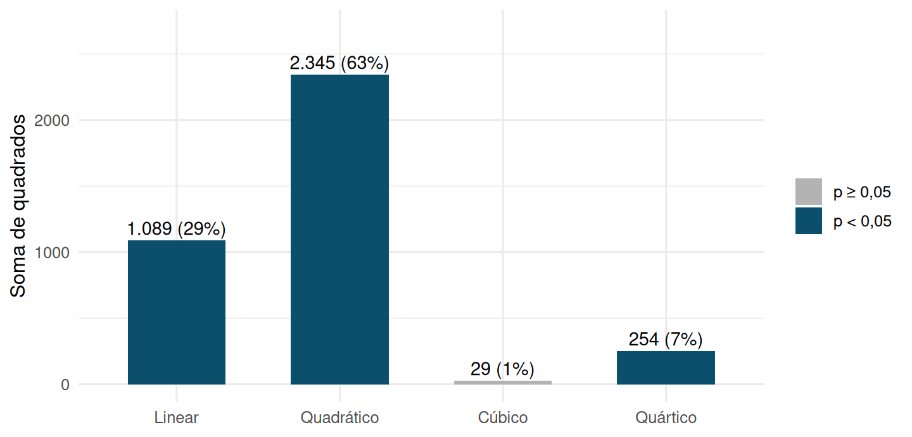
<p class="caption">(\#fig:c3c-plot-poly-sq)Partição de a SQ de tratamentos da cafeína em componentes linear, quadrático, cúbico e quártico; barras escuras indicam componentes com p < 0,05, e o rótulo dá a SQ e sua porcentagem de a SQ de tratamentos.</p>
</div>

O quadrático sozinho responde por 63% de $SQ_{\text{Trat}}$, e linear e
quadrático juntos por 92%; o quártico, embora significativo, explica
7%. A forma dominante é um "U invertido" que sobe com a dose.

Como no experimento do algodão de Montgomery — um DCA clássico em que a resistência de um fio
têxtil é medida sob cinco concentrações de algodão igualmente espaçadas —, o jeito mais direto de
"ver" qual grau de polinômio é necessário é ajustar os quatro graus possíveis lado a lado e
comparar visualmente o quanto cada um se aproxima das cinco médias observadas:

<div class="figure" style="text-align: center">
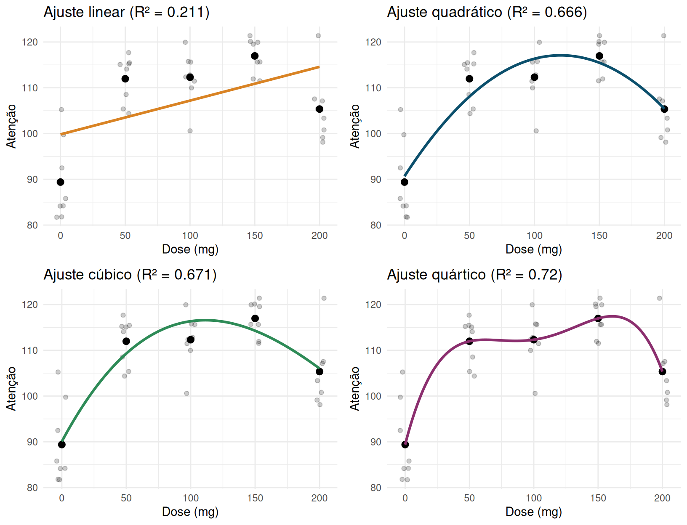
<p class="caption">(\#fig:c3b-plot-poly)Ajustes polinomiais de grau 1 a 4 da atenção em função da dose: pontos cinza são os participantes, pontos pretos as médias por dose, e a curva colorida o polinômio ajustado; o título de cada painel traz o R² do ajuste.</p>
</div>


``` r
c(R2_linear = summary(mod_lin_num)$r.squared, R2_quadratico = summary(mod_quad_num)$r.squared,
  R2_cubico = summary(mod_cub_num)$r.squared, R2_quartico = summary(mod_quart_num)$r.squared)
```

```
##     R2_linear R2_quadratico     R2_cubico   R2_quartico 
##     0.2111213     0.6656282     0.6711609     0.7203006
```

O painel deixa a progressão visível. A reta (canto superior esquerdo) erra o padrão por completo:
fica abaixo das médias no platô e acima delas em 0 mg, com
$R^2 \approx 0{,}21$ apenas. A parábola (canto superior direito) já
captura o essencial — sobe até um pico e desce —, saltando para
$R^2 \approx 0{,}67$. O cúbico quase não acrescenta, e o quártico passa
**exatamente** pelas cinco médias: com cinco parâmetros para cinco pontos, ele não é um modelo da
curva, é uma reprodução das médias, e seu $R^2$ (0,72) é o
máximo atingível com a dose tratada como fator — a diferença para 1 é o erro puro, a variação
entre participantes que receberam a mesma dose. O **grau necessário** é o menor que já descreve a
curva de forma plausível, e o painel sugere a parábola; a seção seguinte mostra por que os testes
formais, aqui, complicam um pouco essa conclusão.

### Falta de ajuste: a parábola basta? {#falta-ajuste-poly}

Com a dose tratada como **fator** (cinco médias livres), o modelo do DCA é o mais flexível
possível para estes dados. Um polinômio de grau $g < t-1$ é um modelo **encaixado** nele, e a
diferença entre os dois é a **falta de ajuste**:

$$SQ_{\text{falta}} = SQ_{\text{Trat}} - \sum_{k=1}^{g} SQ_k = \sum_{k=g+1}^{t-1} SQ_k, \qquad F_{\text{falta}} = \frac{SQ_{\text{falta}}/(t-1-g)}{QME} \sim F_{t-1-g,\;N-t}.$$

O denominador é o **erro puro** do DCA — a variação entre réplicas da mesma dose —, o que só existe
porque o experimento tem repetição em cada nível: sem réplicas, não haveria como distinguir "o
polinômio não descreve as médias" de "as médias são ruidosas". Em termos do Capítulo 2, é mais uma
soma de quadrados extra, $\mathbf Y'(\mathbf P_{\text{fator}} - \mathbf P_{\text{grau } g})\mathbf Y$.


``` r
fa <- anova(mod_quad_num, mod_poly)   # quadrático (encaixado) vs. dose como fator
fa
```

```
## Analysis of Variance Table
## 
## Model 1: atencao_pos ~ dose_num + I(dose_num^2)
## Model 2: atencao_pos ~ dose
##   Res.Df    RSS Df Sum of Sq      F  Pr(>F)  
## 1     37 1725.4                              
## 2     35 1443.2  2    282.11 3.4207 0.04396 *
## ---
## Signif. codes:  0 '***' 0.001 '**' 0.01 '*' 0.05 '.' 0.1 ' ' 1
```

Para a parábola, $SQ_{\text{falta}} = SQ_C + SQ_4 = 28{,}5 + 253{,}6 = 282{,}1$ com
2 gl, $F = 3{,}42$ e $p = 0{,}0440$. Formalmente, ao nível de 5%, rejeita-se que a
parábola descreva as cinco médias — é a mesma informação do quártico significativo, dita de outro
modo. A Figura \@ref(fig:c3c-plot-desvios) mostra onde ela erra.

<div class="figure" style="text-align: center">
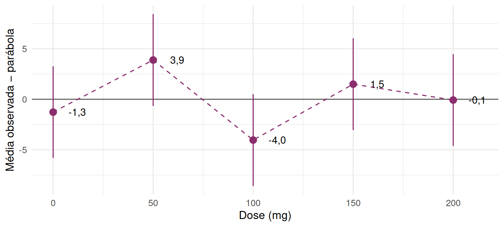
<p class="caption">(\#fig:c3c-plot-desvios)Diferença entre a média observada em cada dose e o valor da parábola ajustada, com barras de mais ou menos dois erros-padrão de uma média (raiz de QME/8).</p>
</div>

Os desvios fazem um zigue-zague de sinais $+,-,+$ em 50, 100 e 150 mg — exatamente o desenho do
coeficiente quártico $(1,-4,6,-4,1)$ com o sinal trocado (o $\hat L_4$ é negativo). A parábola
subestima o platô em 50 mg e o superestima em 100 mg, por cerca de 4 pontos, menos que o
desvio-padrão de um participante ($\sqrt{QME} \approx 6{,}4$).

### O quártico significativo: efeito real ou acaso? {#quartico-acaso}

Aqui temos uma vantagem rara: **sabemos** que a curva verdadeira é uma parábola, de modo que o
quártico significativo é, com certeza, um falso positivo. Ele era previsível? Repetimos o mesmo
experimento 2.000 vezes, a partir do modelo verdadeiro, e registramos com que frequência os termos
cúbico e quártico — ambos nulos na verdade — saem significativos.


``` r
set.seed(321)
x_d <- rep(dose_mg, each = 8)
pq <- replicate(2000, {
  yy <- 40 + 0.5 * rnorm(40, 60, 8) + efeito_dose(x_d) + rnorm(40, 0, 5)
  f <- factor(x_d); contrasts(f) <- contr.poly(5)
  summary(aov(yy ~ f), split = list(f = list(L = 1, Q = 2, C = 3, Q4 = 4)))[[1]][["Pr(>F)"]][4:5]
})
c(cubico = mean(pq[1, ] < 0.05), quartico = mean(pq[2, ] < 0.05),
  algum_dos_dois = mean(apply(pq < 0.05, 2, any)))
```

```
##         cubico       quartico algum_dos_dois 
##         0.0525         0.0520         0.1030
```

Cada um dos dois termos nulos sai significativo em cerca de 5% das repetições, como deve ser, e
**pelo menos um deles** em 10,3% — testar os $t-1 = 4$
graus é, também, uma família de testes, e o problema de multiplicidade da seção anterior reaparece
aqui. Na prática, sem conhecer a verdade, três critérios ajudam a decidir:

- **Plausibilidade:** não há mecanismo fisiológico conhecido para uma ondulação de quarta ordem na
  resposta à cafeína, ao passo que o "U invertido" (lei de Yerkes-Dodson) é bem documentado.
- **Parcimônia e tamanho:** os desvios em relação à parábola são de cerca de 4 pontos e explicam
  7% da variação entre doses.
- **Replicação:** um termo de alta ordem que é real reaparece num novo experimento; um acidental,
  não. Um quártico isolado, sem cúbico e sem justificativa, é o candidato típico a acaso.

A conclusão defensável é adotar a parábola para descrever e interpretar a curva, **reportando** a
falta de ajuste em vez de escondê-la.

### De volta à escala da dose: a equação e a dose ótima {#dose-otima}

Com $x = (d-100)/50$, $\hat b_1 = \hat L_L/10$ e $\hat b_2 = \hat L_Q/14$, a parábola na base ortogonal é


``` r
b1 <- Lk[1] / 10; b2 <- Lk[2] / 14; ybar <- mean(mb)
c(ybar = ybar, b1 = b1, b2 = b2)
```

```
##       ybar         b1         b2 
## 107.195803   3.690166  -4.576002
```

``` r
coef(mod_quad_num)                  # a mesma parábola, ajustada direto na dose
```

```
##   (Intercept)      dose_num I(dose_num^2) 
##  90.663466965   0.439883451  -0.001830401
```

$$\hat y = 107{,}20 + 3{,}690\,x -4{,}576\,(x^2-2), \qquad x = \frac{d-100}{50}.$$

Expandindo, o coeficiente de $d^2$ é $-4{,}576/2500 = -0{,}001830$, o mesmo
do `lm` ajustado diretamente na dose: os polinômios ortogonais não são outro modelo, são a mesma
regressão, numa base em que os termos não se confundem (e em que, por isso, retirar o termo
quadrático não altera a estimativa do linear, o que não acontece na base $d, d^2$).

A pergunta "existe uma dose ótima?" se responde pelo vértice da parábola, $d^\star = -\hat\beta_1/(2\hat\beta_2)$,
uma função não linear dos coeficientes. Seu erro-padrão sai do método delta,
$\mathrm{Var}(\hat d^\star) \approx \nabla g'\,\widehat{\mathrm{Cov}}(\hat{\boldsymbol\beta})\,\nabla g$, com
$\nabla g = \big(0,\ -1/(2\hat\beta_2),\ \hat\beta_1/(2\hat\beta_2^2)\big)'$:


``` r
b <- coef(mod_quad_num); V <- vcov(mod_quad_num)
d_ot  <- unname(-b[2] / (2 * b[3]))
grad  <- c(0, -1 / (2 * b[3]), b[2] / (2 * b[3]^2))
ep_ot <- sqrt(drop(t(grad) %*% V %*% grad))
c(dose_otima = d_ot, ep = ep_ot, li = d_ot - qt(0.975, 37) * ep_ot, ls = d_ot + qt(0.975, 37) * ep_ot)
```

```
## dose_otima         ep         li         ls 
## 120.160429   5.047698 109.932822 130.388037
```

A dose que maximiza a atenção estimada é de cerca de **120 mg** (IC de 95% pelo método
delta: 110 a 130 mg), com atenção prevista de
117,1 pontos. A dose ótima verdadeira, 135 mg, fica
**fora** desse intervalo. A Figura \@ref(fig:c3c-sim-vertice) explica o que aconteceu.


``` r
set.seed(123)
vs <- replicate(2000, {
  yy <- 40 + 0.5 * rnorm(40, 60, 8) + efeito_dose(x_d) + rnorm(40, 0, 5)
  bb <- coef(lm(yy ~ x_d + I(x_d^2))); -bb[2] / (2 * bb[3])
})
ggplot(tibble(v = vs[vs > 50 & vs < 250]), aes(v)) +
  geom_histogram(binwidth = 4, fill = "grey70", color = "white") +
  geom_vline(xintercept = 0.35 / (2 * 0.0013), color = "#2e8b57", linewidth = 1) +
  geom_vline(xintercept = d_ot, color = "#8b2e6e", linewidth = 1, linetype = "dashed") +
  labs(x = "Dose ótima estimada (mg)", y = "Frequência") + theme_minimal(base_size = 12)
```

<div class="figure" style="text-align: center">
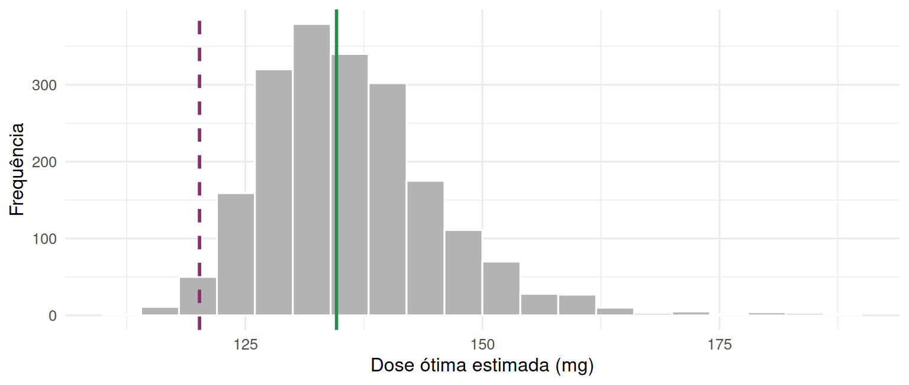
<p class="caption">(\#fig:c3c-sim-vertice)Distribuição da dose ótima estimada (vértice da parábola) em 2.000 repetições simuladas do experimento a partir do modelo verdadeiro; a linha verde contínua marca a dose ótima verdadeira (135 mg) e a roxa tracejada, a estimativa obtida com os dados observados.</p>
</div>

Três observações. Primeiro, um intervalo de 95% erra 5% das vezes, e esta amostra está numa cauda:
em apenas 1,5% das repetições a estimativa saiu tão baixa. Segundo, o motivo é
identificável: esta amostra **superestimou a curvatura** ($\hat\beta_2 = -0{,}00183$ contra
$-0{,}0013$ verdadeiro) — o mesmo platô "achatado" entre 50 e 150 mg que gerou o quártico — e o
erro-padrão do método delta, proporcional a $1/|\hat\beta_2|$, herda esse otimismo; a distribuição
do vértice é, além disso, assimétrica, o que o método delta ignora. Terceiro, e mais importante
para a decisão: perto do pico a curva é achatada. Na curva verdadeira, 120 e 135 mg diferem em
apenas 0,28 ponto de atenção. A dose ótima é difícil de localizar
justamente porque errar o pico custa pouco.

### Doses não igualmente espaçadas e a ordem dos níveis {#poly-armadilhas}

Os coeficientes tabelados valem **apenas** para níveis igualmente espaçados. Se as doses fossem 0,
50, 100, 200 e 400 mg, os números $(-2,-1,0,1,2)$ testariam uma tendência no **posto** da dose, não
na dose; os coeficientes certos dependem dos valores dos níveis:


``` r
P_certo <- contr.poly(5, scores = c(0, 50, 100, 200, 400))   # ortogonais NAS DOSES REAIS
round(P_certo, 3)
```

```
##          .L     .Q     .C     ^4
## [1,] -0.474  0.546 -0.470  0.237
## [2,] -0.316  0.035  0.422 -0.721
## [3,] -0.158 -0.335  0.514  0.631
## [4,]  0.158 -0.652 -0.570 -0.158
## [5,]  0.791  0.405  0.104  0.011
```

``` r
lin_tab <- c(-2, -1, 0, 1, 2)                                 # "linear" da tabela
round(c(cor_com_linear_real = cor(lin_tab, P_certo[, 1]),
        cor_com_quadratico_real = cor(lin_tab, P_certo[, 2])), 2)
```

```
##     cor_com_linear_real cor_com_quadratico_real 
##                    0.95                   -0.31
```

O "linear" tabelado não é ortogonal ao quadrático verdadeiro (correlação de
-0,31): parte da curvatura vaza para o termo linear, e as somas de quadrados
deixam de particionar $SQ_{\text{Trat}}$ com significado. O caminho correto é `contr.poly(k, scores = doses)`
ou, equivalentemente, `lm(y ~ poly(dose_num, 2))` sobre a variável numérica.

Uma segunda armadilha, mais traiçoeira porque não gera mensagem de erro, é a **ordem dos níveis do
fator**. `contr.poly()` atribui os coeficientes na ordem de `levels()`, e se a dose for lida como
texto o R a ordena alfabeticamente:


``` r
dose_txt <- factor(as.character(cafeina$dose))
levels(dose_txt)                                   # "0" "100" "150" "200" "50": 50 mg no fim!
```

```
## [1] "0"   "100" "150" "200" "50"
```

``` r
contrasts(dose_txt) <- contr.poly(5)
summary(aov(cafeina$atencao_pos ~ dose_txt),
        split = list(dose_txt = list(L = 1, Q = 2, C = 3, Q4 = 4)))
```

```
##                Df Sum Sq Mean Sq F value   Pr(>F)    
## dose_txt        4   3717   929.2  22.534 2.82e-09 ***
##   dose_txt: L   1   1167  1166.6  28.292 6.11e-06 ***
##   dose_txt: Q   1   1364  1363.9  33.075 1.64e-06 ***
##   dose_txt: C   1   1066  1065.7  25.844 1.25e-05 ***
##   dose_txt: Q4  1    121   120.5   2.923   0.0962 .  
## Residuals      35   1443    41.2                     
## ---
## Signif. codes:  0 '***' 0.001 '**' 0.01 '*' 0.05 '.' 0.1 ' ' 1
```

A $SQ_{\text{Trat}}$ total é a mesma (o fator é o mesmo), mas a partição perde todo o sentido: o
"linear" passa a medir outra coisa, e o cúbico, que antes não era significativo, passa a ser.
Antes de usar polinômios ortogonais, confira sempre `levels()` — ou construa o fator com
`factor(dose, levels = c(0, 50, 100, 150, 200))`.

### O que os dados de cafeína respondem {#cafeina-respostas}

1. **A atenção depende da dose?** Sim ($F_{4,35} = 22{,}5$).
2. **Mais cafeína é sempre melhor?** Não: o termo linear é positivo, mas o quadrático, negativo e
   responsável por 63% da variação entre doses, mostra que a curva sobe e depois desce.
3. **Existe uma dose ótima?** A parábola estima cerca de 120 mg, mas o pico é mal
   determinado; o que os dados sustentam com segurança é um platô entre 50 e 150 mg.
4. **200 mg é pior que 150 mg?** Sim: queda de 11,6 pontos (Tukey, p ≈ 0,008), coerente
   com excesso de estimulação.
5. **Vale a pena passar de 50 mg?** 150 mg rende só 5,0 pontos a mais que 50 mg,
   diferença não significativa: a menor dose do platô já entrega quase todo o benefício.
6. **A parábola é o modelo certo?** É o modelo plausível e parcimonioso; a falta de ajuste
   ($p \approx 0{,}044$) foi registrada e discutida, e sabemos — por construção — que, neste
   caso, ela era um falso positivo.

```{=html}
<div class="caixa-discussao">
<strong>Para discutir</strong>
<ol>
<li>No exemplo da cafeína o termo quártico foi significativo, mas a curva verdadeira é uma
parábola. Sem a simulação, que evidência adicional você pediria antes de adotar um polinômio de
quarto grau?</li>
<li>Por que o teste de falta de ajuste exige réplicas em cada dose? O que aconteceria com ele num
experimento com uma única observação por dose?</li>
<li>Se as cinco doses não estivessem igualmente espaçadas (0, 50, 100, 200, 400 mg), os
coeficientes tabulados ainda poderiam ser usados diretamente? Por quê?</li>
<li>A dose ótima estimada ficou longe da verdadeira, mas a atenção prevista nas duas doses é quase
igual. Para quem decide uma recomendação de consumo, qual dos dois fatos importa mais? E para um
farmacologista interessado no mecanismo?</li>
</ol>
</div>
```

## Análise de covariância (ANCOVA) {#ancova}

Mesmo com aleatorização perfeita, grupos podem diferir por acaso em alguma variável relevante
medida **antes** do tratamento — aqui, o nível basal de atenção de cada participante. A **análise
de covariância** incorpora essa covariável ao modelo para (i) ajustar as médias de tratamento
pela diferença de linha de base entre grupos e (ii) remover parte da variação residual explicada
pela covariável, aumentando a precisão da comparação entre tratamentos.

### O modelo

$$y_{ij} = \mu + \tau_i + \beta\,(x_{ij} - \bar x_{\cdot\cdot}) + \varepsilon_{ij}, \qquad
\varepsilon_{ij} \sim N(0, \sigma^2)\ \text{i.i.d.},$$

onde $x_{ij}$ é a covariável (o basal, medido antes de qualquer tratamento) e $\beta$ é a
inclinação **comum** a todos os grupos — pressuposto central da ANCOVA, chamado de
*homogeneidade das inclinações*, que deve ser verificado antes de interpretar o modelo: se a
relação entre covariável e resposta difere por grupo (interação $\tau_i \times x_{ij}$
significativa), o ajuste simples por uma única inclinação comum deixa de fazer sentido, e a
covariável deve ser tratada de outra forma (por exemplo, analisando os grupos separadamente).

As médias de tratamento são reportadas **ajustadas** para o valor médio geral da covariável:

$$\bar y_{i\cdot(\text{ajustada})} = \bar y_{i\cdot} - \hat\beta\,(\bar x_{i\cdot} - \bar x_{\cdot\cdot}).$$

### ANCOVA em notação matricial: mais uma coluna em $\mathbf X$

Nenhuma teoria nova precisa ser aprendida para tratar a ANCOVA algebricamente: basta acrescentar
a covariável como mais uma coluna de $\mathbf X$. Com qualquer parametrização de posto completo
para o efeito de tratamento,

$$\mathbf Y = \mathbf X\boldsymbol\beta + \boldsymbol\varepsilon, \qquad
\mathbf X = \big[\ \mathbf X_{\text{trat}} \ \big|\ \mathbf z\ \big], \qquad
\boldsymbol\beta = \begin{bmatrix}\boldsymbol\tau \\ \beta\end{bmatrix},$$

em que $\mathbf X_{\text{trat}}$ codifica o fator dose como em qualquer DCA (Capítulo 2, Seção
\@ref(modelo-geral)) e $\mathbf z$ ($N\times 1$) é a coluna da covariável (o basal). A ANCOVA é,
literalmente, **um caso particular do modelo linear geral** — a única novidade é uma coluna extra
em $\mathbf X$.

Geometricamente, essa coluna extra amplia o espaço-coluna de $\mathbf X_{\text{trat}}$ em uma
dimensão. A projeção $\mathbf P_X$ passa a projetar sobre esse espaço maior, e o teste de
tratamento **ajustado** pela covariável é, de novo, uma soma de quadrados extra (Capítulo 2, Seção
\@ref(modelo-particionado)) — mas comparando dois modelos que **já incluem** a covariável:

$$SQ_{\text{Trat(ajustado)}} = \mathbf Y'\big(\mathbf P_X - \mathbf P_{[\mathbf 1\,\mid\, \mathbf z]}\big)\mathbf Y,$$

a diferença entre projetar sobre $[\mathbf X_{\text{trat}} \mid \mathbf z]$ e projetar apenas sobre
$[\mathbf 1 \mid \mathbf z]$ (o modelo só com a covariável, sem tratamento). O ajuste pela
covariável é, nesse sentido, **uma projeção adicional**: primeiro removemos a direção de
$\mathbf z$ do espaço de resposta, e só então perguntamos se o tratamento explica alguma variação
**além** dela — exatamente por que a soma de quadrados sequencial da tabela a seguir entra a
covariável primeiro.


``` r
X_ancova <- model.matrix(atencao_pos ~ dose + basal, data = cafeina)  # X_trat | z
dim(X_ancova)                                    # N x (t + 1): 5 colunas de dose + basal
```

```
## [1] 40  6
```

``` r
beta_hat_ancova <- solve(t(X_ancova) %*% X_ancova) %*% t(X_ancova) %*% cafeina$atencao_pos
round(t(beta_hat_ancova), 3)                     # bate com coef(mod_ancova) abaixo
```

```
##      (Intercept) dose.L  dose.Q dose.C dose^4 basal
## [1,]       68.36 13.281 -14.009 -1.748 -2.507 0.625
```

### A tabela de ANOVA ajustada pela covariável

A soma de quadrados total se particiona em covariável (regressão), tratamento (ajustado pela
covariável) e erro — nessa ordem, porque a covariável deve ser removida do erro **antes** de
avaliar o efeito de tratamento:

```{=html}
<div class="caixa-r"><strong>Uso do R</strong> — ANCOVA: ajustando pela atenção basal</div>
```


``` r
# 1. Verificar homogeneidade das inclinações: a interação basal:dose deve ser não significativa
mod_inclinacoes <- lm(atencao_pos ~ basal * dose, data = cafeina)
anova(mod_inclinacoes)
```

```
## Analysis of Variance Table
## 
## Response: atencao_pos
##            Df  Sum Sq Mean Sq F value    Pr(>F)    
## basal       1 1478.46 1478.46 79.2477 6.384e-10 ***
## dose        4 3022.36  755.59 40.5009 1.103e-11 ***
## basal:dose  4   99.50   24.87  1.3333    0.2804    
## Residuals  30  559.68   18.66                      
## ---
## Signif. codes:  0 '***' 0.001 '**' 0.01 '*' 0.05 '.' 0.1 ' ' 1
```

<div class="figure" style="text-align: center">
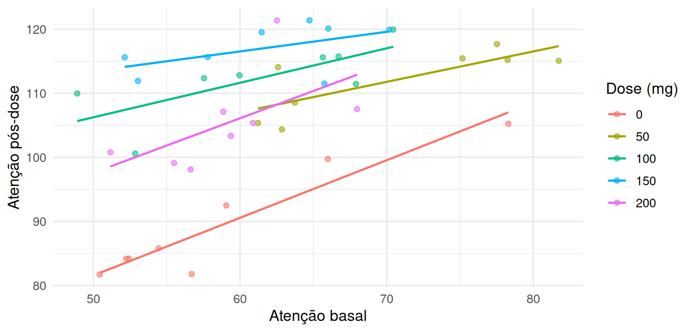
<p class="caption">(\#fig:plot-homog-incl)Atenção pós-dose contra atenção basal, com uma reta de mínimos quadrados ajustada separadamente para cada dose: inclinações parecidas indicam que o pressuposto de homogeneidade das inclinações da ANCOVA é razoável.</p>
</div>

As cinco retas ajustadas separadamente (Figura \@ref(fig:plot-homog-incl)) já são visualmente
quase paralelas; o teste da interação `basal:dose` apenas formaliza o que o gráfico sugere.


``` r
# 2. Interação não significativa (p > 0.05) -> prossegue com o modelo aditivo (ANCOVA)
mod_ancova <- lm(atencao_pos ~ basal + dose, data = cafeina)
anova(mod_ancova)          # soma de quadrados sequencial: covariável entra primeiro
```

```
## Analysis of Variance Table
## 
## Response: atencao_pos
##           Df  Sum Sq Mean Sq F value    Pr(>F)    
## basal      1 1478.46 1478.46  76.257 3.327e-10 ***
## dose       4 3022.36  755.59  38.973 2.988e-12 ***
## Residuals 34  659.18   19.39                      
## ---
## Signif. codes:  0 '***' 0.001 '**' 0.01 '*' 0.05 '.' 0.1 ' ' 1
```


``` r
# médias de dose ajustadas para o valor médio de basal (emmeans faz o ajuste automaticamente)
emmeans(mod_ancova, ~ dose)
```

```
##  dose emmean   SE df lower.CL upper.CL
##  0      91.6 1.59 34     88.3     94.8
##  50    106.8 1.75 34    103.3    110.4
##  100   112.9 1.56 34    109.7    116.1
##  150   117.4 1.56 34    114.3    120.6
##  200   107.3 1.59 34    104.0    110.5
## 
## Confidence level used: 0.95
```

O termo `basal` é altamente significativo — confirma que a covariável de fato explica parte da
variação em atenção pós-dose e "vale a pena" incorporar ao modelo — e o termo `dose`, ajustado
para basal, permanece significativo, com quadrado médio do erro (`Residuals`) menor do que na
ANOVA sem covariável da seção anterior: a ANCOVA tornou a comparação entre doses mais precisa ao
remover uma fonte de variação conhecida (a atenção basal) do erro experimental, no mesmo espírito
da blocagem — mas usando uma covariável contínua, medida, em vez de um agrupamento categórico.

A visualização canônica da ANCOVA é o gráfico de dispersão da resposta contra a covariável,
colorido por tratamento, com uma reta de regressão ajustada para cada grupo. Sob o modelo aditivo
(inclinações homogêneas), essas retas são **paralelas por construção** — a mesma inclinação
$\hat\beta$, só com interceptos diferentes por dose:

<div class="figure" style="text-align: center">
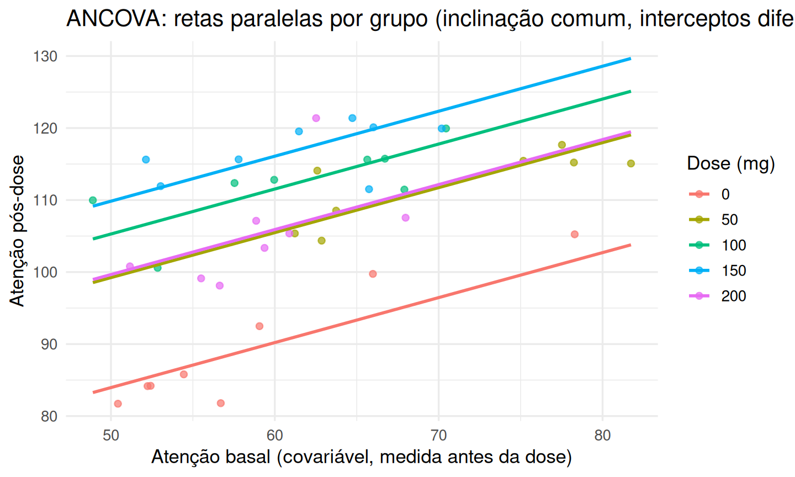
<p class="caption">(\#fig:c3b-plot-ancova)ANCOVA da atenção pós-dose com a atenção basal como covariável. Pontos: participantes, coloridos pela dose de cafeína; retas: o modelo ajustado, com a mesma inclinação para todas as doses e interceptos diferentes. A distância vertical entre as retas é o efeito da dose ajustado pela atenção basal.</p>
</div>

As cinco retas sobem juntas (inclinação comum $\hat\beta \approx$
0.62: cada ponto a mais de atenção basal está associado, em
média, a esse mesmo ganho de atenção pós-dose, **qualquer que seja a dose**), mas partem de
alturas diferentes — é essa separação vertical entre as retas, e não a inclinação, que representa
o efeito ajustado da dose. Visualmente, a reta da dose de 150 mg fica acima das demais mesmo
comparando participantes com o **mesmo** nível basal, confirmando que a diferença não é
inteiramente explicada pela covariável — é exatamente essa comparação "a covariável igual" que a
ANCOVA formaliza e que a inspeção das médias brutas (sem ajuste) não deixaria clara.

```{=html}
<div class="caixa-discussao">
<strong>Para discutir</strong>
<ol>
<li>Por que é essencial que a covariável seja medida <em>antes</em> do tratamento (ou, ao menos,
não ser afetada por ele)? O que dá errado se, em vez do basal, o "basal" fosse medido depois de
alguns participantes já terem recebido cafeína?</li>
<li>Compare ANCOVA com blocagem por uma variável categórica (Capítulo 4): em que situação prática
uma covariável contínua está disponível, mas uma blocagem categórica não seria possível ou seria
menos eficiente?</li>
</ol>
</div>
```

## Teste de Kruskal-Wallis {#kruskal-wallis}

Todos os procedimentos anteriores neste capítulo assumem normalidade dos erros e variância
homogênea entre grupos — pressupostos que a seção sobre verificação de pressupostos ensinou a
checar. Quando esses pressupostos falham de forma severa (assimetria acentuada, valores atípicos
influentes, amostras muito pequenas) e nenhuma transformação os resolve satisfatoriamente, o
**teste de Kruskal-Wallis** oferece uma alternativa não paramétrica à ANOVA de um fator
[@kruskalwallis1952], testando se as $t$ populações têm a mesma distribuição (em particular, a
mesma mediana) sem assumir normalidade.


``` r
# tempos de carregamento reais são tipicamente assimétricos à direita: a maioria das
# cargas é rápida, mas uma cauda de conexões lentas/congestionadas produz outliers.
# Simulamos esse cenário contaminando o dataset de scripts com alguns tempos extremos.
dados_scripts_out <- dados_scripts
set.seed(3)
idx_lentos <- sample(seq_len(nrow(dados_scripts_out)), 4)
dados_scripts_out$tempo_ms[idx_lentos] <- dados_scripts_out$tempo_ms[idx_lentos] +
  rexp(4, rate = 1 / 2000)
```

```{=html}
<div class="caixa-aplicacao">
<strong>Aplicação — Ciência de dados: carregamento de página com conexões lentas</strong><br>
Retomamos o experimento de configurações de scripts, mas agora quatro carregamentos (de 40) foram
medidos em conexões congestionadas, produzindo tempos muito acima do restante da amostra. Um
teste de Shapiro-Wilk sobre os resíduos da ANOVA rejeitaria normalidade — o cenário em que o
Kruskal-Wallis é a escolha mais defensável.
</div>
```

### O que muda em relação à ANOVA

O procedimento substitui os valores observados pelos seus **postos** (*ranks*) na amostra
combinada de $N = \sum n_i$ observações (posto 1 para o menor valor, $N$ para o maior, com médias
de posto em caso de empates). Sendo $R_i$ a soma dos postos no grupo $i$, a estatística é

$$H = \frac{12}{N(N+1)} \sum_{i=1}^t \frac{R_i^2}{n_i} \; - \; 3(N+1),$$

que, sob $H_0$ (as $t$ populações têm a mesma distribuição) e amostras não muito pequenas, segue
aproximadamente $H \sim \chi^2_{t-1}$. Intuitivamente, $H$ mede o quanto os postos médios de cada
grupo se afastam do posto médio esperado sob a hipótese nula — um "ANOVA sobre os postos", em vez
de sobre os valores originais, o que o torna robusto a outliers e a distribuições assimétricas,
ao custo de menor poder quando a normalidade de fato se sustenta.

```{=html}
<div class="caixa-r"><strong>Uso do R</strong> — Kruskal-Wallis e comparações par a par não paramétricas</div>
```


``` r
kruskal.test(tempo_ms ~ config, data = dados_scripts_out)
```

```
## 
## 	Kruskal-Wallis rank sum test
## 
## data:  tempo_ms by config
## Kruskal-Wallis chi-squared = 22.026, df = 3, p-value = 6.443e-05
```

``` r
# comparações par a par não paramétricas, com correção de Bonferroni
pairwise.wilcox.test(dados_scripts_out$tempo_ms, dados_scripts_out$config,
                      p.adjust.method = "bonferroni")
```

```
## 
## 	Pairwise comparisons using Wilcoxon rank sum exact test 
## 
## data:  dados_scripts_out$tempo_ms and dados_scripts_out$config 
## 
##           Nenhum  Analytics Anúncios
## Analytics 0.21278 -         -       
## Anúncios  0.00903 0.01254   -       
## Combo     0.00903 0.00026   1.00000 
## 
## P value adjustment method: bonferroni
```

<div class="figure" style="text-align: center">
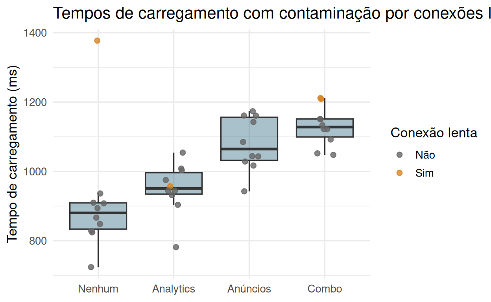
<p class="caption">(\#fig:plot-scripts-outliers)Tempo de carregamento por configuração, com os quatro tempos contaminados por conexões lentas (destacados). A cauda assimétrica à direita, presente em pelo menos uma configuração, é o sintoma visual que motiva a troca da ANOVA pelo teste de Kruskal-Wallis.</p>
</div>

Os quatro pontos em laranja — sorteados aleatoriamente entre as 40 observações, portanto
espalhados de forma desigual entre as quatro configurações — puxam a caixa correspondente para
cima e alongam sua cauda superior, exatamente o tipo de assimetria que infla a variância dentro de
grupo e compromete a suposição de normalidade dos resíduos por trás do teste $F$ clássico. É essa
distorção visual, e não apenas o resultado do teste de Shapiro-Wilk mencionado na aplicação acima,
que justifica substituir os valores brutos pelos seus postos.

O teste de Kruskal-Wallis rejeita $H_0$ com folga, confirmando que as configurações diferem
mesmo na presença dos valores atípicos que violariam os pressupostos da ANOVA clássica — e as
comparações par a par por postos (Wilcoxon com correção de Bonferroni) mantêm o padrão geral de
conclusões da Seção \@ref(comparacoes-multiplas), com um pouco menos de nitidez nas diferenças
mais sutis, o preço esperado por abrir mão do pressuposto de normalidade.

## Controlado × não controlado: o teste $F$ quando ninguém sorteou {#cnc-cap3}

O capítulo começou deduzindo o delineamento completamente aleatorizado (DCA) do próprio sorteio
(Seção \@ref(principios-aleatorizacao)): a distribuição de referência do teste é a distribuição da
estatística sobre **todos os sorteios possíveis**, e o teste $F$ é uma aproximação dela. Daí uma
consequência que costuma passar despercebida: **sem sorteio, o valor-$p$ do teste $F$ não tem
referência.** A tabela de ANOVA pode ser calculada com qualquer planilha, mas a frase "se os
tratamentos não tivessem efeito, uma diferença deste tamanho apareceria em só 5% das vezes" só faz
sentido quando as "vezes" são sorteios que o pesquisador realmente fez.

```{=html}
<div class="caixa-aplicacao">
<strong>Aplicação — Psicologia: três condições de distração, nenhuma com efeito</strong><br>
Retomamos o estudo de tempo de reação sob distração (nenhuma, sonora, visual), agora com
<strong>H<sub>0</sub> verdadeira por construção</strong>: a distração não muda nada, e o tempo de
reação de cada pessoa depende só da sua velocidade basal, mais um ruído de medida. São 36
participantes. <strong>Controlado:</strong> 12 participantes sorteados para cada condição.
<strong>Não controlado:</strong> cada participante escolhe a condição em que quer ser testado, e os
mais lentos tendem a evitar as distrações (escolhem "nenhuma") com uma força κ: κ = 0 é escolha ao
acaso, κ = 2 é uma preferência forte. Em cada regime e cada κ, repetimos o estudo 1.000 vezes e
contamos em quantas o teste F rejeita H<sub>0</sub> a 5%.
</div>
```


``` r
cnc3 <- cnc_cap3()     # taxa de rejeição a 5%, com H0 verdadeira, para kappa de 0 a 2
cnc3 %>% filter(kappa %in% c(0, 0.5, 1, 2)) %>%
  pivot_wider(names_from = regime, values_from = rejeicao)
```

```
## # A tibble: 4 × 3
##   kappa `Controlado: sorteio` `Não controlado: o participante escolhe`
##   <dbl>                 <dbl>                                    <dbl>
## 1   0                   0.052                                    0.052
## 2   0.5                 0.052                                    0.398
## 3   1                   0.038                                    0.868
## 4   2                   0.049                                    0.997
```

<div class="figure" style="text-align: center">
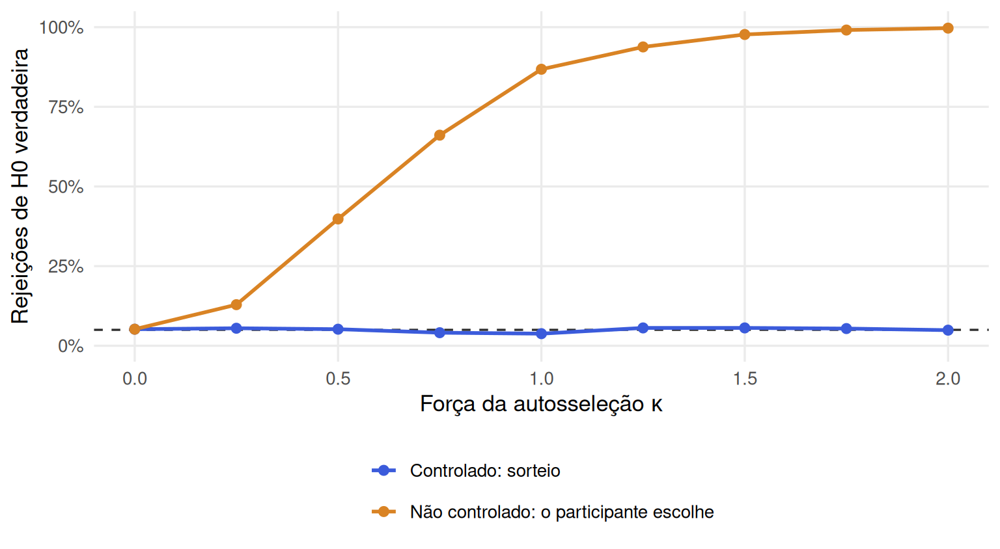
<p class="caption">(\#fig:cnc-cap3-graf)Proporção de estudos em que o teste F do DCA rejeita H0 a 5%, quando H0 é verdadeira (a distração não tem efeito nenhum), em função da força κ da autosseleção. A linha tracejada marca os 5% nominais. Com sorteio (azul), a taxa fica em 5% qualquer que seja κ, porque κ não interfere no sorteio. Quando o participante escolhe a condição (laranja), a taxa sobe rapidamente: com κ = 1, o teste 'descobre' um efeito inexistente em quase 9 de cada 10 estudos.</p>
</div>

Duas observações tornam o resultado menos misterioso do que parece:

- **O teste $F$ não está errado: ele detecta corretamente que os grupos diferem.** Sob
  autosseleção, os três grupos realmente têm médias diferentes, porque reúnem pessoas diferentes
  (os lentos se concentram em "nenhuma"). O que o teste não pode dizer é **por que** diferem. A
  hipótese que ele rejeita é "as três médias populacionais dos grupos são iguais", não "a distração
  não tem efeito"; só o sorteio faz as duas frases coincidirem.
- **O erro tipo I deixa de ser controlado pelo pesquisador.** No regime controlado, o nível de 5% é
  uma escolha; no observacional, ele é consequência de um mecanismo de escolha que o analista não
  conhece (aqui, κ). Uma taxa de rejeição de 87% sob $H_0$ não é um teste conservador ou liberal: é
  um teste que responde a outra pergunta.

O mesmo raciocínio vale para tudo o que o capítulo construiu sobre a tabela de ANOVA: os contrastes
e as comparações múltiplas (com controle da taxa de erro por família, FWER, *family-wise error
rate*) herdam a garantia do sorteio. Controlar o FWER em 5% com Tukey ou Bonferroni é inútil se
cada comparação individual já estiver viesada pela autosseleção. A análise de covariância (ANCOVA,
Seção \@ref(ancova)) pode corrigir um desequilíbrio numa covariável **medida**, como o tempo basal,
mas não nas que ninguém mediu.

```{=html}
<div class="caixa-discussao">
<strong>Para discutir — controlado × não controlado</strong>
<ol>
<li>Se o tempo de reação basal de cada participante tivesse sido medido antes da escolha, uma
ANCOVA com essa covariável traria a taxa de rejeição de volta para perto de 5%? Que suposição sobre
o mecanismo de escolha essa correção exige?</li>
<li>Em um DCA desbalanceado, os tamanhos de grupo variam; na autosseleção, também. Por que o
desbalanceamento, sozinho, não causa o problema da figura, e o que causa?</li>
<li>Um laboratório só testa a condição "visual" às sextas-feiras à tarde, por conveniência de
agenda. Isso é autosseleção? Que tipo de confusão é, e como um sorteio da ordem das sessões a
evitaria?</li>
</ol>
</div>
```

## Resumo do capítulo

Este capítulo cobriu o delineamento completamente aleatorizado (DCA) do início ao fim:

- Um **teste de aleatorização** obtém validade diretamente do mecanismo físico de sorteio dos
  tratamentos, sem pressupor normalidade; o teste $F$ da ANOVA normal-linear é, sob condições
  razoáveis, uma excelente aproximação a ele.
- O modelo do DCA, $Y_{ij} = \mu + \tau_i + \varepsilon_{ij}$, gera a tabela de ANOVA, ICs para
  médias e diferenças de médias, e um cálculo de número de réplicas baseado em tamanho de efeito.
- **Subamostragem** exige um segundo termo de erro no modelo; o teste correto do tratamento usa o
  erro *experimental* (entre unidades experimentais), não o de amostragem — usar o segundo por
  engano é pseudorreplicação.
- O **modelo de efeitos aleatórios** troca "os níveis diferem?" por "quanto os níveis variam?",
  com a mesma tabela de ANOVA mas esperanças de quadrados médios e planejamento amostral
  diferentes.
- Normalidade e homocedasticidade dos resíduos devem ser verificadas antes de confiar na ANOVA;
  quando falham, transformações da família Box-Cox costumam restaurar a validade da análise.
- **Contrastes**: sua esperança, variância, soma de quadrados com 1 grau de liberdade e
  distribuição $F$; e **contrastes ortogonais**, que particionam $SQ_{\text{Trat}}$ em perguntas
  independentes planejadas a priori.
- O perigo do **"data snooping"** — testar como planejada uma hipótese formulada só depois de ver
  os dados — e por que o método de **Scheffé** é a resposta formal a ele, protegendo o espaço
  infinito de todos os contrastes possíveis.
- **Procedimentos de comparação múltipla** (Scheffé, Bonferroni, Tukey, Dunnett, Duncan,
  agrupamento por letras) para controlar (ou, no caso de Duncan, deliberadamente não controlar) a
  taxa de erro por família quando muitas comparações são feitas sobre o mesmo conjunto de dados.
- **Polinômios ortogonais**, o caso particular de contrastes ortogonais mais útil quando os
  níveis do fator são quantitativos e igualmente espaçados, decompondo a tendência em componentes
  linear, quadrático, cúbico etc.
- **ANCOVA**, que ajusta as médias de tratamento e reduz o erro experimental incorporando uma
  covariável contínua medida antes do tratamento — o análogo, para covariáveis contínuas, do que
  a blocagem faz para fatores categóricos.
- O teste de **Kruskal-Wallis**, alternativa não paramétrica baseada em postos para quando os
  pressupostos da ANOVA não se sustentam.

Todo esse ferramental resolve comparações dentro de **um único** fator de classificação. O
Capítulo 4 introduz uma segunda fonte de estrutura no delineamento — os **blocos** — mostrando
como controlar formalmente uma fonte de variação sistemática conhecida (turma, dia, sujeito,
talhão) sem sacrificar a validade da comparação entre tratamentos.
- **Controlado × não controlado:** o sorteio do DCA controla o que as unidades trazem de antes,
  medido ou não. Sem ele, o teste $F$ continua calculável, mas a sua referência desaparece: com
  autosseleção, rejeita $H_0$ verdadeira muito além dos 5%. O controle vale no nível em que o
  sorteio aconteceu (o aquário, não o peixe), e controlar o FWER não corrige viés.

